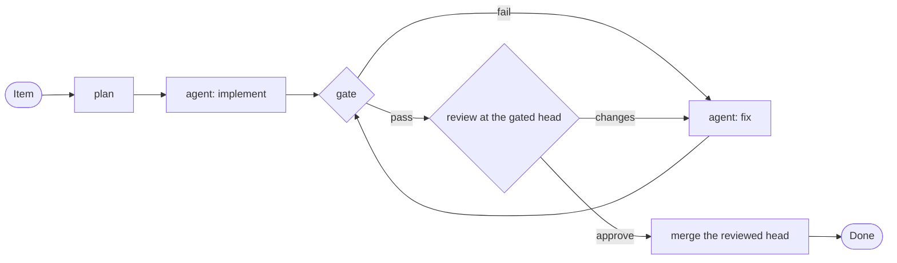

<div align="center">

# obee

**Your agents write the code. A program keeps the process.**

Write the process once as a Starlark file. obee runs it, records every step, resumes after a crash, and merges only the commit that was gated and reviewed.

[](go.mod)
[](LICENSE)
[](#quick-start)
[](#how-obee-compares)

[Why](#why-obee) · [Quick start](#quick-start) · [A workflow](#a-workflow) · [Examples](#examples) · [Comparison](#how-obee-compares) · [Status](#status)

</div>

obee runs coding agents through workflows that you write in Starlark. A workflow says which agent does each step, which command checks the work, who reviews it, and when the loop stops. obee runs the steps in order, records each result, and resumes after a crash at the step where it stopped.

obee is one static binary with no runtime to install. Copy one file and run it. It needs no language runtime, no virtual environment, no Node, no JVM and no server. It has no web app and no telemetry. It needs git and the command line tool of each agent that you use. It needs no GitHub account and no issue tracker. Those are optional adapters.

> **Do not let an agent be the orchestrator.** Agents are good at writing and reviewing code. They are not reliable at keeping the rules of the process around the code. In obee, the process is a file, and a program runs it.

## Why obee

Without obee, the process lives in a prompt or in an agent session. Then the process fails in these ways:

- **A step is skipped.** An agent says that it ran the review. No review ran.
- **The wrong commit merges.** A review approves one commit, and a later commit merges.
- **A session is the only record.** The session hits its limit, and the run is lost.
- **Waiting costs tokens.** A model that waits for a build reads its whole context again after each wait.

With obee, these failures cannot happen:

- A review that the file requires always runs. The agent cannot skip it.
- The merge is pinned to the head that the gate and the review saw. A different head does not merge.
- Each finished step is recorded. After a crash, a reboot or a closed laptop, the run continues at the first step that did not finish.
- obee waits on a build or a timer with no model running. Waiting costs no tokens.



obee records the result of every box. If the process stops, `obee resume` reopens the run at the box that did not finish. The fix loop has a fixed bound in the file.

## Who this is for

You run coding agents on real work, and you want a repeatable process around them: plan, implement, test, review, fix, merge. You tried to put that process in a prompt, or you made one agent the orchestrator of the others. It worked for a while, and then it skipped a step.

obee is for you if you want the agents to do the work and a program to enforce the steps.

<details>
<summary><b>What went wrong when an agent was the orchestrator</b></summary>

<br>

All of these happened to me while one agent orchestrated others:

| What happened | What it cost | What obee does instead |
|---|---|---|
| A cleanup woke 15 finished agents | 5.3 million tokens, no work done | An agent process ends with its step, so nothing is left to wake |
| An agent read its whole context again after each build | 47 million tokens | obee waits on the build. No model waits with it |
| A timer kept the orchestrator awake for ten hours | 34 million tokens | Waiting is a durable step, and it costs nothing |
| A context compaction erased the agent limits | Nine agents at once, usage limit hit twice | The limits are in the config, and code checks them |
| Three agents said that they ran a review | No review happened | The review is a step. obee runs it and records the verdict |
| A pull request merged 15 minutes after a request for changes | A merge against the maintainer | The merge step refuses a standing change request, an open thread and a missing check |
| A review approved one commit, and a different commit merged | Unreviewed code on main | The merge is pinned to the head that the gate and the review saw |
| The orchestrator session hit its limit in the middle of a run | The work in progress was lost | obee resumes the run at the step where it stopped |

</details>

## What this enables

- **A process that cannot skip a step.** The workflow file is the process. A review that the file requires always runs, at the commit that passed the gate.
- **Loops with an exit.** Gate, review and fix until the head is approved, for a fixed number of passes at most. The bound is in the file.
- **Runs that survive.** A crash, a reboot or a closed laptop does not lose the run. Each finished step is recorded, and the run continues at the first step that did not finish.
- **Any repository, with or without GitHub.** Items can live in a local store, in beads or in GitHub issues. Results can be a branch in a local repository or a merged pull request.
- **Questions for a person.** A `wait` step stops the run until you answer with `obee answer`.
- **Workflows that you can check.** `obee check workflow` finds a broken file before any agent starts.

## A workflow

This is the local example, shortened. It needs no tracker and no forge.

```
def main(item):
    plan = agent(name = "plan", prompt = "prompts/plan.md", model = "sonnet", inputs = {"item": item})
    agent(name = "implement", prompt = "prompts/implement.md", model = "sonnet", inputs = {"item": item, "plan": plan.text})

    approved = False

    for _ in range(3):
        check = gate(name = "check")
        findings = check.report

        if check.passed:
            review = agent(
                name = "review",
                prompt = "prompts/review.md",
                model = "sonnet",
                pin = check.head,
                outputs = ["verdict"],
                inputs = {"item": item},
            )
            approved = review.verdict == "approve"
            findings = review.text

        if approved:
            break

        agent(name = "fix", prompt = "prompts/fix.md", model = "sonnet", inputs = {"item": item, "findings": findings})

    if approved:
        command(name = "push", run = ["git", "push", "origin", "HEAD:refs/heads/" + item.id])
```

`obee check workflow` reads the file before any agent starts. It prints one line for each problem: a file that does not parse, a name that is not defined, or a missing `main`.

## Quick start

To build obee, you need Go 1.27, Make and git. To run it, you need git and a coding agent on the path.

```bash
make build                                   # write bin/obee
mkdir -p ~/.config/obee/projects
cp examples/local/project.star ~/.config/obee/projects/demo.star
# Set source in demo.star to a git repository on this machine.

obee doctor                                  # check the machine
obee item add demo fix-login --title "Fix the login" --body-file task.md
obee run fix-login demo --workflow examples/local/workflow.star
obee status
```

The result is a branch named `fix-login` in the source repository.

## Examples

| Example | What it does | Needs |
|---|---|---|
| `examples/local` | An item becomes a reviewed branch in a local repository | git |
| `examples/research` | A question becomes a report file with notes and sources, not code | `curl` |
| `examples/swarm` | A job splits into tasks, one agent works on each, and one gate run lands the pull requests | git, `gh` |
| `examples/remediation` | A backlog of issues becomes reviewed, merged pull requests | git, `gh`, beads |

Each example folder has a `workflow.star` with comments that name the variables it reads.

## Claude Code plugin

`plugins/claude-code` adds five slash commands to Claude Code: `/obee:queue`, `/obee:run`, `/obee:status`, `/obee:answer` and `/obee:cancel`. Each one runs an obee command. To try it, run `claude --plugin-dir plugins/claude-code`. `docs/claude-code-plugin.md` has the install steps.

## How obee compares

Other tools run coding agents too. Stars are the counts that each GitHub page showed on 29 October 2026, rounded. "Not stated" means that the README or the docs page does not say. Each cell comes from the README of the tool or its docs. The links are in the table.

| Tool | Stars | What you install | Server | Telemetry | Agents |
|---|---|---|---|---|---|
| **obee** | | **One static binary** | **None** | **None** | **Claude Code today. Others are planned** |
| [Archon](https://github.com/coleam00/Archon) | 24k | An installer script or Homebrew, and Claude Code or Codex | A web console with `archon serve` | Anonymous usage events. You can switch them off | Claude Code, Codex, Pi |
| [Gas Town](https://github.com/gastownhall/gastown) | 19k | Git, Go, Beads, sqlite3, tmux, Dolt and the Claude Code CLI | Dolt, a daemon and a dashboard, started by `gt up` | OpenTelemetry export, set by environment variables | 11 presets, Claude Code by default |
| [Bernstein](https://github.com/sipyourdrink-ltd/bernstein) | 1.3k | A language runtime, version 3.12 or newer | A browser dashboard with `bernstein gui serve` | Not stated | More than 50 adapters |
| [Vibe Kanban](https://github.com/BloopAI/vibe-kanban) | 28.5k | One command, `npx vibe-kanban` | A local backend and web app | Off unless a PostHog key is set at build time | More than 10 agents |
| [GitHub Agentic Workflows](https://github.com/github/gh-aw) | 5.5k | The `gh` extension and GitHub Actions | Not stated | Not stated | Copilot, Claude Code, Codex, Gemini, Pi |
| [ruflo](https://github.com/ruvnet/ruflo) | 80k | Claude Code 2.1.287 or newer, and an npm package | An MCP server and a background daemon | Not stated | Claude Code, Codex, Hermes |

Vibe Kanban says in its README that it is sunsetting.

### Who keeps the process, and how the merge works

| Tool | What the README says |
|---|---|
| **obee** | A program runs the workflow file. The review step always runs. The merge uses the head that the gate and the review saw. |
| [Archon](https://github.com/coleam00/Archon) | A workflow engine runs YAML workflows. The merge gate checks the review verdict and the CI result at the head commit. The README does not say that the merged commit must equal the reviewed commit. |
| [Gas Town](https://github.com/gastownhall/gastown) | A daemon (code) and coordinator agents (models). A merge queue batches changes, runs the gates, and bisects a failing batch. The README does not say that the merge is pinned to a reviewed commit. |
| [Bernstein](https://github.com/sipyourdrink-ltd/bernstein) | Code: "No LLM in the coordination loop." A check of tests, files, lint and types runs before work lands. The README does not say that the merge is pinned to a reviewed commit. |
| [Vibe Kanban](https://github.com/BloopAI/vibe-kanban) | A person reviews diffs in the web interface and leaves inline comments. The person creates the pull request and merges. |
| [ruflo](https://github.com/ruvnet/ruflo) | A Claude Code session, with hooks that route tasks. Some plugins run loops. The README does not describe a review step or a merge rule. |

### General workflow engines

Airflow and Prefect are general workflow engines. They are not tools for coding agents, but they solve a part of the same problem: a durable, ordered run.

| Tool | Stars | What you install | Server |
|---|---|---|---|
| [Apache Airflow](https://airflow.apache.org/docs/apache-airflow/stable/start.html) | 47k ([repository](https://github.com/apache/airflow)) | A language runtime, version 3.10 to 3.14 | `airflow standalone` starts the components, with the web interface on `localhost:8080` |
| [Prefect](https://www.prefect.io/docs/v3/get-started/install) | 24k ([repository](https://github.com/PrefectHQ/prefect)) | A language runtime, version 3.11 or newer | An API server: Prefect Cloud, or one that you host |

obee has no agent steps, review rules or pinned merge in common with them. obee is one binary with no server, and it is built for coding agents.

## Inspired by Archon

[Archon](https://github.com/coleam00/Archon) showed that a coding agent works better inside a workflow than inside one long prompt. I used it before I wrote obee. obee keeps that idea and makes two different choices.

**The workflow language is Starlark, not YAML.** Starlark has functions, loops and conditions in the language itself. A workflow can bound a review loop with `for _ in range(3)` and read `review.verdict` as a value. obee checks the file before the run, and a workflow has no template strings to fill in.

**The engine is a library, not custom code.** A durable run needs a record of each step, a resume after a crash and a queue. Archon builds its own (about 72,000 lines at commit `72817c5`, October 2026). obee uses [DBOS Transact](https://github.com/dbos-inc/dbos-transact-golang), an existing engine for durable workflows on SQLite. obee's own code is the step kinds and the rules, not the engine.

| | Archon | obee |
|---|---|---|
| Workflow files | YAML | Starlark, checked before the run |
| Durable runs | Its own engine | DBOS Transact, a durable workflow library |
| What you install | An installer script or Homebrew | One static binary |
| Server and telemetry | A web console with `archon serve`, and anonymous usage events that you can switch off | None |
| A web interface | Yes | No. A terminal interface is planned |
| Agents | Claude Code, Codex and Pi | Claude Code today. Codex and Copilot are planned |

## Status

obee is under construction, and the workflow file format can still change.

| Works today | Planned |
|---|---|
| The Starlark workflow files and `obee check workflow` | A step that opens a pull request, and stacked pull requests |
| The `agent`, `command`, `gate`, `wait`, `merge`, `batch_merge`, `spawn` and `gather` calls, with `stdin`, `env` and `stop_on_rc` on `command` | A terminal interface |
| Durable runs that resume after a crash | Codex, Copilot and other agents |
| Local items, beads and GitHub issues | |
| A pinned merge with review, thread and check guards | |

`docs/architecture.md` describes the packages, their layers and the durable loop.

## Build

```bash
make setup    # install the Go tools and generate the agent files
make check    # the full gate
make build    # write bin/obee
```

## License

MIT. See `LICENSE`.

Every fact about Archon's size comes from its source code at commit `72817c5` (October 2026). The other facts about Archon come from its README on 29 October 2026.
