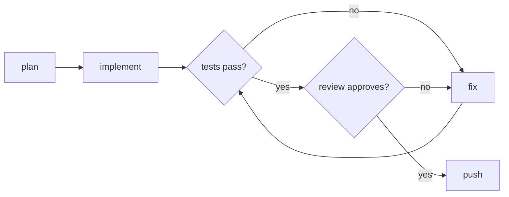

> [!CAUTION]
> # 🚧 UNDER CONSTRUCTION 🚧
>
> **beehave is not ready for use.** The workflow API, the commands and the file formats change without notice, and there is no release yet. Do not run it on work you cannot lose.

<h1 align="center">beehave</h1>

<p align="center">
  <strong>A deterministic, durable workflow engine for AI coding agents.</strong><br/>
  Write your process down once. beehave makes your AI agents follow it, every time, and picks up where they stopped.
</p>

<p align="center">
  <a href="https://github.com/tobocop2/beehave/stargazers"></a>
  <a href="LICENSE"></a>
  
  
</p>

<!-- demo: a terminal recording. Start a run, kill it at the review step, run the same command again, and the run continues at the review. -->

AI agents are good at one task at a time and bad at following a process. On a big job they skip steps, forget what they did, say they finished when they did not, and stop when something crashes.

beehave runs them through your process instead. You write the steps once in a short Starlark file: plan, implement, test, review, merge. Code picks the next step, not a model. A run resumes where it stopped, and beehave asks you only when a decision is yours.

## Why beehave

- **Deterministic by design.** The workflow file has no clock, no randomness and no direct access to files or the network. The same results always lead to the same next step, and a run that resumes after a crash takes the same path it took before. Pass or fail comes from exit codes and test reports that the engine reads itself, not from what an agent says.
- **Write the process once.** Plan, do the work, check it, get a second opinion, finish. You write those steps in one short file, and every job follows them in the same order. The agent does the thinking inside each step. It does not decide which steps to skip.
- **Nothing is lost.** If the laptop sleeps, the program crashes or the account runs out of credit, run the same command again. Finished steps stay finished, so you do not wait for them or pay for them twice.
- **Limits that hold.** You set the most time, turns and money a job may use. beehave stops the job at the limit. It does not ask the agent to stop.
- **It asks you only what it cannot decide.** A job that needs you waits with its question, and the other jobs keep going. Answer when you are ready.
- **A whole backlog at once.** Give it a list of jobs. It runs as many at a time as you allow and queues the rest.
- **Try it before it costs money.** A dry run walks the whole process with fake agents, so you see every step before a real one runs.
- **It runs on your own machine.** One program and one small database file. No server and no account to sign up for.
- **Any job with steps.** Code changes are the first use. The same engine runs research reports, an incident desk, sign-offs and a daily data load. See [the examples](#examples).

<details>
<summary><strong>The problems this came from</strong></summary>

beehave grew out of months of running teams of AI agents on real backlogs. These are the failures that cost the most, worst first.

1. **Agents ran far past their token limit.** A limit written in the instructions did nothing: agents told to stop at 70k tokens used 120k to 240k. Across 295 agent runs, the median was 187k. *In beehave, each agent step has a cap on turns and on dollars, and each run has a total budget. The engine stops the step.*
2. **Fix loops patched the same bug again and again.** One pull request used 27 agent runs. Another got five review rounds for code that the tool it wrapped could already do. *In beehave, the number of rounds is a number in the workflow file, not a hope in a prompt.*
3. **Agents said a review or a test ran when it never did.** Reports named reviews that did not happen, and "tests pass" came from a log that said they failed. *In beehave, every step is recorded. `beehave status` shows what ran, and the engine reads the exit code itself.*
4. **Waiting burned tokens.** A model that checks on other agents pays for every check: 123 calls in one hour went to status wake-ups alone. *In beehave, the engine waits, not a model. A step that waits for a person or for another run costs nothing.*
5. **Agents redid work that was already done.** Agents spent hours on issues that were already fixed on main, and two sessions started the same 118-issue audit within minutes. *In beehave, a finished step never runs again, an item is claimed before work starts, and an open pull request by someone else holds the item.*
6. **Agents ignored the rules in their instructions.** In one day, one agent run in three broke a written rule: bulk `git add`, unsafe deletes, `--no-verify`. One bulk commit pushed a 4.3 MB data file to a public pull request. *In beehave, a shell check refuses those commands before they run, and protected paths stop the step.*
7. **Too many builds at once overloaded the machine,** so tests failed on timeouts and ran again, 25 minutes each time. *In beehave, `max_concurrent` caps the agent processes, and the items wait in a queue.*
8. **One open question stopped all the work.** A single question to the owner sat for seven hours while a rented machine billed. *In beehave, a question pauses only its own run. The other runs go on, and `beehave answer` lets the paused run continue.*
9. **Merges went in under running reviews.** Eleven pull requests merged in one minute, and one merge ignored an open "changes requested". *In beehave, the merge guard reads every review and lands only the commit that was reviewed.*
10. **Rented machines kept billing, or were deleted with work on them.** One machine billed for 16 days after the work ended. *In beehave, a workflow starts the build host when it needs one and stops it when the run ends. It saves the work on the host first.
11. **A crash meant starting again, and paying again.** *That is why beehave saves each step before the next one starts.*

</details>

## What it looks like

```starlark
# workflow.star
def main(item):
    plan = agent(name = "plan", prompt = "prompts/plan.md", edits = False, inputs = {"item": item})
    agent(name = "implement", prompt = "prompts/implement.md", inputs = {"item": item, "plan": plan.text})

    for _ in range(3):                                # at most three rounds of test, review and fix
        check = gate(name = "check")                  # your own test command
        if check.passed:
            review = agent(
                name = "review",
                prompt = "prompts/review.md",
                pin = check.head,                     # review the exact commit that passed
                edits = False,                        # the reviewer cannot change the code
                outputs = ["verdict"],
                inputs = {"item": item},
            )
            if review.verdict == "approve":
                command(name = "push", run = ["git", "push", "origin", "HEAD:refs/heads/" + item.id])
                return
            findings = review.text
        else:
            findings = check.report
        agent(name = "fix", prompt = "prompts/fix.md", inputs = {"item": item, "findings": findings})
```



```bash
beehave run fix-login myrepo --workflow workflow.star
```

The file is [Starlark](https://github.com/bazelbuild/starlark), the configuration language of Bazel: loops, functions and conditions, with no clock, no randomness and no direct access to files or the network. Each call (`agent`, `gate`, `command`) is one recorded step.

## Quickstart

beehave builds from source today. You need Go 1.27, Make and [Claude Code](https://claude.ai/code).

```bash
git clone https://github.com/tobocop2/beehave && cd beehave && make build
bin/beehave check workflow examples/local/workflow.star --dry-run     # walk the workflow, no agent calls

mkdir -p ~/.config/beehave/projects
cp examples/local/project.star ~/.config/beehave/projects/myrepo.star   # set source to your repository
bin/beehave item add myrepo fix-login --title "Fix the login" --body-file task.md
bin/beehave run fix-login myrepo --workflow examples/local/workflow.star
```

The result is a branch named `fix-login` in your repository. If the run stops, run the same command again. `beehave status` lists the runs and the questions that wait for you.

## Examples

| Folder | What it does |
|---|---|
| [`local`](examples/local) | One item to a reviewed branch. No tracker, no forge. |
| [`remediation`](examples/remediation) | Issues from GitHub or beads to reviewed pull requests, with the merge guards. |
| [`queue`](examples/queue) | Works the open items of a project until no work remains. |
| [`swarm`](examples/swarm) | Splits a job into tasks, one agent each, and lands them with one merge per priority. |
| [`maintenance`](examples/maintenance) | Bumps the dependencies of many repositories once a week. |
| [`research`](examples/research) | Answers a question with notes and sources. No code. |
| [`research-desk`](examples/research-desk) | A cited report on a wiki, with every quote checked and a person who approves. |
| [`incident`](examples/incident) | An incident desk: an agent proposes, the on-call roles approve in order. |
| [`approvals`](examples/approvals) | Signed sign-offs by role, with a tamper-evident ledger. |
| [`ticket-pipeline`](examples/ticket-pipeline) | A daily load to a warehouse, with backfill, retry and a cost budget. |

[`docs/examples.md`](docs/examples.md) lists the settings of each example.

## Status

beehave is under construction, and the workflow API changes without notice.

- **Works today:** the engine, the CLI, the examples, the merge guards, the sandbox on Linux and macOS, and Claude Code as the agent.
- **Next:** OpenCode, pi, Codex and Hermes as agents, and `beehave serve`, a resident engine that runs schedules.
- **Windows** comes last.

## Learn more

- [`docs/architecture.md`](docs/architecture.md): the packages, the durable loop, and the reasons for DBOS and Starlark.
- [`docs/claude-code-plugin.md`](docs/claude-code-plugin.md): `/beehave:run`, `/beehave:status` and the other slash commands for Claude Code.
- [`CONTRIBUTING.md`](CONTRIBUTING.md): build, test and the gate.

## License

MIT. See [`LICENSE`](LICENSE).
