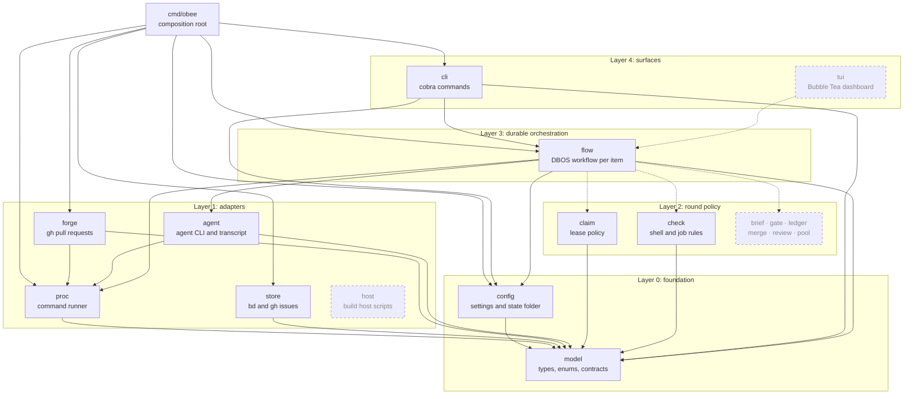
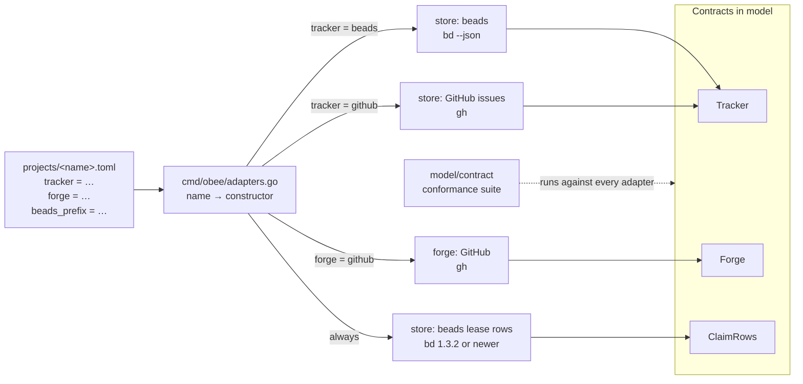
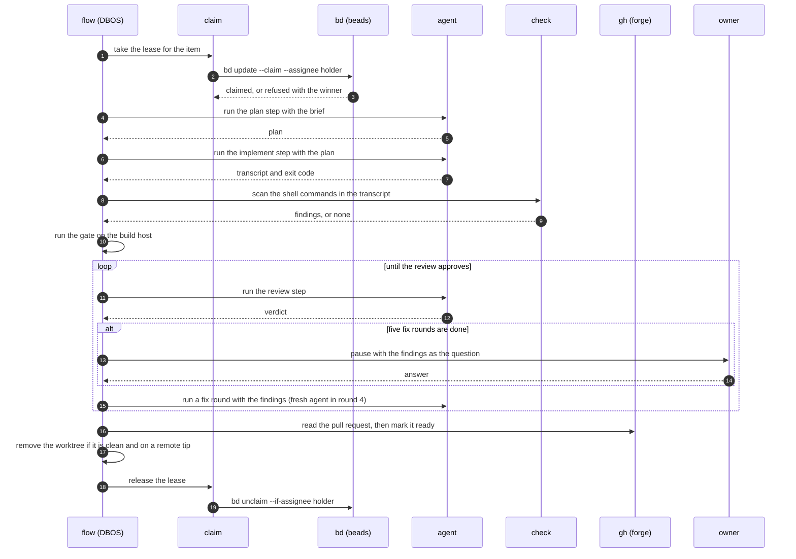

# obee architecture

obee takes a backlog of issues to reviewed, gated pull requests with any coding agent. This document describes the Go packages, their dependencies and the durable loop.

## Packages and layers

A package imports its own layer and lower layers. `depguard` in `.golangci.yml` fails an upward import and fails a package that is not on a layer list.

The diagram shows each package and its imports of other obee packages. A solid box is a package that exists. A dashed box is a package that a later milestone adds.

Every package imports `model`, and `model` imports no obee package. Only `proc` starts a process: `forge` and `agent` call it, and `store` reaches it through the runner that the composition root passes in.

Layer 2 packages declare the small interfaces they need and do not import layer 1. For example, `claim` declares `Rows` and does not import `store`. The composition root builds the adapters and passes them into the layer 2 constructors. `check` fills the scanner seam of `agent` as a function value, so neither package imports the other.

## Composition root

`cmd/obee/main.go` builds the config, the logger, the adapters, the policy packages and the `flow` engine once, and passes them down as constructor arguments. There is no package-level state, no lazy getter and no reset function. A test builds the same graph with fakes.

## Adapters

The tracker and the forge are adapters that a project selects. `model` declares three contracts. `Tracker` covers items and parents. `ClaimRows` covers the lease of each item. `Forge` covers pull requests, reviews, threads and checks. The lease store is not a choice: beads fills `ClaimRows` for every project. beads, GitHub Issues and GitHub are the first adapters. No adapter is a default: a project file names both with `tracker` and `forge`. Every project also sets `beads_prefix`, because its leases live in beads whatever its `tracker` is. `obee check config` refuses a project without one.

`model.ParseTracker` and `model.ParseForge` check a name, as `ParseAgent` does. `obee check config` refuses an unknown name. `cmd/obee/adapters.go` holds the one table from name to constructor, and a test fails when the table and the name lists differ. `obee check config` builds the tracker, the forge and the lease store of each project, so a project that cannot build them is a problem. It also runs `bd --version` through the command runner and refuses a bd older than 1.3.2: "obee needs bd 1.3.2 or newer for claims; found 0.56.1". No other package dispatches on an adapter name. Layer 2 packages keep small interfaces over the contracts, so a consumer never sees the whole `Tracker`.

Each contract has an exported conformance suite in `internal/model/contract`, in the style of `testing/fstest.TestFS`. The suite runs against every adapter with a fake command line. It checks the claim row rules (for `ClaimRows`) and checks that every method returns an error when its command fails.

## Store and claim

`store` has two backends: beads through `bd --json` and GitHub issues through `gh`. The CLI is the contract. Each payload decodes once into a named struct, and a payload of another shape is a refusal that names the command. Unknown fields are kept, because `bd` and `gh` send many fields the code does not read. The GitHub backend reads and writes issues only. It holds no lease.

`claim` holds the lease policy and no command line: the settle read-back, the expiry test and the refusal of a live holder. It declares the small `Rows` interface it needs and does not import `store`. Beads holds one claim row for each item.

## Leases live in beads

Leases live in beads for every project, whatever tracker the project uses, because beads is the store with a real compare-and-set. GitHub labels have no write that tests the old value, so a lease on a label needs a park-and-rename protocol and still has a window. beads has the atomic operations:

- **Take.** A row is a task titled `lock:<kind>-<item>`. bd 1.3.2 claims only a row that is `open` and has no assignee. `bd update --claim --assignee <holder>#<token>` tests this in one write. A row left with a stale assignee or a closed status is reset to open first, guarded by the values that were read. A refused take exits 1 with the text `issue already claimed` or `issue not claimable`. The adapter reads that exit as a lost take, and `claim` reads the row to learn the winner. Any other exit 1 is an error.
- **Token.** The assignee of a take is `<holder>#<token>`, and the token is a new random text for each take (`rand.Text()`). A guard on the assignee compares a value that never repeats, so a holder that releases and takes again cannot match the guard of a stale reader. This closes the same-holder ABA by construction. People never see the token: `Row`, `HeldRows` and every message show the holder only. A row with no token is not the take of any holder.
- **Release.** `bd unclaim <row> --if-assignee <holder>#<token>` clears the assignee and sets the status back to open, so the next take can claim the row. A mismatch exits 1 with the text `assignee mismatch`, and `claim` refuses with code 3. A closed row holds nothing and counts as free.
- **Change.** A store of the lease uses `bd update --if-assignee <holder>#<token> --if-status in_progress`. A mismatch writes nothing and exits 13. The adapter reads exit 13 as "the row moved".
- **Heartbeat.** The heartbeat is `last_activity` of an agent bead.
- **Version.** The guards and `bd unclaim --if-assignee` exist from bd 1.3.2. The lease store asks `bd --version` once before its first write and refuses an older bd before it writes anything. `obee check config` runs the same check.

The package `store/storetest` holds the fake `bd` that the tests of `store` and `cmd/obee` share, as `net/http/httptest` holds a fake server. The fake follows bd 1.3.2.

The contract test `TestLeaseContract` in `internal/store` runs the same scenarios against the fake and against a real bd 1.3.2 on a private dolt server. The real run is off by default. To run it, set `OBEE_BD_132` to the path of a bd 1.3.2 binary (check its checksum against the release file), put `dolt` on `PATH`, and run `go test ./internal/store -run TestLeaseContract`. The test starts its own dolt server on a free port, refuses ports 3306 and 3307, and stops the server at the end. `cmd/obee` runs `claim` over the real lease store, because only the composition root may import `store` and `claim` together.

Planned upgrade: `bd update --if-revision` (beads#4682, not released) compares a revision of the whole row. The token then becomes unnecessary.

The lease rules: a holder expires only when its last beat is older than the lease it stored. A holder with no beat or an unreadable lease never expires. A read that fails, does not parse or fills a page is an error, and `claim` turns it into a refusal. The lease store is not a distributed lock beyond what bd gives: the settle read-back in `claim` closes the window between two writers, and after it stores the lease, `claim` reads the row again and refuses when the row is no longer its take.

## Forge and the command runner

`forge` runs `gh` and has one decoder for each payload shape. The pull request, review, comment, thread and check types live in `model`, so layer 2 declares its own interfaces over them without importing `forge`.

`proc` holds the one command runner. `model.Decode` is the one JSON decoder for command answers. `store` and `forge` share them. The runner starts each command in its own process group with a timeout, and reports exit code 124 for a deadline, 127 for a missing command and 130 for a cancel.

## Agent runs

`agent` starts one CLI per step from a profile (binary, fixed arguments, login variables) chosen by a switch on the agent name. Claude is the only profile; other agents return later. The prompt goes on stdin, so it never shows in a process list. The CLI gets an allowlisted environment: the path, home, locale, proxy and certificate variables, the login folder variables of its runner and the token if one is passed. No other variable of the caller reaches it. A run does not start when the login folder is missing, because the CLI would create an empty profile there.

The CLI runs in its own process group through `proc`. A total timeout, an idle timeout (reset by each write on stdout or stderr) or a cancel of the context kills the group, and the group is killed again when the CLI exits, so no child outlives the step. Stdout is the transcript. A line writer redacts each line (the token value and anything shaped like an `sk-ant-` key) before it reaches the log, and drops a line longer than 16 MiB instead of splitting a secret across two writes. Stderr keeps a redacted tail of 4 KiB for the result.

The transcript reader walks each JSON line of a Claude Code file. A Skill call counts once, in a `tool_use` block of an assistant line. A Bash call counts at any depth. The transcript check takes the shell scanner as a function value; the shell rules live in `check`. A line ends at LF, CRLF or a lone CR. A file with no JSON object line is refused, so an empty or cut-off transcript never passes a check.

## Shell rules and the job check

`check` reads shell text with the `mvdan.cc/sh/v3` parser and walks the tree, so quotes, heredocs, pipes, subshells and functions need no hand-written tokenizer. `Scan` fills the scan seam of `agent.CheckTranscript`. It finds bulk staging, a delete that needs approval (a path that is not a literal absolute path, or any delete inside an `ssh`, `gcloud compute ssh` or wrapper command), and delete text in `echo`, `printf` or a heredoc. A command that sets `GIT_INDEX_FILE` to a value stages into a private index and passes.

The package imports the parser and its `expand` package, never `interp`. `make deps` checks every package of the module and `depguard` denies `interp`. `expand` resolves a variable that holds a host wrapper. A name it does not know stays as `$name` text, so the literal path rule still sees it. Command substitutions, backticks and process substitutions are read as commands. `busybox` is a wrapper.

Two caps bound the work of the variable lookup. A value longer than 4096 bytes is unreadable, and so is a lookup that must work out more than 1000 values. An unreadable variable stays `$name` text. If it is the command word, or the first word after the wrapper words (`sudo`, `env`, `nice`, `timeout`, `xargs`), the scan reports `opaque-command`, so a cap never lets a staging or a delete pass. A value that depends on a variable being read is kept for the current lookup only, so the number of values worked out for one use does not grow with the number of uses. The time for a script still grows with its size.

`JobScript` applies the bulk staging rule and refuses a test command with no `timeout` in front of it. A test command is `cargo test`, `cargo nextest`, `pytest`, `py.test`, `bats` or `make test*`. The check reads a string that a shell, `ssh`, `eval`, a container runner or `uv run` runs, and a heredoc that a shell reads or that a later command runs as a file.

`JobScript` also refuses two kinds of text:
- A line that does not parse as shell. The lines that do parse are still judged, and so is a line that only ends in an operator, such as `git add -A &&`.
- A command the check cannot read: `env -S`, `find -exec sh -c`, and a command word that holds a variable or a substitution when the words after it would be a staging or a delete if the word were `git` or `rm`, such as `$g add -A` and `$x -rf "$d"`. A delete needs a recursive or force option to count when the variable is the `rm` itself. A command word that hides no rule, such as `$ROOT/bin/run.sh`, passes.

## Lane papers

`check` also reads the papers a lane leaves. Each check returns its lines and a verdict, or an error that is a `Refusal` when it cannot run. A refusal carries the lines found before it stopped. `Report` and `Authors` cannot refuse; `Authors` returns the exit code, because its two refusals (2 and 3) differ.

- The lane report has four sections (Claims, Hunks, Inputs, Siblings), each a table with a fixed column count. A section with nothing to list has one `none: <reason>` row. A claim names the head commit it was verified at, and the report says that no background command is left.
- The handoff file of a lane that stops early states the regressions so far and the lane context. A handoff written between a launch and its read is refused.
- The burn record reads the transcript of the orchestrator. It counts the main thread calls for each hour and the token count of each lane notice. A token count prints as the transcript wrote it, whole or fractional. The lane cap comes from an argument, then `LANE_CONTEXT_CAP`, then 150000; an empty argument is refused, and a cap above the integer range is the largest cap. A project folder that starts with a dot holds no transcript. With no `HOME` and no `CLAUDE_CONFIG_DIR`, the transcript path is refused. A text that is not UTF-8 gets one replacement mark for each cut multi-byte sequence and one for each other bad byte. A transcript line whose `message` or `usage` is not an object is skipped, and so is a line with `NaN` or `Infinity`. A transcript key matches by exact case.
- The papers check lists the source paths that a revision range changes. A range that starts with `-` is refused, so git never reads it as an option. A lane of proof and papers changes none. The globs match as `fnmatch` does: a malformed `[` is a plain `[`, `^` is a plain `^`, `!` negates, and `*` crosses `/`. `check` declares its own `runner` interface for git, so layer 2 does not import `forge`.
- The author check compares the address of a commit with the address of the account. A login with no linked account and a foreign address is refused as well.

The gate list is a Markdown file. Its `## Gate steps` section holds one row for each step, with a `Derived from:` line that ends in a commit. A row with the command `see <file>` is an unstated step: the job passes when it prints `name=<step>`. Any other step passes when one command of the job holds every literal part of the gate command, in order, around the `<slot>` parts. A command here is a simple command with its redirects, a pipeline or list (`&&`, `||`, `;`, `|`), a subshell, a compound command that sits on one line (`time cargo fmt`, `{ cmd; }`, `if`, `while`, `for`, `case`, `coproc`) with its keyword, or one line of a here-document. A compound command on several lines is not one command. The check keeps the text of the outermost command of a chain once, so its cost is linear in the length of the job. A line that runs a step and also declares a skip, such as `cargo fmt; echo "GATE-SKIP fmt: x"`, counts the run and records the skip. Words join on blank and tab only, so a no-break space does not join them. A comment at the end of a line is not a command. The skip reason and the fixed-status message print the text of the command, not of its whole line. The rows and sections are read as text with `splitRow`; the job is read with the parser of `parseUnits`, and the `let` rule parses its arithmetic text with the same parser. A `GATE-SKIP <step>: <reason>` line declares a skip. It needs a reason, a step of the list, a `command -v` check when the reason names a missing tool, and a final marker with `gate=partial`.

The exit marker rule finds a print command (`echo`, `printf`, a here-document or a here-string, also inside a shell string argument) that prints `rc=` followed by a literal number. A variable counts as a literal when one assignment sets it, to a number, and nothing else can change it: no arithmetic, `read`, `for`, `printf -v`, `eval` or sourced file. The caller passes the function that reads sourced files. A file that cannot be read, or a path that only the shell can resolve, makes every variable unknown.

## Configuration

In the config folder, `runners.toml` holds `[agents]` (`max_concurrent`, the global limit on agent processes), `[pool]` and the `[[runner]]` logins. `projects/<name>.toml` holds the project keys (`repo`, `tracker`, `forge`, `base_branch`, `gate`, `build_host` and `beads_prefix`) and an optional `[steps.<step>]` table that overrides the defaults of the default workflow. The step names are the typed constants in `model`. `obee check config` loads the folder, prints one line for each problem with the file path, and exits 2 when it finds any.

`config` is the only package that reads the environment. The `OBEE_*` variables override the file values, `OBEE_CONFIG` names the config folder and `OBEE_STATE_DIR` names the state folder. `cmd/obee` sets `umask 077`. `cli.Execute` refuses to start when a `DBOS__*` variable is set. The state folder must be absolute, owned by the user and mode 0700.

## The durable loop

`flow` runs each item as a DBOS workflow. DBOS stores the state of every workflow in SQLite (`dbos.db`) in the state folder. A finished step is never run again, so a crash resumes at the last finished step. The workflows make no outgoing request other than the model call.

### Item and phase workflows

An item workflow has the ID `item-<n>-r<k>`, where `k` counts the attempts at the item. The ID makes a second start of the same attempt join the first. The item workflow is not queued. It runs these steps in order:

1. Pick the login of the item from the `implement` step of its project.
2. Claim the item.
3. Run the plan phase and the implement phase.
4. Run the gate, run the review phase, and read the verdict. If the verdict file is missing, run the review phase one more time. Repeat with a fix round until the verdict approves.
5. Read the forge, then mark the pull request ready. The gate, the review and the ready step must see the same head commit: a push after the review stops the item.
6. Release the worktree, then release the claim.

Each agent phase (plan, implement, review, fix) is a child workflow named `phase`. It writes the brief, then starts the agent. Both are steps. The agent is a subprocess (`claude -p`) in its own process group, with a total and an idle timeout. A phase that does not exit with code 0 stops the item with an error that names the step.

### Queue and limits

Phases run on the queue `agents`. The partition key of a phase is the login, and each partition runs one phase at a time. The queue also has a global limit, `agents.max_concurrent`. One login never runs two agents at once, and the host never runs more than the global limit. The queue holds only phases. The wait for the owner is outside the queue and holds no slot.

`run` refuses an item with an empty login before it claims the item or stores a run. The message names the runner setting to change.

### Fix rounds

The round policy is one pure function of the number of fix rounds so far and the verdict:

| Fix rounds so far | Verdict asks for changes |
|---|---|
| 0 to 2 | The next round resumes the agent session. |
| 3 | The next round (round 4) starts a fresh agent. |
| 4 | The next round (round 5) resumes the fresh agent. |
| 5 | The item pauses until the owner answers. |

An approved verdict ends the loop at any round. A gate that ran and failed counts as a verdict that asks for changes, with the gate report as the findings. A gate that could not run stops the item with an error and uses no fix round. The findings of round `k` go into the brief of round `k + 1`.

The optional key `fresh_runner` of the `implement` step names the runner of the fresh agent in round 4. If the key is absent, the fresh agent uses the runner of the item. `obee check config` refuses a name that `runners.toml` does not list.

The pause sets the findings as the question of the run and waits for a durable receive with no deadline: the receive starts again every seven days. `obee status` shows the question. `obee answer <item> <text>` sends the answer. The answer goes into the brief of round 6, and the run continues.

### Claim beat

A tick runs every 2 seconds in each running `obee run` process. Each tick reads only the runs that the process executes, then it renews each claim that the process holds. Each renewal has its own timeout of 30 seconds, so a hung tracker call delays no other claim. If a renewal fails or times out, the run records the reason and refuses to start its next phase. The error tells the owner to run `obee run <item>` again.

### Process control

Each agent process group is a row in the file `agents.pgid` in the state folder (mode 0600). A row holds the group ID and the start time of its leader. A group dies when its phase ends, times out or is canceled, and when `obee run` shuts down.

DBOS does not kill child processes, so a crash leaves them. At the next start, `obee run` kills each recorded group whose start time still matches the live process. A reused process ID has a different start time, and the check leaves it alone.

On each tick, the process also stops the agents of each run that is now canceled, then releases its worktree and claim. This is how a `cancel` from another process takes effect. The release runs beside the tick, so a slow tracker delays no renewal and no scan. Every release call has a timeout (30 seconds).

`obee cancel` writes a marker file for the run in the `canceled` folder of the state folder before it cancels the run. The release removes the marker. If an engine stops before it finishes the release, the marker stays, and the next `obee run` gives the item back when it starts. A marker for a run that is no longer cancelled, or whose item has a newer run, is dropped. A marker that cannot be read is logged and skipped, and the other markers still give back. The marker is written to a temporary file and renamed, so a crash leaves no half marker. All the markers of one start share one release timeout.

### Ready and release

Before the ready step marks a pull request ready, it reads the forge. It refuses the step when the head of the pull request is not the commit the review read, when a review asks for changes, when a thread is unresolved, or when the branch conflicts with its base. The error names the pull request and each reason. A failed read refuses the step too.

The release steps run on every exit of the item except a cancel, while the claim is still held. Ctrl-C is not an exit: the run stays open. The worktree step removes the worktree only when all of these are true: the tree is clean, `git ls-remote --heads origin` lists a branch tip, and HEAD equals that tip. In every other case the tree stays, and the log says why. One timeout covers all the git calls. The claim release runs last.

### Status, resume and cancel

Each run pins the build version that started it. `obee status` lists every run with its state: running, queued, done, failed or cancelled. A run that another version started shows as stranded and names that version. Every command refuses to change a stranded run.

`obee cancel <item>` cancels the open run and the phases it started. The release of the worktree and the claim runs outside the cancelled workflow. If an engine runs, it does the release on its next tick, after the agent groups of the run are dead. If no engine runs, `obee cancel` does the release itself.

`obee resume <item>` first takes a fresh claim on the item, because the release of the old run gave the old claim back. If the claim is held, `resume` refuses and names the holder. A cancelled run that left its claim gives it back at the next `obee run`, so run that first and then `resume` again. The run then uses the fresh claim for its beat and its release. The token of the fresh claim is in `owners/<run id>` in the state folder, and the file ends with the run: a release that works, or the deletion of the run by the retention, removes it. A run whose claim step never finished takes no claim at `resume`: the step claims when the run continues. No engine renews the fresh claim between `obee resume` and the next `obee run`, so run the item soon after the resume. `resume` reopens the cancelled or the failed run. Then `obee run <item>` continues it from the last finished step. After a crash, or after Ctrl-C of `obee run`, the run stays open, and `obee run <item>` continues it without `resume`.

`obee run <item>` starts a new run only after a finished or a cancelled run. If the last run failed, `obee run` refuses, names the step that failed, and tells the owner to run `obee resume <item>`.

### One engine for each state folder

`obee run` takes an exclusive lock on `engine.lock` in the state folder and holds it until the command ends. A second `obee run` on the same state folder refuses and tells the owner to wait or to run `obee status`. The client commands do not take this lock. Every open of the store also takes the lock `migrate.lock` for the time of the database migration, because the migration of the workflow library has no lock of its own.

An item belongs to the project that `run` names. `run` refuses an item that has an open run under another project.

### One item, end to end

The diagram shows one item through these steps. Each call to `bd`, `gh` or the agent CLI goes through `proc`.

## DBOS and secrets

The DBOS rules live in `.ai-rulez/rules/dbos-and-secrets.md`. In short:

- The state folder is created at 0700 under `umask 077` before DBOS opens `dbos.db`. A test checks the file modes.
- `flow` builds the DBOS config with an empty Conductor URL and key, no schedule, the JSON serializer and a pinned application version. It refuses to start if any `DBOS__*` variable is set.
- A custom `slog` logger writes to a 0600 file and redacts every record when it writes it. DBOS stores the text of a step error as it is, so each step error passes through the same redactor before it returns to DBOS.
- No secret passes through a workflow input, a step output, an event or a message.
- At each start, `obee run` deletes the finished runs that are older than seven days, with their phases, using `DeleteWorkflows`. Failed and cancelled runs stay, because `obee resume` can reopen them.
- The enterprise DBOS module is never imported, and DBOS is imported only in `flow` (both `depguard` rules). `make deps` checks that `go list -deps ./...` has no `go.dbos.dev`, viper or `net/http`. `crypto/tls` is allowed because DBOS links it through its Postgres driver; `TestRun_OpensNoNetworkSocket` proves that `obee` opens no network connection. cobra is allowed (its core imports neither). `make vuln` runs govulncheck, and `go.mod` pins `toolchain go1.27.3` or later.

## Decisions

- **Interfaces at the consumer.** A package states what it needs, so a fake needs few methods and an adapter can change without edits in policy code.
- **CLI as contract for `gh` and `bd`.** The `gh` and `bd` commands are what the owner runs by hand. `bd` has a public Go package, but it needs cgo or a Dolt backend and pulls its whole tree. Revisit when `bd` ships a slim client module.
- **No framework for config.** go-toml/v2 decodes into a struct and rejects unknown keys. The overlay is explicit code in one package.
- **Make, not Task.** A single Makefile holds the targets: `check`, `lint`, `test`, `format`, `vet` and `coverage`.
- **Coverage exclusion.** Only `cmd/obee/main.go` is excluded from the 100% gate. The smoke step runs the built binary.
- **Agent rules from `.ai-rulez/`.** Generated files (`AGENTS.md`, `CLAUDE.md` and the preset folders) are ignored by git.
