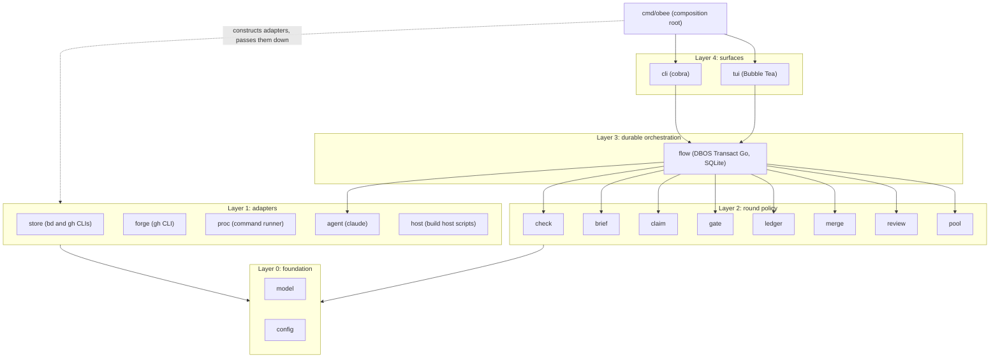

# obee architecture

obee takes a backlog of issues to reviewed, gated pull requests with any coding agent. This document describes the Go packages, their dependencies and the durable loop.

## Packages and layers

A package imports its own layer and lower layers. `depguard` in `.golangci.yml` fails an upward import and fails a package that is not on a layer list.

Layer 2 packages declare the small interfaces they need (for example `merge` declares a `Forge` with the three calls it makes) and do not import layer 1. Layer 1 packages return concrete types. The composition root builds the adapters and passes them into the layer 2 constructors, which is the dashed arrow. Only `flow` imports `agent` directly, to start agent processes.

## Composition root

`cmd/obee/main.go` builds the config, the logger, the adapters, the policy packages and the `flow` engine once, and passes them down as constructor arguments. There is no package-level state, no lazy getter and no reset function. A test builds the same graph with fakes.

## Adapters

The tracker and the forge are adapters that a project selects. `model` declares three contracts. `Tracker` covers items and parents. `ClaimRows` covers the lease of each item. `Forge` covers pull requests, reviews, threads and checks. The lease store is not a choice: beads fills `ClaimRows` for every project. beads, GitHub Issues and GitHub are the first adapters. No adapter is a default: a project file names both with `tracker` and `forge`. Every project also sets `beads_prefix`, because its leases live in beads whatever its `tracker` is. `obee check config` refuses a project without one.

`model.ParseTracker` and `model.ParseForge` check a name, as `ParseAgent` does. `obee check config` refuses an unknown name. `cmd/obee/adapters.go` holds the one table from name to constructor, and a test fails when the table and the name lists differ. `obee check config` builds the tracker, the forge and the lease store of each project, so a project that cannot build them is a problem. It also runs `bd --version` through the command runner and refuses a bd older than 1.3.2: "obee needs bd 1.3.2 or newer for claims; found 0.56.1". No other package dispatches on an adapter name. Layer 2 packages keep small interfaces over the contracts, so a consumer never sees the whole `Tracker`.

Each contract has an exported conformance suite in `internal/model/contract`, in the style of `testing/fstest.TestFS`. The suite runs against every adapter with a fake command line. It checks the claim row rules (for `ClaimRows`) and checks that every method returns an error when its command fails.

## Store and claim

`store` has two backends: beads through `bd --json` and GitHub issues through `gh`. The CLI is the contract. Each payload decodes once into a named struct, and a payload of another shape is a refusal that names the command. Unknown fields are kept, because `bd` and `gh` send many fields the code does not read. The GitHub backend reads and writes issues only. It holds no lease.

`claim` holds the lease policy and no command line: the settle read-back, the expiry test and the refusal of a live holder. It declares the small `Rows` interface it needs and does not import `store`. Beads holds one claim row for each item.

## Leases live in beads

Leases live in beads for every project, whatever tracker the project uses, because beads is the store with a real compare-and-set. GitHub labels have no write that tests the old value, so a lease on a label needs a park-and-rename protocol and still has a window. beads has the atomic operations:

- **Take.** A row is a task titled `lock:<kind>-<item>`. bd 1.3.2 claims only a row that is `open` and has no assignee. `bd update --claim --assignee <holder>#<token>` tests this in one write. A row left with a stale assignee or a closed status is reset to open first, guarded by the values that were read. A refused take exits 1 with the text `issue already claimed` or `issue not claimable`. The adapter reads that exit as a lost take, and `claim` reads the row to learn the winner. Any other exit 1 is an error.
- **Token.** The assignee of a take is `<holder>#<token>`, and the token is a new random text for each take (`rand.Text()`). A guard on the assignee compares a value that never repeats, so a holder that releases and takes again cannot match the guard of a stale reader. This closes the same-holder ABA by construction. People never see the token: `Row`, `HeldRows` and every message show the holder only. A row with no token is not the take of any holder.
- **Release.** `bd unclaim <row> --if-assignee <holder>#<token>` clears the assignee and sets the status back to open, so the next take can claim the row. A mismatch exits 1 with the text `assignee mismatch`, and `claim` refuses with code 3. A closed row holds nothing and counts as free.
- **Change.** A store of the lease uses `bd update --if-assignee <holder>#<token> --if-status in_progress`. A mismatch writes nothing and exits 13. The adapter reads exit 13 as "the row moved".
- **Heartbeat.** The heartbeat is `last_activity` of an agent bead.
- **Version.** The guards and `bd unclaim --if-assignee` exist from bd 1.3.2. The lease store asks `bd --version` once before its first write and refuses an older bd before it writes anything. `obee check config` runs the same check.

The package `store/storetest` holds the fake `bd` that the tests of `store` and `cmd/obee` share, as `net/http/httptest` holds a fake server. The fake follows bd 1.3.2.

The contract test `TestLeaseContract` in `internal/store` runs the same scenarios against the fake and against a real bd 1.3.2 on a private dolt server. The real run is off by default. To run it, set `OBEE_BD_132` to the path of a bd 1.3.2 binary (check its checksum against the release file), put `dolt` on `PATH`, and run `go test ./internal/store -run TestLeaseContract`. The test starts its own dolt server on a free port, refuses ports 3306 and 3307, and stops the server at the end. `cmd/obee` runs `claim` over the real lease store, because only the composition root may import `store` and `claim` together.

Planned upgrade: `bd update --if-revision` (beads#4682, not released) compares a revision of the whole row. The token then becomes unnecessary.

The lease rules: a holder expires only when its last beat is older than the lease it stored. A holder with no beat or an unreadable lease never expires. A read that fails, does not parse or fills a page is an error, and `claim` turns it into a refusal. The lease store is not a distributed lock beyond what bd gives: the settle read-back in `claim` closes the window between two writers, and after it stores the lease, `claim` reads the row again and refuses when the row is no longer its take.

## Forge and the command runner

`forge` runs `gh` and has one decoder for each payload shape. The pull request, review, comment, thread and check types live in `model`, so layer 2 declares its own interfaces over them without importing `forge`.

`proc` holds the one command runner. `model.Decode` is the one JSON decoder for command answers. `store` and `forge` share them. The runner starts each command in its own process group with a timeout, and reports exit code 124 for a deadline, 127 for a missing command and 130 for a cancel.

## Agent runs

`agent` starts one CLI per step from a profile (binary, fixed arguments, login variables) chosen by a switch on the agent name. Claude is the only profile; other agents return later. The prompt goes on stdin, so it never shows in a process list. The CLI gets an allowlisted environment: the path, home, locale, proxy and certificate variables, the login folder variables of its runner and the token if one is passed. No other variable of the caller reaches it. A run does not start when the login folder is missing, because the CLI would create an empty profile there.

The CLI runs in its own process group through `proc`. A total timeout, an idle timeout (reset by each write on stdout or stderr) or a cancel of the context kills the group, and the group is killed again when the CLI exits, so no child outlives the step. Stdout is the transcript. A line writer redacts each line (the token value and anything shaped like an `sk-ant-` key) before it reaches the log, and drops a line longer than 16 MiB instead of splitting a secret across two writes. Stderr keeps a redacted tail of 4 KiB for the result.

The transcript reader walks each JSON line of a Claude Code file. A Skill call counts once, in a `tool_use` block of an assistant line. A Bash call counts at any depth. The transcript check takes the shell scanner as a function value; the shell rules live in `check`. A line ends at LF, CRLF or a lone CR. A file with no JSON object line is refused, so an empty or cut-off transcript never passes a check.

## Configuration

In the config folder, `runners.toml` holds `[agents]` (`max_concurrent`, the global limit on agent processes), `[pool]` and the `[[runner]]` logins. `projects/<name>.toml` holds the project keys (`repo`, `tracker`, `forge`, `base_branch`, `gate`, `build_host` and `beads_prefix`) and an optional `[steps.<step>]` table that overrides the defaults of the default workflow. The step names are the typed constants in `model`. `obee check config` loads the folder, prints one line for each problem with the file path, and exits 2 when it finds any.

`config` is the only package that reads the environment. The `OBEE_*` variables override the file values, `OBEE_CONFIG` names the config folder and `OBEE_STATE_DIR` names the state folder. `cmd/obee` sets `umask 077`. `cli.Execute` refuses to start when a `DBOS__*` variable is set. The state folder must be absolute, owned by the user and mode 0700.

## The durable loop

`flow` holds one DBOS workflow per item. Steps: claim, plan, implement, gate, review, ready, merge, release. Each agent step starts a subprocess (`claude -p`) in its own process group with a total and an idle timeout. A bounded fix loop returns to implement while the review verdict asks for changes. The wait for the owner is a durable receive with no deadline; it survives a restart. DBOS stores workflow state in SQLite under the state folder, so a crash resumes at the last finished step. The workflow takes no outgoing request other than the model call.

## DBOS and secrets

The DBOS rules live in `.ai-rulez/rules/dbos-and-secrets.md`. In short:

- The state folder is created at 0700 under `umask 077` before DBOS opens `dbos.db`. A test checks the file modes.
- `flow` builds the DBOS config with an empty Conductor URL and key, no schedule, the JSON serializer and a pinned application version. It refuses to start if any `DBOS__*` variable is set.
- A custom `slog` logger writes to a 0600 file and redacts step errors. Each step wraps its error with a scrubbed message.
- No secret passes through a workflow input, a step output, an event or a message.
- Finished workflows are deleted with `DeleteWorkflows`.
- The enterprise DBOS module is never imported, and DBOS is imported only in `flow` (both `depguard` rules). `make deps` checks that `go list -deps ./cmd/obee` has no `go.dbos.dev`, viper, `net/http` or `crypto/tls`; cobra is allowed (its core imports neither). `make vuln` runs govulncheck, and `go.mod` pins `toolchain go1.27.3` or later.

## Decisions

- **Interfaces at the consumer.** A package states what it needs, so a fake needs few methods and an adapter can change without edits in policy code.
- **CLI as contract for `gh` and `bd`.** The `gh` and `bd` commands are what the owner runs by hand. `bd` has a public Go package, but it needs cgo or a Dolt backend and pulls its whole tree. Revisit when `bd` ships a slim client module.
- **No framework for config.** go-toml/v2 decodes into a struct and rejects unknown keys. The overlay is explicit code in one package.
- **Make, not Task.** A single Makefile holds the targets: `check`, `lint`, `test`, `format`, `vet` and `coverage`.
- **Coverage exclusion.** Only `cmd/obee/main.go` is excluded from the 100% gate. The smoke step runs the built binary.
- **Agent rules from `.ai-rulez/`.** Generated files (`AGENTS.md`, `CLAUDE.md` and the preset folders) are ignored by git.
