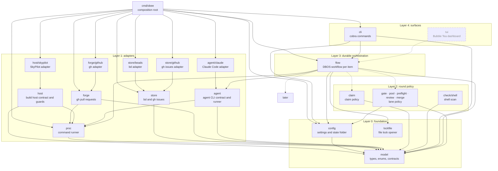
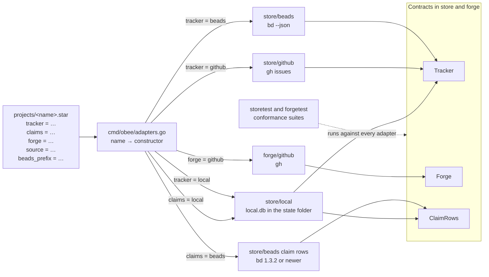
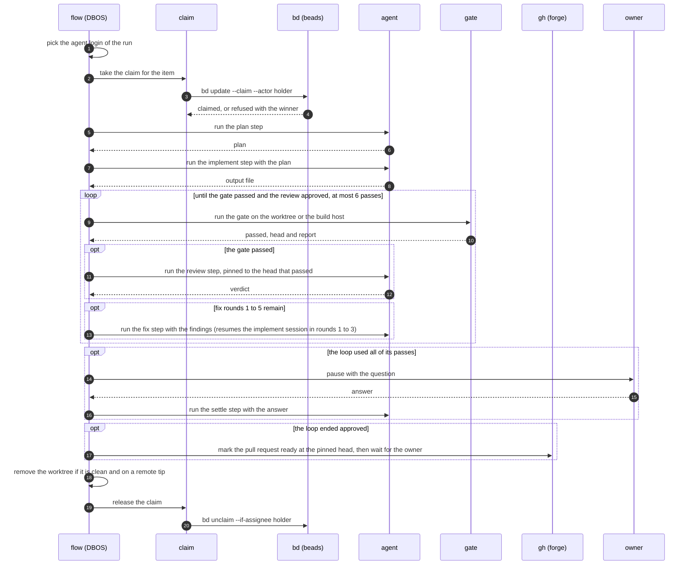

# obee architecture

obee takes a backlog of issues to reviewed, gated pull requests with any coding agent. This document describes the Go packages, their dependencies and the durable loop.

## Why DBOS and Starlark

This section records the choice of engine and workflow language, the options that obee rejected, and the reason for each verdict. obee first wrote workflows and config files in HCL. It now reads Starlark for both, and the code no longer reads HCL. An old `.hcl` config file is refused with the name of the file.

### The decision

- DBOS is the engine. Starlark is the workflow language and the config language, through a thin binding (issue #72).
- obee owns the method and its adapters (see "What obee owns" below).
- Every licence is permissive (MIT, BSD, Apache). No dependency is GPL.

### Requirements

Each justification below points to one of these requirements.

- **Q1.** A user runs a workflow with no compile step.
- **Q2.** A workflow is replay-safe and resumes after a crash.
- **Q3.** obee runs on one laptop as one program, with no listener and no telemetry.
- **Q4.** Every licence is permissive.
- **Q5.** The method is written once and reused.
- **Q6.** obee maintains no part that a mature tool already owns.
- **Q7.** Every new dependency has a commit in the last 30 days. A project with no tags is accepted when obee pins it by commit.
- **Q8.** A workflow reads as steps in order, with branches, loops and early exit.

### Why DBOS

- **DBOS records each step result and replays the workflow around the results.** This serves Q2. A crash must not run an agent step twice. After a crash, the steps that finished return their recorded results, and the run continues at the step that was running.
- **Durable waits survive a crash.** This serves Q2 and Q6. A wait for a review or a human answer can last days. DBOS stores the wait in its database, so obee has no checkpoint code.
- **DBOS is a library inside the binary, with SQLite or Postgres.** This serves Q3. There is no separate engine server to start.
- **DBOS is MIT and already a dependency.** This serves Q4 and Q6.

### Engines compared

| Engine | What it is | Why not |
|---|---|---|
| Dagu | A single binary that keeps state in local files | Fails Q4: GPLv3, so obee cannot link it. It restarts a failed step and does not replay a Go function, which gives less than DBOS for Q2. Its bounded loop and reference check are unproven. The method (reviewer, merge rule, transcript checks) would still be obee code, run as shell steps |
| Windmill | A workflow platform | Fails Q4: its core is AGPLv3. It also needs Postgres, so it is not one program (Q3) |
| go-workflows | A Go engine (v1.4.2, MIT) with SQLite, in process | No gain over DBOS: one maintainer, no CLI, no partitioned queues |
| Argo Workflows | A workflow engine for Kubernetes | Fails Q3: it runs only on Kubernetes |
| Temporal | A durable engine | Fails Q3: it needs a server that listens on port 7233 |
| Restate | A durable engine | Fails Q3 and Q4: its server is BUSL-1.1 and sends telemetry unless the user disables it |
| Inngest | A durable engine | Fails Q4: its self-hosted server is not under a permissive licence |
| Hatchet, Cadence | Durable engines | Fail Q3: each needs a server |
| Kestra, Conductor | Durable engines | No gain over DBOS, which is already a dependency. The method stays obee code on any engine |

"No gain over DBOS" marks an engine that fails no requirement but adds nothing DBOS lacks.

### Why Starlark

- **A workflow file runs with no compile step.** This serves Q1. A user edits a file and runs it.
- **Starlark has no clock, no randomness and no I/O.** This serves Q2. A workflow is replay-safe for DBOS by construction, with no rule for the author to remember.
- **A file acts only through obee's steps.** This serves Q2. Each effect of a workflow goes through a recorded step, so a replay repeats no effect.
- **Starlark has functions, `for` loops, `if` statements and early return in the language.** This serves Q8. A workflow reads as steps in order.
- **Functions and `load()` let a method be written once.** This serves Q5. The review loop lives in one shared file, and each workflow loads it (see issue #70).
- **starlark-go parses, resolves and runs the file.** This serves Q6. obee will delete its own loader, checker and step-graph walker (about 2,400 lines, issue #72).

starlark-go publishes no tags, so obee pins it by version and hash (a pseudo-version in `go.mod` and `go.sum`). It has recent commits and merged outside pull requests (Q7). It also has a deterministic step limit (`SetMaxExecutionSteps`), no `while` and no recursion, so a replay hits a limit at the same point as the first run (Q2).

Uber's `cadence-workflow/starlark-worker` (Apache-2.0) runs Starlark on Cadence and Temporal. The script re-runs inside the workflow function, and each side effect is an activity. The research found none for DBOS, so obee writes a thin binding of the same shape.

The cost: a wrong step reference or a bad argument is a run-time error with the file, line and column. `obee check workflow` reports syntax and name errors before a run.

### Languages compared

| Language | What it is | Why not |
|---|---|---|
| YAML | A data format | It has no loops or conditions of its own, so obee writes the interpreter and schema for them (fails Q6): a parser layer of about 2,900 to 3,300 lines against about 2,200 to 2,300 with HCL |
| HCL | A configuration language (`hashicorp/hcl/v2`); obee used it before Starlark | It evaluates expressions but has no loop over steps, so obee wrote the step interpreter and schema (fails Q6): about 2,200 to 2,300 lines in all, of which the interpreter is about 600. Starlark removes about 2,400 lines of obee code |
| CUE | A constraint language | Fails Q8: it has no statements and no sequenced host calls with early return, so a step sequence cannot be written in it |
| CEL | An expression language | Fails Q7: no commit for 47 days at the time of the research. obee must also declare a type for every step output |
| Go as the workflow language | Plain Go on DBOS (v1.8.0, MIT) | Fails Q1: a change to a workflow needs a rebuild, and the per-file hash pin of a workflow changes meaning. The compiler does check step references |
| Pkl | A configuration language | Fails Q3: it runs through the separate `pkl` binary, so a workflow needs a second program at run time (checked 2026-10-28) |
| goja | JavaScript in Go | Fails Q2. goja can control time and randomness (`SetTimeSource`, `SetRandSource`), but it has no deterministic execution bound: only a host-set `Interrupt`, so a limit hit can differ between the first run and a replay. It also allows `while` and recursion. Starlark has a deterministic step limit, no `while`, no recursion and no clock (checked 2026-10-28) |
| Jsonnet (go-jsonnet) | A data templating language | Fails Q7: no commit in the 30 days before the check (checked 2026-10-28) |
| Risor | A scripting language for Go | Fails Q7: no commit in the 30 days before the check (checked 2026-10-28) |
| gopher-lua | Lua in Go | Fails Q7: no commit in the 30 days before the check. Its standard library includes the `os` and `io` modules unless the host leaves them out, which works against Q2 (checked 2026-10-28) |

### Agent orchestrators compared

None of these tools covers three things together: the pinned reviewer with a bounded fix loop, the merge of only the reviewed head after reading every thread, and transcript evidence. Nothing on the market owns the method, so obee would still write it on top of any of them (see "What obee owns").

| Tool | What it is | Why not the base |
|---|---|---|
| Archon | MIT, v0.13.0. A workflow runner with durable waits | Closest by requirements. It pins a merge to a head, and it has a round-limited review loop. It has no pinned fresh reviewer, no stated escalation to a fresh stronger reviewer, and no transcript or skill checks. It sends telemetry until the user turns it off, and `archon serve` listens on all interfaces, which fails Q3 by default. It owns the run process |
| Sortie | Apache-2.0, v1.30.0. A single Go binary with SQLite | Right footprint, but it has no reviewer, no merge rule and no transcript checks. The loop would live in a model prompt |
| no_human | MIT. A package with a local board server | Merging is a human click. Its tamper guard checks tests, not transcripts |
| Orbi | AGPL-3.0 or Sustainable Use. Keeps its state in GitHub Issues | Fails Q4: AGPL. It merges only the reviewed head, which confirms the design. The research did not read whether it checks transcripts |
| Bernstein | Apache-2.0, v3.23.0. A local agent runner | It has a quorum approval bound to the diff, but no reviewer agent and no transcript rules. It runs a local server |
| Gas Town | MIT, v1.2.1. Standing agent sessions | Needs Dolt, tmux and several standing agent sessions that run on a model. It is far from one program (Q3) |
| Symphony | Apache-2.0. A specification, with an Elixir reference | A spec only. It has no review rule, merge rule or transcript check |
| gh-aw | v1.0.1. GitHub agentic workflows | It has a `/review` alias and a threat-detection gate on outputs. It has no pinned reviewer, merge rule or transcript check |

### What obee owns

The method and its adapters (about 17,700 lines). Nothing found on the market owns these:

- The pinned reviewer.
- The bounded fix loop with escalation.
- The gate on the exact head.
- The transcript rules.
- The forge read before a merge.
- The account pick by headroom.
- The adapters for `bd`, `gh` and `sky`.

## Packages and layers

A package imports its own layer and lower layers. `depguard` in `.golangci.yml` fails an upward import and fails a package that is not on a layer list.

The diagram shows each package and its imports of other obee packages. A solid box is a package that exists. A dashed box is a package that a later milestone adds.

Every package imports `model`, and `model` imports no obee package. Only `proc` starts a process: `forge` and `agent` call it, and `store` reaches it through the runner that the composition root passes in.

File locks come from `github.com/gofrs/flock`. `flow` and `merge` open every lock through `lockfile.Open`, a layer 0 package. It opens the file for reading and writing, so a folder or a read-only file of that name is refused and not locked.

Layer 2 packages declare the small interfaces they need and do not import layer 1. For example, `claim` declares `Rows` and does not import `store`. The composition root builds the adapters and passes them into the layer 2 constructors.
## Composition root

`cmd/obee/main.go` builds the config, the logger, the adapters, the policy packages and the `flow` engine once, and passes them down as constructor arguments. There is no package-level state, no lazy getter and no reset function. A test builds the same graph with fakes.

## Adapters

The tracker and the forge are adapters that a project selects. The package `store` declares two contracts and the package `forge` declares one. `store.Tracker` covers items and parents. `store.ClaimRows` covers the claim of each item. `forge.Forge` covers pull requests, reviews, threads and checks. A project file selects each adapter with a key: `tracker` (`local`, `beads` or `github`), `claims` (`local` or `beads`) and `forge` (`github`). Each key is optional. A missing `tracker` or `claims` means `local`. A missing `forge` means the project has no forge. `repo` is required when `tracker` or `forge` is `github`. `beads_prefix` is required when `tracker` or `claims` is `beads`. A project with no forge must set `source`, a git URL or an absolute path (a leading `~` expands). A path `source` needs `build_host = "local"`, because a remote host cannot read a path on this machine. `obee check config` refuses each of these cases at the position of the key.

The local tracker and the local claim store keep their rows in `local.db` in the state folder (`internal/store/local`). The state folder is where `OBEE_STATE_DIR` points. The file has mode 0600. The local claim store covers one state folder, on one machine: two machines need beads. `obee item add <project> <id> --title <title> --body-file <file>` files an open item. `obee item list <project>` shows the open items. Both refuse a project whose tracker is not `local`. `obee run <id>` refuses an id that the local project never added, and names the fix: `obee item add`.

A project with no source of a clone gets it from the forge. A project with `source` clones from `source`, and never asks the forge. The gate of a build host reads the same URL. A project with no forge and no `source` gets the error "no forge" (`forge.ErrNoForge`) from every call that needs a forge.

`model.ParseTracker` and `model.ParseForge` check a name, as `ParseAgent` does. `obee check config` refuses an unknown name. `cmd/obee/adapters.go` holds the one table from name to constructor, and a test fails when the table and the name lists differ. `obee check config` builds only what the project names. A local tracker and a local claim store open no file in that check. A project that names beads, for the tracker or the claims, also runs `bd --version` through the command runner and refuses a bd older than 1.3.2: "obee needs bd 1.3.2 or newer for claims; found 0.56.1". A project that names no beads never starts `bd`. No other package dispatches on an adapter name. Layer 2 packages keep small interfaces over the contracts, so a consumer never sees the whole `Tracker`.

Each contract has an exported conformance suite, in `internal/store/storetest`, `internal/forge/forgetest` and `internal/agent/agenttest`, in the style of `testing/fstest.TestFS`. The suite runs against every adapter with a fake command line. It checks the claim row rules (for `ClaimRows`) and checks that every method returns an error when its command fails.

## Store and claim

`store` holds the `Tracker` and `ClaimRows` contracts and the decode helpers. It has three backends: `store/beads` through `bd --json`, `store/github` for GitHub issues through `gh`, and `store/local` over SQLite, which starts no program. For the first two the CLI is the contract. Each payload decodes once into a named struct, and a payload of another shape is a refusal that names the command. Unknown fields are kept, because `bd` and `gh` send many fields the code does not read. The GitHub backend reads issues only. It holds no lease.

`claim` holds the claim policy and no command line: the read of the winner, one reclaim of an ended lease and the refusal of a live holder. It declares the small `Rows` interface it needs and does not import `store`. Beads holds one claim row for each item.

## Claims in beads

A project with `claims = "beads"` keeps its claims in beads, whatever tracker the project uses, because beads has native claim leases and works across machines. GitHub labels have no write that tests the old value and no lease. For these projects bd grants, renews and ends the lease. A project with `claims = "local"` (the default) keeps its claim rows in `local.db` and needs no `bd`.

- **Row.** A forge number has no beads row, so each item gets a task titled `lock:<kind>-<item>`. A row left with a stale assignee or a closed status is reset to open first, guarded by the values that were read.
- **Take.** `bd update <row> --claim --actor <holder>` claims an open row with no assignee in one write and grants the lease to the actor. The holder is the actor and the assignee. A refused take exits 1 with the text `issue already claimed` or `issue not claimable`. The adapter reads that exit as a lost take, and `claim` reads the row to learn the winner. Any other exit 1 is an error.
- **Beat.** `bd heartbeat <row> --actor <holder>` renews the lease of each row of the holder. A row that fails does not stop the renewal of the other rows: the errors join. A holder with no row gets the text that the claim is gone. A row that another holder took after the list gets the same text, because bd refuses the heartbeat with `issue already claimed`. Any other failure is an error. The lease lasts 5 minutes, and bd has no flag to change it.
- **Reclaim.** `bd reclaim --id <row> --older-than 0s` frees a row only when its lease ended. bd ends no lease by itself: a late beat before the reclaim revives the lease. A row set to `in_progress` by hand has no lease, and bd never reclaims it.
- **Release.** `bd unclaim <row> --if-assignee <holder>` sets the status back to open and ends the lease. A mismatch exits 1 with the text `assignee mismatch`, and `claim` refuses with code 3. A closed row holds nothing and counts as free.
- **Version.** The leases and the guards exist from bd 1.3.2. The claim store asks `bd --version` once before its first write and refuses an older bd before it writes anything. `obee check config` runs the same check.

The lease table of bd is node-local: it is not committed to Dolt and not replicated. All the clients of one `dolt sql-server` see the same leases, and a second server has its own. Keep one server for each project.

Backends copy small helpers, such as `derefText` and the argument constants, rather than share them through the parent. A shared helper would add an export that only backends use.

The package `store/beads/beadstest` holds the fake `bd` that the tests of `store/beads` and `cmd/obee` share, as `net/http/httptest` holds a fake server. The fake follows bd 1.3.2. The same package holds the helpers that start and stop the private dolt server of the real-bd contract tests, so `internal/store/beads` and `cmd/obee` share one copy.

The contract test `TestLeaseContract` in `internal/store/beads` runs the same scenarios against the fake and against a real bd 1.3.2 on a private dolt server. The real run is off by default. To run it, set `OBEE_BD_132` to the path of a bd 1.3.2 binary (check its checksum against the release file), put `dolt` on `PATH`, and run `go test ./internal/store/beads -run TestLeaseContract`. The test starts its own dolt server on a free port, refuses ports 3306 and 3307, and stops the server at the end. It ends a lease with `dolt sql` instead of a wait of 5 minutes. `cmd/obee` runs `claim` over the real claim store, because only the composition root may import `store` and `claim` together.

The claim rules: a holder is live while the end of its lease is after the clock. The end comes from bd and the clock from obee, so a clock skew between the host of bd and the host of obee can make `EnsureFree` and `Who` disagree with `Take`. `EnsureFree` only prechecks, and `bd reclaim` decides. A holder with no lease never expires, because bd never reclaims it. A read that fails, does not parse or fills a page is an error, and `claim` turns it into a refusal. `Take` is bd's atomic claim. When another holder wins, `claim` runs one reclaim, then claims again, then refuses with code 3.

## Forge and the command runner

`forge` holds the `Forge` contract. Its backend `forge/github` runs `gh` and has one decoder for each payload shape. The writes are `PostComment`, `SetDraft`, `MergePR`, `CreateBranch`, `SetBase` and `SetBody`. `MergePR` runs `gh pr merge --merge --match-head-commit` and refuses a pin that is not a full commit id before `gh` runs. `TokenScopes` reads `gh auth status --active`. The pull request, review, comment, thread and check types live in `model`, so layer 2 declares its own interfaces over them without importing `forge`.

Seven methods read the conversation and move the pull request. `Comments` and `ReviewComments` return the conversation comments and the inline comments, all pages joined. `Search` returns the numbers of the open issues or pull requests that involve a user and changed since a date, and refuses an answer that fills its limit. `DefaultBranch` returns the default branch and refuses a repository that names none. `BranchRef` returns the tip of a branch; a branch that does not exist gives `found` false and no error, and every other failed read is an error. `PostComment` adds a comment, and `SetDraft` converts a pull request to a draft or marks it ready. `forgetest` runs each method in its conformance suite, and the suite checks that every method fails on a failed command.

`proc` holds the one command runner, the `Runner` interface, and `proc/proctest` holds the scripted fake of it. `model.Decode` is the one JSON decoder for command answers. `store` and `forge` share them. The runner starts each command in its own process group with a timeout, and reports exit code 124 for a deadline, 127 for a missing command and 130 for a cancel.

## Build host

`host` holds the `Host` contract: `Up`, `Status`, `Down`, `Submit`, `Wait`, `Cancel`, `Drain` and `Resume`. A provider is a child package, and `host/skypilot` is the first one. It runs the `sky`, `ssh` and Slurm command lines through `proc.Runner`, links no cloud library and opens no listener. The `sky` command starts its own local API server; only a project that selects this provider gets it. `Up` runs `sky launch --down` with `host.idle_minutes` and passes `host.max_run` as the SkyPilot setting for the lifetime of an instance, which SkyPilot documents for GPU instances only. `Status` reads `sky status -o json`, `sinfo` and `df`. `Submit`, `Wait`, `Cancel`, `Drain` and `Resume` run `sbatch`, `squeue` (then `sacct` after the controller forgets the job), `scancel` and `scontrol` over ssh. Every parser refuses an answer it does not recognise. `Up` is the first call and `Down` the last. The job id, job state, disk reading and host status types live in `model`, so layer 2 declares its own interfaces without importing `host`. Nothing outside a provider names SkyPilot or Slurm. `host/hosttest` is the conformance suite, in the style of `forgetest`.

The guards live in `host`, so every provider gets them. `Banked`, `Bank`, `FindRepos` and `EnsureUnused` take a command runner and run git or find through it, so the same code scans the machine of obee or a remote host. `DiskFloor` and `WaitJob` take a `Host`.

The invariant is: a job holds its slot until its work is banked, for at most `host.max_run`. The provider deletes an idle host with no obee code alive. SkyPilot counts only its own job queue, so `Submit` also starts a `sky exec -d` job that waits for a bank marker, and `Wait` banks the work of the host, writes the marker, and returns a final state. `Wait` returns the state of the job together with the error when the bank fails. `Wait` and `Teardown` scan the same root: the login folder of the head node by its absolute path (`WorkRoot`). `Teardown` is the only way to stop a host with the guards. `Teardown` scans, banks and stops the host; it takes no function, so a caller cannot pass a stub for the check.

1. **Banked.** `Banked` lists every branch tip, tag, stash entry and worktree HEAD that is not an ancestor of a head or tag that `git ls-remote` reports on a remote with a host part. A path or `file://` remote does not count. A remote that cannot be read holds nothing. A git command that cannot read a repository is an error. An annotated tag counts by the commit it names. `Bank` pushes the missing commits to `host.private_remote`, checks again, and refuses when anything is still missing. Each commit goes to its own branch, `obee-banked/<12 characters of the commit>`, on the private remote, with a plain push that never overwrites a branch. All repositories of a host share that namespace. The branches stay until someone deletes them, and CI on the remote can see them. A retry after a partial failure pushes the same names. Uncommitted and untracked files are not banked: they are lost when the host goes.
2. **Repository scan.** `FindRepos` has no depth cap. It lists a directory that holds `.git` and a bare repository. A symlink as the root is followed; a symlink inside the root is not, so a repository reached only through one is not listed. A scan that fails, including one that cannot read a directory, or finds no repository, refuses.
3. **Disk floor.** `DiskFloor` refuses a new job when the free space is under `host.disk_floor_gb` or the reading is not readable.
4. **In-use directories.** `EnsureUnused` refuses when a process or one of its threads has the directory as its working directory, runs an executable from it, or holds a file open in it. One call to `sh` on the host resolves the directory with `readlink -f` and matches the cleaned and the resolved path; nothing resolves on the machine of obee. A scan that fails counts as in use.
5. **Waits.** `WaitJob` accepts only a final job state from the scheduler of the host. Any other state refuses.

A project selects a host with `build_host` and the `host` block. The `host` block is required when `build_host` is a cluster name and refused when it is `"local"`. `provider` names an adapter, a nested block named after the provider (`host { skypilot { } }`) holds the keys of that adapter only, and an unknown key or block is refused. `cmd/obee/adapters.go` picks the provider from its host block by `provider`, like the tracker and the forge, and `obee check config` builds the host of each project. The `skypilot` block keys are `cloud`, `region` (needs `cloud`) and `instance_type`; the cluster name is `build_host`.

## Agent runs

`agent` holds the runner and the `Adapter` contract. An adapter supplies the profile of one CLI (binary, fixed arguments, login variables) and reads its output stream. `agent/claude` is the only adapter; other agents return later as their own packages. `cmd/obee` holds the table that maps an agent name to the constructor of its adapter, and puts the adapter in the `Spec` of each run. A run with no adapter does not start. The conformance suite is `agent/agenttest`: it starts a fake CLI and checks the profile, the arguments and the call reader of an adapter. Every new adapter calls it from its tests. The prompt goes on stdin, so it never shows in a process list. The CLI gets an allowlisted environment: the path, home, locale, proxy and certificate variables, `SSH_AUTH_SOCK`, the login folder variables of its runner and the token if one is passed. No other variable of the caller reaches it. A run does not start when the login folder is missing, because the CLI would create an empty profile there.

The CLI runs in its own process group through `proc`. A total timeout, an idle timeout (reset by each write on stdout or stderr) or a cancel of the context kills the group, and the group is killed again when the CLI exits, so no child outlives the step. Stdout is the transcript. A line writer redacts each line (the token value and anything shaped like an `sk-ant-` key) before it reaches the log, and drops a line longer than 16 MiB instead of splitting a secret across two writes. Stderr keeps a redacted tail of 4 KiB for the result.

The adapter reads the calls from the stream-json lines on stdout, which the runner already reads, and not from the session file on disk. A Skill call counts in a `tool_use` block of an assistant line. A Bash call counts at any depth of a line. A call of a sub-agent counts too, because Claude Code forwards the `tool_use` blocks of sub-agents in the stream (they carry `parent_tool_use_id`). The shape is the one of the Claude Code headless page (https://code.claude.com/docs/en/headless). The session path stays in the result as a reference, and no code reads it. The shell rules live in `check/shell`.

The setting `forbid_commands` of an `agent` step is a list of finding kinds: `bulk-staging`, `delete-text`, `local-delete`, `opaque-command`, `remote-delete` and `unparsed`. A step that sets `forbid_commands` also installs a hook before the call. The Claude adapter passes `--settings` with inline JSON that adds a `PreToolUse` hook with matcher `Bash` for that run (https://code.claude.com/docs/en/hooks). The adapter never edits a settings file of the user. The cli-reference page says of the flag: "Values you set here override the same keys in your `settings.json` files for this session. Keys you omit keep their file-based values." (https://code.claude.com/docs/en/cli-reference). The hooks page says: "Hook entries merge across settings levels rather than replacing each other: user, project, and local settings add their own hooks without removing managed ones." That sentence does not name `--settings`. Whether the hook of `--settings` adds to the hooks of the user, or replaces the `hooks` key, is not verified against a real Claude Code. The hook runs `obee check command --forbid <kinds>`, which reads the event on stdin and exits 2 with the reason on stderr when the command breaks a listed rule. Claude Code then blocks the call. The command exits 2 for every failure: a bad flag, a bad kind, an event it cannot read. The hook also sets `"onFailure": "block"`, so a hook that cannot start (for example, the program of obee moved during the run), exits with another code or times out blocks the call too. Without the key those failures let the call go ahead. The hooks page says of the key: "Requires Claude Code v2.1.295 or later." An older Claude Code ignores the key and fails open on those failures. A step that sets `forbid_commands` does not start (outcome `not-started`, with a note) when obee cannot find the path of its own program, or when the agent CLI of the runner has no hook. Hooks run in the shell of Claude Code; the quoting of the command is for a POSIX shell, and a Windows shell (PowerShell or cmd) is not supported. A command that does not go through the Bash tool is not seen by the hook, so the check after the run stays as the second line. After the run, `cmd/obee` scans each Bash call of the stream with `check/shell` and records one line for each hit of a listed kind, as `<kind>: <command>`, in the output `violations`. The output holds at most 20 lines, which include the lines for an incomplete check, and then one line that gives the number left out. The output is empty when the run is clean. A hit does not fail the step: the workflow reads `agent.<name>.violations`, for example in the `until` of a loop. The phase of the agent is a recorded step, so a replay reads the recorded lines and scans no output again. A step with no `forbid_commands` installs no hook and records no violation. `obee check workflow` refuses a kind that is not in the list, and shows its position. A line of the output that is not a JSON object holds no call. Each Bash call has the id of its `tool_use` block. A call whose `tool_result` is an error that starts with `PreToolUse:` was refused by the hook and never ran, so it is not a violation. A call whose error result does not start with `PreToolUse:` still counts as a violation, so a permission denial is counted too. This errs toward strict. The violations also hold one line when the check did not see the whole output: "a line of the output was too long to check" (the runner dropped a line over 16 MiB), "the output of the run was not complete: it has no result line", and "the output of the run was not complete: it holds a line that is not valid JSON". The check reads only the output of the run itself. A resumed session (`resume`) starts a new run, so the calls of earlier runs of the session are not read; the check of the older disk reader could read them from the session file.

## Shell rules and the job check

`check/shell` reads shell text with the `mvdan.cc/sh/v3` parser and walks the tree, so quotes, heredocs, pipes, subshells and functions need no hand-written tokenizer. `Scan` is the scan of the `forbid_commands` setting. It finds bulk staging, a delete that needs approval (a path that is not a literal absolute path, or any delete inside an `ssh`, `gcloud compute ssh` or wrapper command), and delete text in `echo`, `printf` or a heredoc. A command that sets `GIT_INDEX_FILE` to a value stages into a private index and passes.

The package imports the parser and its `expand` package, never `interp`. `make deps` checks every package of the module and `depguard` denies `interp`. `expand` resolves a variable that holds a host wrapper. A name it does not know stays as `$name` text, so the literal path rule still sees it. Command substitutions, backticks and process substitutions are read as commands. `busybox` is a wrapper.

Two caps bound the work of the variable lookup. A value longer than 4096 bytes is unreadable, and so is a lookup that must work out more than 1000 values. An unreadable variable stays `$name` text. If it is the command word, or the first word after the wrapper words (`sudo`, `env`, `nice`, `timeout`, `xargs`), the scan reports `opaque-command`, so a cap never lets a staging or a delete pass. A value that depends on a variable being read is kept for the current lookup only, so the number of values worked out for one use does not grow with the number of uses. The time for a script still grows with its size.

`job.Script`, in `examples/remediation/tools/job`, reads a job through the scan of `check/shell`. It applies the bulk staging rule and refuses a test command with no `timeout` in front of it. A test command is `cargo test`, `cargo nextest`, `pytest`, `py.test`, `bats` or `make test*`. The check reads a string that a shell, `ssh`, `eval`, a container runner or `uv run` runs, and a heredoc that a shell reads or that a later command runs as a file.

`job.Script` also refuses two kinds of text:
- A line that does not parse as shell. The lines that do parse are still judged, and so is a line that only ends in an operator, such as `git add -A &&`.
- A command the check cannot read: `env -S`, `find -exec sh -c`, and a command word that holds a variable or a substitution when the words after it would be a staging or a delete if the word were `git` or `rm`, such as `$g add -A` and `$x -rf "$d"`. A delete needs a recursive or force option to count when the variable is the `rm` itself. A command word that hides no rule, such as `$ROOT/bin/run.sh`, passes.

## Lane papers

The engine has one check package: `check/shell`, for the shell scan. The gate list check, the job check, the report check, the papers check, the handoff check, the author check and the spend tables are not part of the engine. They live in `examples/remediation/tools/gate`, `examples/remediation/tools/job`, `examples/remediation/tools/papers` and `examples/remediation/tools/transcript`. Each keeps its own copy of the small text helpers it uses, and they share only the `Refusal` type of `examples/remediation/tools/check`. They run through `remedy gatelist`, `remedy job`, `remedy report`, `remedy papers`, `remedy handoff`, `remedy authors` and `remedy spend`, see the section on the remediation tools. The packages `gate` and `job` read shell text through `check/shell` (`ParseUnits`, `Scan` and a `Reader` of command words). The package `papers` reads the context of a lane through `transcript.LaneContext` of the tools. Each check returns its lines and a verdict, or an error that is a `Refusal` when it cannot run. A refusal carries the lines found before it stopped. `Report` and `Authors` cannot refuse; `Authors` returns the exit code, because its two refusals (2 and 3) differ.

- The lane report has four sections (Claims, Hunks, Inputs, Siblings), each a table with a fixed column count. A section with nothing to list has one `none: <reason>` row. A claim names the head commit it was verified at, and the report says that no background command is left.
- The handoff file of a lane that stops early states the regressions so far and the lane context. A handoff written between a launch and its read is refused.
- The burn record reads the transcript of the orchestrator. It counts the main thread calls for each hour and the token count of each lane notice. A token count prints as the transcript wrote it, whole or fractional. The lane cap comes from the `--cap` flag of `remedy spend`, else 150000; the tool reads no environment variable. An empty cap is refused, and a cap above the integer range is the largest cap. A text that is not UTF-8 gets one replacement mark for each cut multi-byte sequence and one for each other bad byte. A transcript line whose `message` or `usage` is not an object is skipped, and so is a line with `NaN` or `Infinity`. A transcript key matches by exact case.
- The papers check lists the source paths that a revision range changes. A range that starts with `-` is refused, so git never reads it as an option. A lane of proof and papers changes none. The globs come from `github.com/gobwas/glob`, compiled with no separator, so `*` and `?` cross `/`. A pattern has three forms that `fnmatch` does not have. `[!x]` negates a set. `{a,b}` chooses between patterns, so a literal brace is `\{` or `\}`. `\` escapes the next character, so a literal backslash is `\\` and `\*` is a literal star. A pattern that does not parse is a refusal that names the pattern. Examples are an unclosed `[` or `{`, a lone `[!`, `[]]`, `[!]a]` and a trailing `\`. The package `papers` declares its own `runner` interface for git, so it does not import `forge`.
- The author check compares the address of a commit with the address of the account. A login with no linked account and a foreign address is refused as well.

The gate list is a Markdown file. Its `## Gate steps` section holds one row for each step, with a `Derived from:` line that ends in a commit. A row with the command `see <file>` is an unstated step: the job passes when it prints `name=<step>`. Any other step passes when one command of the job holds every literal part of the gate command, in order, around the `<slot>` parts. A command here is a simple command with its redirects, a pipeline or list (`&&`, `||`, `;`, `|`), a subshell, a compound command that sits on one line (`time cargo fmt`, `{ cmd; }`, `if`, `while`, `for`, `case`, `coproc`) with its keyword, or one line of a here-document. A compound command on several lines is not one command. The check keeps the text of the outermost command of a chain once, so its cost is linear in the length of the job. A line that runs a step and also declares a skip, such as `cargo fmt; echo "GATE-SKIP fmt: x"`, counts the run and records the skip. Words join on blank and tab only, so a no-break space does not join them. A comment at the end of a line is not a command. The skip reason and the fixed-status message print the text of the command, not of its whole line. The rows and sections are read as text with `splitRow`; the job is read with the parser of `shell.ParseUnits`, and the `let` rule parses its arithmetic text with the same parser. A `GATE-SKIP <step>: <reason>` line declares a skip. It needs a reason, a step of the list, a `command -v` check when the reason names a missing tool, and a final marker with `gate=partial`.

The exit marker rule finds a print command (`echo`, `printf`, a here-document or a here-string, also inside a shell string argument) that prints `rc=` followed by a literal number. A variable counts as a literal when one assignment sets it, to a number, and nothing else can change it: no arithmetic, `read`, `for`, `printf -v`, `eval` or sourced file. The caller passes the function that reads sourced files. A file that cannot be read, or a path that only the shell can resolve, makes every variable unknown.

## Ledger

`ledger` is a tool of the remediation example, in `examples/remediation/tools/ledger`. It is not part of the engine: no file under `internal/` or `cmd/obee/` names it. The command is `remedy ledger`.

`ledger` keeps one row for each lane of each pull request. The rows are a SQLite file in the state folder, with mode 0600. One table holds the lanes. A second table records the issues that the first review of a key closes.

`Add` writes in one `BEGIN IMMEDIATE` transaction, so two writers never lose a row, and a reader sees a whole transaction or none of it. An `Add` waits up to 30 seconds for another writer, then refuses with the locked error. A read that meets the journal of a crashed writer rolls it back with a read-write connection; in a folder that cannot be written it refuses. `Add` records a lane once: a key that has a row for the lane is left as it is. A request with no time is refused. The first review of a key also records the issue numbers that the pull request closes, in the same transaction as the lane row. The numbers come from the `Closing` function of the request. It is read before the transaction starts, and the first writer to commit the closes of a key wins. The closing-keyword pattern spells each letter in both cases, because Go case folding maps the long s to `s`.

A fix lane is a fix, a rework or a relay. `Rounds` counts the fix and rework rows on one mechanism since the last design row. `Since` returns whole days from the latest row of a kind. The time of a row is kept to the minute, in UTC.

`ledger` imports `examples/remediation/tools/check` and the SQLite driver `modernc.org/sqlite`. The print lines of a command line are not here: `Add` returns what it did, and the command prints it.

The state folder is a flag. Every `remedy ledger` verb and `remedy scope` take `--state <folder>`, and the ledger file is `lane-ledger.db` in that folder. The tool does not guess the folder from the working folder, and it reads no environment variable for it. `remedy admit` takes the same flag. The workflow passes the folder that it keeps for the run.

`remedy ledger add <key> <lane> <kind>` records a lane. A fix lane takes `--mechanism`, `--model` and `--round`. An `owner-add` row takes the issue number as the lane and `--words`. The first review of a key needs the issues that the pull request closes: `--body-file <path>` takes the closing keywords of a file, and `--pr <number>` reads them through the forge of the `origin` remote with the read of `remedy scope`, and only when the ledger asks for it. The time of the row is the time of the run. The verb prints the issues that a first review recorded.

`remedy ledger count <key> <kinds>`, `rounds <key> <mechanism>`, `prior <key> <lane>` and `closes <key>` print the answer of the ledger. A refusal of the ledger and a failed read are exit code 2.

## Gate

`gate` runs the gate command of a project, on this machine or on its build host, and says whether the tree passed. It takes three function values: the shell, the reader of the tree and the finder of the build host. `proc.RunShell` is the shell. It returns both streams in order, and 128 plus the signal number for a process that a signal ends. It keeps the last `model.ReportLimit` bytes of the output, so a command that prints without end does not grow memory.

A tree with uncommitted changes is refused. A head or tree that changes during the run is refused as well, because the gate must judge the commit that obee sends on. A host job in any state except succeeded or failed gives `ErrNoVerdict`; it never counts as a pass. A gate on a build host sends one command line that makes the host judge the sent commit: a fresh folder under the login folder that an `EXIT` trap removes without a change to the exit status, a clone of the repository from the `CloneURL` of the request, a detached checkout of the head, a check that the checkout is that head, and then the gate command. Every word is shell-quoted. A clone or checkout that fails, as it does for a head that is not pushed, is a failed gate and never a pass. A host request without a `CloneURL` is refused. No caller builds a gate request yet; milestone 12 fills `CloneURL` from the forge of the project. A request with a `Resume` job id reads that job again and submits none. It must carry `ResumeHead`, the head that the job was submitted with, or it is refused, and `Result.Head` is that head. `Submitted` receives the id of a new job as soon as the host accepts it.

## Runner pool

`pool` picks the runner of an agent that has room. A runner has room when both windows are under their caps from `config.Pool`. The pick is the lowest seven-day use, then the lowest five-hour use, then the first runner in config order. A runner whose usage is unknown is never picked. The refusal ends with "Wait for it." only when a reset time is known or no runner needs a login. When runners exist and none has room, `Select` returns `NoneQualifiesError`, and the command that called it maps the error to exit 3. The run does not move to another agent.

A reset time prints with its offset and, when it has a fraction, six digits of it (`05:00:00.500000+00:00`).

`pool` reads no usage. It takes a `Reader` function value and reads all runners at the same time, so the whole read takes one timeout. A reader that panics gives an unknown reading and leaves the others.

The window types `Window`, `Usage` and `Reading` live in `model`, because the reader is a layer 1 package and layer 1 cannot import `pool`. A `Reading` holds usage or a reason, and its zero value is unknown.

`agent/claude` has the reader. It starts the CLI with stream-json in the folder `/`, sends one `get_usage` request and stops at its answer. The CLI gets the allowlisted variables and the login of the runner only (`agent.LoginEnv`), never a token. The read has three limits: 30 seconds from the context, 4 MB of output, and one process group that dies at the end. A CLI that cannot start, that exits without an answer or whose reply has no usable window gives an unknown reading with the reason. A reply with a utilization outside 0 to 100 is unknown. A success reply with `rate_limits_available` false has no Claude plan limits: the profile is not logged in, or it uses an API key. That reading is unknown and needs a login. Its reason names the runner and gives the command `CLAUDE_CONFIG_DIR=<dir> claude`, then `/login`. A success reply with no `rate_limits` and no such flag is unknown too. A reply line that is not valid JSON, such as one with `NaN`, is skipped.

## Doctor

`obee doctor` checks that the machine can run obee and prints one line for each check: `ok` or `FAIL` with the fix. It exits 1 when any check fails. The checks are a table of a name and a function that returns an error, the fix, or nil. The programs come from the projects: `git` always, `bd` when a project names beads for the tracker or the claims, and `gh` when a project names GitHub for the tracker or the forge. They run in this order: the config folder loads, `git`, `bd` and `gh` are on the path, the bd version is new enough, then for each Claude runner with a `config_dir`: the folder exists, the usage read shows plan limits (a runner with no login fails with the login command), and its token is readable when it has a Keychain entry. The bd version check runs only when `bd` is on the path. A version error with no text is still a failure.

The doctor command lives in `cli`. `BuildInfo.Doctor` holds two function values that `cmd/obee` fills: the Keychain reader, which runs `security` and never returns the token, and the bd version check of the beads adapter. Both are required: the command refuses a `Doctor` with a nil value and runs no check. A call of `security` stops after 10 seconds. `cli` does not import a backend.

## Preflight

`preflight` asks whether the pull request a caller is about to act on is still the one it expects. It reads the pull request once and its head branch once, through a two-method `Reader` that the forge fills, and returns a `Result`.

`Stop` is a closed set with a `Code`: 0 unchanged, 2 refused, 3 merged, 4 closed, 5 head moved, 6 base changed, 7 branch gone, 8 draft and 9 held. `Check` tests them in this order: merged, closed, branch gone, hold, draft, head, base. A merged pull request still shows a head that looks fine, so the state comes first. A hold outranks a draft. The expected head must be a full 40-character SHA; any other length is refused and never compared.

A failed read, or a pull request with no state, draft flag, head branch or label list, is a `ReadError`. A null would pass as an open and ready pull request. Only a missing branch counts as branch gone: the ref read answers HTTP 404 and a second read of the repository succeeds, because a missing repository gives the same 404; any other failed read of the branch is a `ReadError`. Each stop carries lines that name the problem and the recovery.

## Review poll

`review` answers one question for a reviewer: what needs me now? It declares the small interfaces it reads (`Reader`, `Own`, `Stacks`), and the forge fills them. It imports only `model`.

`Poll` returns one `Row` for each thing that needs an answer. A pull request that others ask us to review, that we reviewed, or that has other activity, is read once and gets a kind from our last verdict: `NEW`, `CURRENT`, `WAITING`, `FOLLOW-UP` or `RE-REVIEW`. A `CURRENT` or `WAITING` pull request with a reply after our verdict is `REPLIED`. A comment, a dismissed review and a draft review are not a verdict. A review request on a `CURRENT` pull request makes it `RE-REVIEW`. The poll also lists `REPLY` rows (an issue or pull request where others spoke after us), `CI-RED` and `CI-NOT-RUN` rows for our ready pull requests with a failed check, and `OWN` rows for our pull requests with a fresh review, an open thread or a standing change request. A search that fills its limit is an error, because the list may be cut off.

`Sweep` lists our open pull requests with their change requests, open threads and base branch. A base branch that is not the integration branch gets a flag. The sweep and the `OWN` rows read the forge once, through `OwnPulls`. A pull request with a list longer than one page is read again with the per-pull-request reads, so the batched answer and the single reads give the same rows. A list that the single read also refuses for length prints `?` in the sweep and `unknown` in the poll. A failed read stops the poll with an `UnreadError` that names the read and its cause. A page of unknown rows would hide the cause.

## Scope

`scope` is a tool of the remediation example, in `examples/remediation/tools/scope`. The command is `remedy scope <pr> --state <folder> [--key <key>]`. It reads the issues that the pull request closes and the ledger in the state folder. The GitHub forge lists the issues with the `closingIssuesReferences` field of GraphQL, so the list holds the issues linked in the sidebar as well as the ones named by keywords in the body. More than 100 issues is a refusal. GitHub links a closing keyword only for a pull request into the default branch ([linking a pull request to an issue](https://docs.github.com/en/issues/tracking-your-work-with-issues/using-issues/linking-a-pull-request-to-an-issue)). For a pull request into any other branch, such as an integration branch, the tool reads the closing keywords of the body instead. A forge with no such read is read by the closing keywords of the body in every case. The first review row of the ledger records its issues with this same read. `--key` names the ledger key when it is not the pull request number. A pass is exit code 0. A refusal, a bad argument and a failed read are exit code 2.

`scope` refuses a pull request that started to close a new issue after its first review. The first review of a key records the issues that the pull request closes. `Check` reads the issues now and compares the two lists. It reads the forge only when the ledger holds a first review for the key, and with no first review it fixes the scope under the key and passes. For a pull request into the default branch, one GraphQL read gives the list, the base branch and the default branch, and a base branch or default branch that the answer lacks is a refusal. The forge keeps an issue when its repository is the base repository of the same answer, and refuses when it drops every issue of a non-empty list. For a pull request into any other branch, and for a forge with no list, the closing keywords of the body count, and a keyword must start at an ASCII word boundary, a rule of this tool, so `unfixed #3` closes nothing. Two spellings of one number, such as `12` and `012`, name one issue.

A new issue passes only when the ledger holds an `owner-add` row for the key and the issue. The lane column of that row is the issue number and the words column is the reason of the owner. The refusal names the command that adds the row: `remedy ledger add <key> <issue> owner-add --state <folder> --words <words>`. An `owner-add` row never fixes a lane, so `Count`, `Prior`, `Rounds` and `Since` do not see it. `Check` imports `ledger`, reads the ledger and the forge through the small `Records` and `Reader` interfaces, and returns a `Result` with an exit code and the lines to show.

## Merge

`merge` merges one reviewed pull request into the base, pinned to the commit that a reviewer gated. `Run` takes a `Request` and returns a `Result` with a `Stop` and the lines to show. The stops are a closed set with a `Code`: 0 done, 2 refused, 3 no workflow scope and 4 own work. The request carries every policy value: the repository, the base, the own identities, `Approved`, the hold label, the `forbid_text` patterns and `Retarget`. The engine holds no pattern of its own.

A request with `GatedTree` set gets a tree proof after the merge. The run reads the tree of the base tip and compares it with the gated tree. A different tree ends the run as refused, and the lines list the paths that differ. A forge proves trees when it also implements the `Trees` interface of `merge`; the `github` backend does through `CommitTree` and `TreeBlobs`. When a poll first sees a check as failed or cancelled, the run writes the log of the failed steps to `check-logs/pr<number>-<job>-<check>.log` in the state folder, through the optional `Logs` interface of `merge`. A log is written to a temporary name and renamed, and only when its text is not empty, so an empty log is read again at the next poll. A log that is already on disk is not read again. One poll reads at most five logs; the output names the checks that the cap leaves for the next poll. The `github` backend reads a log with `gh run view --job <number> --log-failed`.

`review` also holds the verdict of a finding list and the rewrite rule of a standing. `NeedsCommit` is true for a blocking finding, and for any open finding when the `Policy` sets `NoFollowUps`. `Standing.Compare` lets a review of an earlier commit stand for a head that holds the same tree.

The round cut and the merge audit are not part of the engine. They live in `examples/remediation/tools/` and run through the `remedy` binary, see the next section.

## Remediation tools

`examples/remediation/tools/` holds the tools of the remediation example, in the same Go module as the engine. The one binary is `examples/remediation/tools/cmd/remedy`. `make build` makes `bin/remedy`; the release archive holds only `obee`. The package `remedy` holds the command table, and `cmd/remedy` only passes the GitHub forge and the beads claim store to `remedy.Main`, which wires the real git runner. The package `lease` builds the claims over the rows and finds the project of a repository in the config folder, for `cmd/obee` and `cmd/remedy` alike. A `command` step runs `remedy <subcommand>` and reads `rc` and `stdout`.

Each subcommand follows the exit codes of obee: 0 for a pass, 1 for a defect found, 2 for a refusal or a failed read. A bad argument is a refusal. The tool finds the repository from the `origin` remote of its working folder.

`remedy cut --old <branch> --new <branch> --pr <number> [--trunk <branch>] [--dry]` runs `roundcut`. It refuses unless the integration pull request is merged, makes or resumes the new base only at the trunk tip, moves every open pull request on the old base to it, and never deletes the old branch. A dry run takes the same path and prints `WOULD:` lines, and it makes no write call. The forge interface has no call that deletes a branch. The trunk is `main` when `--trunk` is not given. The number of the new round is the text after the last dash of the new branch.

`remedy audit authored ` and `remedy audit present <tip> <base>` run `audit`. The audit reads the merges of a range through git, with `-z` path lists. `Authored` lists the paths of a merge that differ from every parent, as resolved or authored, with a mark on sensitive paths. `Present` lists the lines a merge added that the tip lost, and the files deleted at the tip. A line that marks a finding is exit code 1. A range that git cannot read is a refusal, never a clean report.

`remedy take <pr> --me <login> --idle <hours> --grace <hours> [--head <sha>] [--item <id>] [--apply | --take [--reply-read]]` runs `takeover`. It decides whether to take a pull request that somebody else holds. With no step flag it reads and says what it would do. `--apply` posts the notice. `--take` checks the notice, the grace period and the replies. A pull request that is not open or is ours is refused first, in every step. The notice needs a `CHANGES_REQUESTED` review of ours, names its basis (assigned to us or idle) and the grace period, and a second notice is refused. `--take` refuses in this order: no notice, a notice younger than the grace period, a pull request touched inside the idle threshold, and a reply or a push after the notice. A push after the notice is an objection with no words. A reply that says `KEEP` stops the take. A reply that says `RELEASE` takes the pull request without the grace wait or the idle wait. A reply with neither word prints every reply and refuses, and `--reply-read` lets the take go on with a note. Every refusal is exit code 2. `--me` is a flag, so the tool keeps no state. `--head` names the head commit that the caller works on. If the pull request has another head, the step refuses with exit code 2, and the lines say that the author pushed. With no `--head`, any head passes.

`remedy take` never writes a claim. A claim lapses after 5 minutes unless something renews it, and the tool exits at once. The run of the item in the engine takes the claim and renews it. `--apply` and `--take` read the claim store of the project that owns the origin repository, from the obee config folder, through `internal/lease`, the same code that `obee run` uses. The store opens only when the claim must be read, after every guard and rule that needs no store, so a store that does not open never hides a refusal. `--apply` refuses when another owner holds the pull request, before it posts. `--take` refuses the same way. When every check passes, `--take` prints one line: the pull request may be taken now, and the run of the item holds the claim. It never prints TAKEN. A store that does not open is exit code 2. `--item` names the tracker item that the run claims. The claim read checks that item, never the pull request number. `--apply` and `--take` refuse with exit code 2 when `--item` is missing. The dry step needs no item. The engine gives each run a random owner token and no login maps to an owner, so the read asks as the fixed owner `remedy`, which never holds a claim. Any live claim on the item is another owner's. So run `remedy take` before a run claims the item: inside the item's own run, it sees the run's claim and always refuses. The forge of the tools has no call that assigns a pull request, so the take does not co-assign it.

The prompts of the example hold the text that a lane reads: `examples/remediation/prompts/` has one Markdown file for each step, and the `agent` step renders it. No Go code builds that text. The tools only judge a brief that a lane has written, in the package `examples/remediation/tools/brief`.

`remedy admit <kind> ...` runs the gates before a lane starts. An impl lane needs its acceptance slots, and a script needs its result at the base. A fix or rework lane names one mechanism, and a pull request with two patch rounds on that mechanism and no design lane since gets a design lane next. A lane of new behavior needs a design lane in the ledger. A lane that follows an earlier fix lane of the same key needs a handoff that passes, and a handoff with two regressions sends the next brief to a design lane. A pass is exit code 0, a gate that holds the brief back is exit code 1 with the lines for the orchestrator, and any other refusal is exit code 2.

`remedy papers <base>..<head> [--globs <patterns>]` lists the source paths that the range changes, and a source path is exit code 1. `remedy handoff <file> [--name <text>] [--transcript <file>] [--cap <tokens>]` checks a handoff, and a refused handoff is exit code 1. `remedy authors <file> --email <address> --login <name>` checks `<sha> <email> <login>` lines against the identity of the owner; a commit of the owner under another address is exit code 1, and a missing identity or an empty file is exit code 2. `remedy spend <transcript> [--hours <n>] [--cap <tokens>]` prints the hour table and one row for each lane, and a lane over the cap is exit code 1. None of the four reads the state folder. `remedy gatelist <file>` reads a gate list, and a list that states no usable step is exit code 2. `remedy job <script> --list <file> [--job-dir <folder>]` checks a host job against the gate list; a defect in the job is exit code 1, and a gate list that cannot be read is exit code 2. `--job-dir` names the folder that a sourced file is read from, the folder of the script when not given. `remedy report <file> --head <sha>` checks the four tables of a lane report, and a defect is exit code 1. None of the three reads an environment variable.

`remedy size <brief> [--cap n]` reads a filled brief. The required reading is the brief plus the files under its read-first list, and the limit is 160,000 bytes. The command warns about a file above 8,000 bytes, a chain of briefs and an acceptance script with no expected behavior, and that is exit code 1. It refuses a reading above the limit with exit code 2. It lists every file the brief names, follows the briefs that those files name and counts each file once. The limit and the file warning are constants, not settings.

`takeover` never calls `time.Now`. `remedy` puts the time in the context, so every age is a pure function of the input. A time that is not a UTC stamp is a refusal, and a pull request with no timestamp at all is unreadable, not idle. A token stands alone as a word when no Unicode letter, digit or underscore touches it, so `KEEPER`, `KEEP_ALL` and `KEEPé` do not say `KEEP`. The text of the notice is Markdown in `takeover/text`, read through one `embed` variable.

`depguard` keeps the engine free of the tools: no file under `internal/` or `cmd/obee/` imports `examples/`. The rule has no exception, test files included. The `testscript` scripts of `remedy` are a test in `examples/remediation/tools/cmd/remedy`. A test in `examples/remediation/tools/remedy` reads the calls of `workflow.star` and fails when a `remedy` command in it names a subcommand that is not in the table.

### Own work merges only after another step approved it

Nobody merges their own work. Guard 0 runs before any other read or refusal. It reads the pull request once. If the author of the pull request, any author of any commit, or the committer of any commit, has a login or address equal to an owner login, an owner address or the login of a runner in `runners.star`, the stop is `OwnWork`, unless the request has `Approved`. Case does not count. A third party's pull request with one commit of ours is refused too, because the rule is about the work and not the opener. The text names the login and says that the owner merges it in the forge.

Only `Approved` lifts this rule, and it lifts only this rule. `AllowOrphans`, `AllowNoChecks` and `AllowReady` do not reach it, and `auto_merge` covers only the pull request of a contributor. A missing owner login or address, or an empty one, is a refusal, because the rule cannot tell whose work it is. The scopes of the token and every later read run after guard 0, so a refused pull request has had no write.

The commit list of the first read can be cut by the forge. Guard 0 also reads the forge's own count of commits with `PullCounts`. A count that is larger than the list read, or that cannot be read, is an `OwnWork` refusal that says the list is incomplete. The commit list names authors only, so guard 0 also reads the committer of each commit with `Committers`, from the REST list of the commits. A list shorter than the count, or a read that fails, is an `OwnWork` refusal too. The workflow scope guard applies the same rule to changed files: a file list that is absent, or shorter than the forge's count, is a refusal.

### Order of the guards

The guards refuse in this order: the repository and the base branch of the merge request, a gated commit id that is not 40 characters, the state, the base, the head, the mergeable flag, the hold label, children, checks, the workflow scope, change requests, open threads, the forbidden text of `forbid_text`, commits with no linked account and the draft rule. The first read asks for every field in one call. The tip of the base is read at the start of the run, after the gated commit id. Then the merge reads the head once more, reads the tip of the base again, and reads the stack of the pull request. A head or a base that moved is refused, and a base tip that cannot be read is refused. A pull request in a native stack is refused, because it merges through the asynchronous merge, which obee does not run. If `Retarget` is set, the children move onto the base only after all of these have passed, right before the merge call. If a move fails, the children before it stay moved, the merge does not happen, and the refusal names both groups. The merge call pins the head on the forge side. A merge call that fails is a refusal with code 2, and the result keeps the text of the forge.

A child is an open pull request whose base is the branch of the pull request. A merge orphans it, unless it is in the same native stack, which GitHub retargets. That child is a note. `AllowOrphans` lets the merge go on and says that this is a stated decision. A list of 1000 pull requests is refused as cut off. A check that skipped is not a pass: with no pass the merge refuses unless `AllowNoChecks` is set.

### Edit of the shared body

`EditBody` reads a body, applies an edit and writes the result. It holds an exclusive `flock` lock on `integration-<pr>.lock` in the state folder for the whole read and write, so two writers never lose a row. The lock is released on every exit, a failed write included. A merge with an integration pull request records its row through `EditBody`. A row that cannot be recorded does not undo the merge. The step says so, and the owner adds the row.

### Merge step of the item

A merge step with `merge = true` evaluates its settings and merges through the forge of the project, after the ready step, pinned to the head that the gate and the review read. The runners of the config count as own identities. A merge that is done, or that is refused as own work, goes on to the ready watch, which ends when the owner merges. Any other refusal ends the item with the lines of the merge. A project with no forge never reaches the merge: the check refuses the step first, and a call that gets there fails with the typed no-forge error.

## Configuration

In the config folder, `runners.star` calls `agents(...)` (`max_concurrent`, the global limit on agent processes), `pool(...)` and one `runner(...)` for each login. `projects/<name>.star` calls `project(...)` once, with the project arguments (`repo`, `source`, `tracker`, `claims`, `forge`, `base_branch`, `gate`, `build_host` and `beads_prefix`) and a `host(...)` value for a project with a build host. Each file is Starlark with the step limit of the workflow files. A config file keeps no top-level variable except a `def` function and a name that starts with `_`: the loader refuses any other name with its position, because a config value belongs inside a constructor call. It refuses a `host(...)` or `skypilot(...)` call that no argument holds, and it refuses `print`. An old `.hcl` file is refused with the name of the file. The limits and the runner of a step are keys of its block in the workflow file. `obee check config` loads the folder, prints one line for each problem with the file path, and exits 2 when it finds any.

`config` is the only package that reads the environment. The `OBEE_*` variables override the file values, `OBEE_CONFIG` names the config folder and `OBEE_STATE_DIR` names the state folder. `cmd/obee` sets `umask 077`. `cli.Execute` refuses to start when a `DBOS__*` variable is set. The state folder must be absolute, owned by the user and mode 0700.

## Workflow files

One Starlark file (`workflow.star`) is one workflow. The file defines `def main(item):`, and the engine calls it with the work item. Control flow is plain Starlark: `if`, `for` and `def`. The dialect has no `while`, no recursion and no top-level control flow, so a run always ends. A run stops after one million instructions. A method value, such as a prompt or a model name, is a value in the file and never a Go constant.

The engine predeclares `agent`, `command`, `env`, `gate`, `merge`, `wait`, `struct` and `json`. `json` is the `json` module of the Starlark library (`json.decode`, `json.encode`, `json.indent`); it is pure, so it records no step. `workflow.Builtins` is the one list of these names. Each builtin except `struct` and `json` takes keyword arguments, runs as a recorded DBOS step, and returns a struct of its outputs. The step is recorded under the name `<builtin>:<name>#<n>`. `name` is the argument of the call, and `n` counts the calls of that builtin, whatever their names, so a call in a loop gets a new record in each round. Every `merge` and `wait` call also records a step under this name, after the work of the call. An `agent` call must name a `model`; a call without it fails at its line. A restart replays `main` from the top. Each call finds its record and returns the recorded outputs, so a finished step never runs again, and the same code makes the same calls in the same order.

`item.<field>` reads a field of the work item, such as `item.id`, `item.title` or `item.body`. `env("<NAME>")` reads a variable of the engine environment, and the value is recorded, so a replay sees the value of the first run. A name that is not set fails the step and names the variable. `env` refuses a name that starts with `DBOS__` or `OBEE_`, a name that ends in `_KEY`, and a name that holds `TOKEN`, `SECRET`, `PASSWORD` or `CREDENTIAL`.

A file loads another file with `load("//file.star", "name")` for a file in its own folder, or `load("@obee//review_fix.star", "review_fix")` for a library in the binary. The library `review_fix.star` holds the review and fix loop of the remediation method as a function. A project that wants another policy copies it into its folder. At the start of a run, the engine pins the SHA-256 of the workflow file and of every file it loads. A resume reads the pinned bytes, not the files on disk.

A `merge` step has these settings besides `head`, `merge` and `name`: `repo`, `base`, `hold`, `own`, `approved`, `tree`, `forbid_text` and `children`. `tree` is the tree id that the gate recorded as its output `tree`; the merge compares the tree of the base tip with it after the merge and stops on a difference. A call without `tree` asks for no proof. A call that merges and sets `tree` to the empty text is refused, because a gate that runs a program, or a resumed host job whose head is not the current head, records no tree. A call that does not merge never reads `tree`. A workflow that merges passes `tree`. The proof runs after the merge: if the base moved between the gate and the merge, the merged tree was never gated, and the run stops as refused. The merge is not undone, and the item ends failed with the pull request merged. The remediation example does not merge, so it passes no `tree`. The step pins the merge to the head of the pull request, not to `head`, when a rewrite left that head with the same tree as the reviewed `head`: the review stands for it. A head with another tree is refused. `repo` and `base` name the repository and the branch. `base` is the integration branch, never the default branch. `repo` must be the repository of the project, or the step refuses. `hold` is a label: a pull request with that label is never merged. Case does not count. `own` is `{"logins": [...], "emails": [...]}`, the identities of the owner and of the runners. `forbid_text` is a list of RE2 patterns for the lines of the pull request body and of each commit message. `children` is `refuse` (the default) or `retarget`. A computed value of another kind fails the step and names the value. A file keeps no login or address: it reads them with `env("<NAME>")`.

`own` and `approved` work together. Nobody merges their own work, and our pull requests merge only on a verdict that another step gave. A pull request of an `own` identity merges only when `approved` is true. `approved` is a boolean that the file computes, such as `review.verdict == "approve"`. If `approved` is not set, the step refuses our own pull requests. A pull request of any other author does not depend on `approved`. A standing changes-requested review of another person blocks the merge in every case. The review step must not be the step that wrote the code. Nothing checks this, because the file does not say which step wrote the head.

The merge step refuses, when it runs, `merge = True` with no `repo`, `base` or `own`, and an `own` that is not a dict with `logins` and `emails`, each a list of strings, or that has an unknown key or two empty lists. It refuses a `hold` with a comma, a `forbid_text` item that is not a string, is empty or is not RE2, and an unknown `children` value. A value of another type fails the step and names the value. An environment name that is unset fails the step and names the variable.

A `command` step has three settings besides `run`, `timeout`, `host` and `name`. `stdin` is a string that the program reads. `env` is a dict of strings that the program gets as variables. `stop_on_rc` is a list of exit codes from 1 to 255. When the code of the program is in the list, the item ends with the name, the code and the output of the step, and no later step runs. `obee run` prints them and exits with code 1, and `obee status` shows `stopped at <step> rc <n>`, where `<step>` is the record name such as `command:probe#1`. Other codes stay readable as `rc` and `stdout` of the returned struct, so a workflow can send code 1 to a fix round and stop on code 2.

The program of a `command` step gets a small environment: the names that an agent run also takes from the caller (the path, home, locale, proxy and certificate variables, and `SSH_AUTH_SOCK`), then the variables of `env`. No other variable of the caller reaches it. The `env` builtin refuses the name of a secret, so a workflow cannot read a token from the environment of the engine. `env` cannot set a name that starts with `DBOS__` or `OBEE_`. A step with `host` takes neither `stdin` nor `env`, because a host job takes a command line only. The engine evaluates `stdin`, `env` and `stop_on_rc` before the durable step, and the record keeps the stop. A replay builds the same request and a stopped step stays stopped. A `gate` step keeps the environment of the process.

`resume` of an `agent` call is the session of an earlier agent, such as `impl.session`. The call takes a `pin`, a commit id such as `check.head`, and starts only when the head of the worktree equals it.

`obee check workflow [file]` reads `workflow.star` by default and prints one line for each problem as `file:line:col: text`, then the count. It exits 0 for a valid file and 1 for problems. It exits 2 when a file cannot be read or parsed. It runs no workflow code. It checks that:

- the file and every file it loads parse, and each name in them is defined;
- no two files load each other (the error shows the path as `a -> b -> a`);
- each `load` names a file in the folder of the workflow or a library in the binary;
- the file defines `main`.

The check reads the `follow_ups` and `outputs` arguments of an `agent` call, and no other argument of a builtin. A wrong argument, a missing prompt file, or a field that the item lacks fails the step when it runs, with the file, the line and the column of the call.

`examples/remediation/` is one workflow written in this form: a plan, an implement step, a review and fix loop of up to five fix rounds (six passes, so the sixth reviews the fifth fix), a wait for the owner, a settle step and a merge step, with five prompt files. The method lives in that folder and never in Go. `examples/remediation/CONFORMANCE.md` has one row for each rule of the method, with its home (`core`, `file`, `skill` or `drop`) and its status (`gap`, `expressed`, `proven` or `n/a`). A test in the `workflow` package fails when an ID repeats, when a home or status is not one of the allowed words, or when an `expressed` row names a builtin call that the example and its library do not hold. A row moves to `proven` when a behavior test runs it.

`examples/research/` is a workflow for work that is not code, with no forge and no gate. A `scope` agent writes up to five sub-questions as the output `questions`, one on each line. One `research` agent for each sub-question writes `notes/<n>.md` in the work folder. Every line of a notes file is a claim, except a blank line and a heading, and each claim ends with one or more `[source: <URL>]` tags. The `command` step `check` runs `tools/check.sh`. It exits 1 for a claim with no source or a URL that does not answer, and the engine sends only the files named in its output back to `research`. It exits 2 when it cannot run: no network (no source answers and a known address does not answer either; `CHECK_PROBE` sets that address), no `curl`, a limit that is not a whole number, a notes file with no sub-question (the workflow passes the number of sub-questions in `CHECK_QUESTIONS`, and `notes/6.md` with two sub-questions stops the item at once), or the total time passed before any source failed. When the total time passes after a source failed, it prints the failures found so far and exits 1. Each fetch has a connect timeout and a time limit, and a run reads at most 40 URLs. The check has three passes. The step has `stop_on_rc = [2]` on the first two passes and `stop_on_rc = [1, 2]` on the third, so the third failing pass, or a check that cannot run, ends the item with the output of the check. A `summary` agent writes a short summary of the notes. A fresh `review` agent, with `follow_ups = "forbid"` and `output_tries = 2`, tries to refute the notes and checks that the summary states only what the notes state. Any open finding gives the verdict `changes`, and a `revise` agent and a new check follow. After each `revise` step and its check, the `summary` agent runs again with the findings, so each review reads a summary of the notes it reviews. The loop ends at the first review with no finding, or after the third review. The reviewer also writes the text of its findings as the output `open` of the verdict file, and the report uses that text. The `report` step then runs `tools/report.sh`. It writes `<RESEARCH_OUT>/<item id>.md`, which starts with the summary. When the third review still finds a problem, it writes `<RESEARCH_OUT>/<item id>-unreviewed.md` with the open findings on top and exits with code 3. That code is in `stop_on_rc` of the step, so `obee status` shows `stopped at command:report#<n> rc 3` and not a plain success. The scripts are POSIX shell, and `check.sh` uses `curl`, because the engine code may not import `net/http`. The library `review_fix.star` does not fit: its fix step needs an implementer agent and resumes that session, it sets its own model tiers and its own forbidden commands for code, and its loop goes back to one fix step, while the notes come from one agent for each sub-question and a failed check goes back to the research step of each file that failed. The environment variables `RESEARCH_TOOLS` and `RESEARCH_OUT` name the tools folder and the report folder.

## The durable loop

`flow` runs each item as a DBOS workflow. DBOS stores the state of every workflow in SQLite (`dbos.db`) in the state folder. A finished step is never run again, so a crash resumes at the last finished step. The workflows make no outgoing request other than the model call.

### Item and phase workflows

An item workflow has the ID `item-<n>-r<k>`, where `k` counts the attempts at the item. The ID makes a second start of the same attempt join the first. The item workflow is not queued. It runs these steps in order:

1. Pick the agent login of the run from the pool.
2. Claim the item.
3. Run `main(item)` of the workflow file on one Starlark thread. Each builtin call runs as a recorded step, so a restart replays `main` and skips the steps that finished.
4. Release the worktree, then release the claim.

The file decides the rest. The `gate` step runs the gate of the project and reports `passed`, `head`, `tree` and `report`. `tree` is the tree id of `head`, read from the worktree before the gate runs; a gate that runs a program records an empty `tree`, and so does a resumed host job unless the resumed head equals the current head. An `agent` call takes `follow_ups = "allow"` (the default) or `"forbid"`. With `"forbid"`, the call must list `verdict` in `outputs`, and the agent writes a `findings` list of `{"class", "text"}` objects (classes `blocking`, `deferred`, `pre-existing`, `minor`) in the output file. If any finding is open, the output `verdict` becomes `changes`; otherwise the agent verdict stands. The review loop of the library takes a `follow_ups` argument and passes it to its review call; the remediation example sets it to `"forbid"`. `obee check workflow` refuses a literal value that is not listed, and a literal `"forbid"` whose literal `outputs` lack `verdict`, and shows the position. It sees only calls named `agent`: a call through an alias or a wrapper is checked when the run starts it. An `agent` step with a `pin` starts only when the head of the worktree equals the pin, so a review reads the head that the gate passed. The `merge` step reads the forge, marks the pull request ready at the pinned head, and watches it until it merges. A change request or a conflict sets it to draft and ends the item.

Each agent step runs as a child workflow named `phase`. It starts the agent with the prompt text of the step. The agent is a subprocess (`claude -p`) in its own process group, with a total and an idle timeout from the step. A phase that does not exit with code 0 stops the item with an error that names the step.

### Queue and limits

Phases run on the queue `agents`. The partition key of a phase is the login, and each partition runs one phase at a time. The queue also has a global limit, `agents.max_concurrent`. One login never runs two agents at once, and the host never runs more than the global limit. The queue holds only phases. The wait for the owner is outside the queue and holds no slot.

`run` refuses an item with an empty login before it claims the item or stores a run. An `agent` step that names no `runner` uses the login that the run picked. The pick happens once, before the run starts, and the login is stored in the input of the run. A resume keeps that login, so a step that resumes a session runs on the login that owns the session.

### Fix rounds

The library `review_fix.star` sets the fix rounds. `examples/remediation/workflow.star` calls `review_fix` with the default of `rounds = 6`. A round is one gate, one review and one fix. The loop starts with a review, so five fix rounds need six reviews: the sixth review reads the fifth fix. The loop leaves before the `fix` call of round 6, so the sixth pass never fixes.

The loop also gates on the violations of the lane runs. The latest violations are `impl.violations` in round 1, and after that the violations of the `fix` call of the round before. The review reads them. The `fix` call runs when they are not empty, even if the review approves, and it gets them ahead of the review text as findings. The loop does not end while they are not empty. A hit in any lane run so forces one more fix round and one more review of it. If the violations are still not empty at round 6, the loop is exhausted and the owner rules.

| Round | The `fix` agent |
|---|---|
| 1 to 3 | Resumes the session of the `implement` agent, on `sonnet`. |
| 4 and 5 | Starts a fresh agent, on `opus`. |

The loop ends when the gate passed and the review approved. A gate that ran and failed gives its report as the findings of the round. A gate that could not run stops the item with an error and uses no fix round. The findings of round `k` go into the prompt of the `fix` call in round `k`.

The `review` call has a `pin` of `check.head`, the head that the gate passed, so the review reads only that head.

If the loop used all its rounds, the `exhausted` field of its result is true. The `wait` call in the example then sets a question for the owner and waits for a durable receive with no deadline: the receive starts again every seven days. `obee status` shows the question. `obee answer <item> <text>` sends the answer. The `settle` agent step applies the answer, and the run continues.

### Claim beat

A tick runs every 2 seconds in each running `obee run` process. Each tick reads only the runs that the process executes, then it renews each claim that the process holds. Each renewal has its own timeout of 30 seconds, and never more than the time left before the engine stops trusting the claim, so a hung tracker call delays no other claim.

The lease lasts 5 minutes. The engine stops trusting a claim 2 seconds (one tick) before the lease can end: 4 minutes 58 seconds after the start of the last good renewal. For a claim that the run took, the start is the start of the take. A run that continues or resumes did not make the take, so it needs one good renewal before its first step. The engine counts the time on the monotonic clock and on the wall clock, and it uses the longer count. The monotonic clock stops while the machine sleeps, and the lease in the tracker does not. The engine never compares `lease_expires_at` with the clock, so the only error it can make is to stop early.

Two things end the trust. At each good renewal the engine arms a timer for that time, and the timer fires whatever a renewal in flight does. Each tick also checks the time, because a timer cannot see a sleep of the machine: after a sleep, the trust ends at the first tick.

A renewal that fails or times out does not lose the claim before that time. The next tick tries again, and a renewal that works moves the time forward. When the time passes, or at once when the tracker says that another holder has the row or that no claim row exists, the run records the reason and the engine cancels the run, and the claim ends its context.

Each claim a run holds has one context, and every agent of that run starts under it. The context is the only way a lost claim stops an agent: it ends when the engine stops trusting the claim, and when the run ends. If the end comes before an agent starts, the start finds the context done and starts no process. If it comes after, the end of the context kills the process group of the agent. No check sits between the claim and the start, so no loss can fall between them. The context belongs to one run, so the loss of a run never touches the agent of another run of the same item.

A phase asks, by the id of the run that queued it, whether that run holds a trusted claim now: not lost, not past the time on either clock, and with one good renewal when the run did not make the take. The claim of another run on the same item does not count. The phase asks before it renders its prompt, and the prompt is keyed by the run id, so the prompt of a lost run never replaces the prompt of a new run. A phase that `obee resume` reopened waits for its run to take the claim again: it waits while the run is open, and for 3 seconds when the run is not open yet. A phase whose run ended stops after those 3 seconds. So no second `obee run` can reclaim the item while the first run still works on it. The run ends with an error that names the reason. It does not release a claim it lost.

A process that leaves its agent's process group is out of reach of this kill. The agent group is the unit that dies.

If the first renewal of a run that continues or resumes fails, the run tries it again every 2 seconds until one works, the tracker says the claim is gone, or the time of trust has passed.

After a loss by time, the old session still holds the row until its lease ends. `obee resume <item>` refuses with code 3 until then, which is up to 5 minutes. Run it again after that time.

### Process control

Each agent process group is a row in the file `agents.pgid` in the state folder (mode 0600). A row holds the group ID and the start time of its leader. A group dies when its phase ends, times out or is canceled, when its run loses the claim, and when `obee run` shuts down. The file does not carry the kill of a lost claim: the context of the claim does. The file serves the end of a phase, the cancel of a run, and the next start after a crash.

DBOS does not kill child processes, so a crash leaves them. At the next start, `obee run` kills each recorded group whose start time still matches the live process. A reused process ID has a different start time, and the check leaves it alone.

On each tick, the process also stops the agents of each run that is now canceled, then releases its worktree and claim. This is how a `cancel` from another process takes effect. The release runs beside the tick, so a slow tracker delays no renewal and no scan. Every release call has a timeout (30 seconds).

`obee cancel` writes a marker file for the run in the `canceled` folder of the state folder before it cancels the run. The release removes the marker. If an engine stops before it finishes the release, the marker stays, and the next `obee run` gives the item back when it starts. A marker for a run that is no longer cancelled, or whose item has a newer run, is dropped. A marker that cannot be read is logged and skipped, and the other markers still give back. The marker is written to a temporary file and renamed, so a crash leaves no half marker. All the markers of one start share one release timeout.

### Ready and release

Before the ready step marks a pull request ready, it reads the forge. The read is `review.Pull`, and it returns one `review.Standing`. `Standing.Reasons` is the only list of reasons: a read that failed, a head that is not the commit the review read, a review that asks for changes, a conflict with the base branch, and an unresolved thread, in that order. The refusal lists the reasons in this order, so its text differs from the text of the earlier flow check. The ready step refuses with the pull request and each reason. A failed read refuses the step too, because an empty fact is not a clean one.

After the ready step marks the pull request ready, the item runs the watch step. The next section describes it.

The release steps run on every exit of the item except a cancel, while the claim is still held. Ctrl-C is not an exit: the run stays open. The worktree step removes the worktree only when all of these are true: the tree is clean, `git ls-remote --heads origin` lists a branch tip, and HEAD equals that tip. In every other case the tree stays, and the log says why. One timeout covers all the git calls. The claim release runs last.

### Ready watch

`review.Watch` reads a ready pull request once and returns `Merged`, `Waiting` or `SendBack` with a reason. A merged pull request wins over every other fact. A change request or a conflict is `SendBack`. An open thread and a moved head are `Waiting`, because the ready step already judged them. A failed read is an `UnreadError`, never `Waiting`.

The watch step of the item reads the pull request number through the forge, then reads with `review.Watch` and waits with `dbos.Sleep` between two reads. The sleep is durable, so a restart resumes the watch and no timer of ours runs. The clock of the engine sets the length of the sleep. The default is one hour, so a day of waiting adds 48 reads and 48 sleeps, 96 durable rows, to the history of the run. A restart replays all of them. Three failed reads in a row end the watch with the last error. A good read resets the count.

On `Merged` the step ends. On `SendBack` the step calls `SetDraft` to put the pull request back to draft and ends the item with a finished run. The result of the run holds the reason, and `obee status` shows it as `sent back to draft`. The next `obee run <item>` starts a new attempt, because the run did not fail.

### Status, resume and cancel

Each run pins the build version that started it. `obee status` lists every run with its state: running, queued, done, failed or cancelled. A run that another version started shows as stranded and names that version. Every command refuses to change a stranded run.

`obee cancel <item>` cancels the open run and the phases it started. The release of the worktree and the claim runs outside the cancelled workflow. If an engine runs, it does the release on its next tick, after the agent groups of the run are dead. If no engine runs, `obee cancel` does the release itself.

`obee resume <item>` first takes a fresh claim on the item, because the release of the old run gave the old claim back. If the claim is held, `resume` refuses and names the holder. A cancelled run that left its claim gives it back at the next `obee run`, so run that first and then `resume` again. The run then uses the fresh claim for its beat and its release. The token of the fresh claim is in `owners/<run id>` in the state folder, and the file ends with the run: a release that works, or the deletion of the run by the retention, removes it. A run whose claim step never finished takes no claim at `resume`: the step claims when the run continues. No engine renews the fresh claim between `obee resume` and the next `obee run`, so run the item within 5 minutes after the resume. When the lease of the fresh claim ends, any other `obee run` can take the item. `resume` reopens the cancelled or the failed run. Then `obee run <item>` continues it from the last finished step. After a crash, or after Ctrl-C of `obee run`, the run stays open, and `obee run <item>` continues it without `resume`.

`obee run <item>` starts a new run only after a finished or a cancelled run. If the last run failed, `obee run` refuses, names the step that failed, and tells the owner to run `obee resume <item>`.

### One engine for each state folder

`obee run` takes an exclusive lock on `engine.lock` in the state folder and holds it until the command ends. A second `obee run` on the same state folder refuses and tells the owner to wait or to run `obee status`. The client commands do not take this lock. Several processes can open a new state folder at the same time: the migration of the workflow library is safe for that.

An item belongs to the project that `run` names. `run` refuses an item that has an open run under another project.

### One item, end to end

The diagram shows one item through these steps. Each call to `bd`, `gh` or the agent CLI goes through `proc`.

## DBOS and secrets

The DBOS rules live in `.ai-rulez/rules/dbos-and-secrets.md`. In short:

- The state folder is created at 0700 under `umask 077` before DBOS opens `dbos.db`. A test checks the file modes.
- `flow` builds the DBOS config with an empty Conductor URL and key, no schedule, the JSON serializer and a pinned application version. It refuses to start if any `DBOS__*` variable is set.
- A custom `slog` logger writes to a 0600 file and redacts every record when it writes it. DBOS stores the text of a step error as it is, so each step error passes through the same redactor before it returns to DBOS.
- No secret passes through a workflow input, a step output, an event or a message.
- At each start, `obee run` deletes the finished runs that are older than seven days, with their phases, using `DeleteWorkflows`. Failed and cancelled runs stay, because `obee resume` can reopen them.
- The enterprise DBOS module is never imported, and DBOS is imported only in `flow` (both `depguard` rules). `make deps` checks that `go list -deps ./...` has no `go.dbos.dev` or viper. DBOS links `crypto/tls` through its Postgres driver and `net/http` through an enterprise entitlement check that runs only when auto-upgrade is on, so both are allowed in dependencies; the `depguard` rule `no-http-client` keeps `net/http` out of obee's own code, and `TestRun_OpensNoNetworkSocket` proves that `obee` opens no network connection. cobra is allowed (its core imports neither). `make vuln` runs govulncheck, and `go.mod` pins `toolchain go1.27.3` or later.

## Decisions

- **Interfaces at the consumer.** A package states what it needs, so a fake needs few methods and an adapter can change without edits in policy code.
- **CLI as contract for `gh` and `bd`.** The `gh` and `bd` commands are what the owner runs by hand. `bd` has a public Go package, but it needs cgo or a Dolt backend and pulls its whole tree. Revisit when `bd` ships a slim client module.
- **No framework for config.** A config file is a Starlark file. `starlark.UnpackArgs` rejects unknown arguments, and each problem carries `file:line:col`. The overlay is explicit code in one package.
- **Make, not Task.** A single Makefile holds the targets: `check`, `lint`, `test`, `format`, `vet` and `coverage`.
- **Coverage exclusion.** Only `cmd/obee/main.go` is excluded from the 100% gate. The smoke step runs the built binary.
- **Agent rules from `.ai-rulez/`.** Generated files (`AGENTS.md`, `CLAUDE.md` and the preset folders) are ignored by git.
