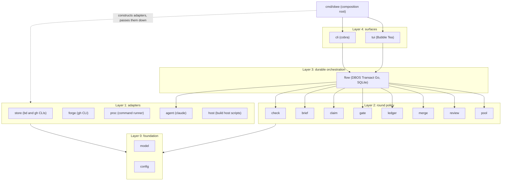

# obee architecture

obee takes a backlog of issues to reviewed, gated pull requests with any coding agent. This document describes the Go packages, their dependencies and the durable loop.

## Packages and layers

A package imports its own layer and lower layers. `depguard` in `.golangci.yml` fails an upward import and fails a package that is not on a layer list.

Layer 2 packages declare the small interfaces they need (for example `merge` declares a `Forge` with the three calls it makes) and do not import layer 1. Layer 1 packages return concrete types. The composition root builds the adapters and passes them into the layer 2 constructors, which is the dashed arrow. Only `flow` imports `agent` directly, to start agent processes.

## Composition root

`cmd/obee/main.go` builds the config, the logger, the adapters, the policy packages and the `flow` engine once, and passes them down as constructor arguments. There is no package-level state, no lazy getter and no reset function. A test builds the same graph with fakes.

## Store and claim

`store` has two concrete backends: beads through `bd --json` and GitHub issues through `gh`. The CLI is the contract. Each payload decodes once into a named struct, and a payload of another shape is a refusal that names the command. Unknown fields are kept, because `bd` and `gh` send many fields the code does not read. A caller picks the backend, so there is no dispatch by name.

`claim` keeps the claim rows in beads. It declares its own runner interface for `bd` and `gh` and does not import `store`. Both packages share the command result type in `model`.

## Forge and the command runner

`forge` runs `gh` and has one decoder for each payload shape. The pull request, review, comment, thread and check types live in `model`, so layer 2 declares its own interfaces over them without importing `forge`.

`proc` holds the one command runner. `model.Decode` is the one JSON decoder for command answers. `store`, `forge` and `claim` share them. The runner starts each command in its own process group with a timeout, and reports exit code 124 for a deadline, 127 for a missing command and 130 for a cancel.

## Agent runs

`agent` starts one CLI per step from a profile (binary, fixed arguments, login variables) chosen by a switch on the agent name. Claude is the only profile; other agents return later. The prompt goes on stdin, so it never shows in a process list. The CLI gets an allowlisted environment: the path, home, locale, proxy and certificate variables, the login folder variables of its runner and the token if one is passed. No other variable of the caller reaches it. A run does not start when the login folder is missing, because the CLI would create an empty profile there.

The CLI runs in its own process group through `proc`. A total timeout, an idle timeout (reset by each write on stdout or stderr) or a cancel of the context kills the group, and the group is killed again when the CLI exits, so no child outlives the step. Stdout is the transcript. A line writer redacts each line (the token value and anything shaped like an `sk-ant-` key) before it reaches the log, and drops a line longer than 16 MiB instead of splitting a secret across two writes. Stderr keeps a redacted tail of 4 KiB for the result.

The transcript reader walks each JSON line of a Claude Code file. A Skill call counts once, in a `tool_use` block of an assistant line. A Bash call counts at any depth. The transcript check takes the shell scanner as a function value; the shell rules live in `check`. A line ends at LF, CRLF or a lone CR. A file with no JSON object line is refused, so an empty or cut-off transcript never passes a check.

## Configuration

In the config folder, `runners.toml` holds `[agents]` (`max_concurrent`, the global limit on agent processes), `[pool]` and the `[[runner]]` logins. `projects/<name>.toml` holds the project keys and an optional `[steps.<step>]` table that overrides the defaults of the default workflow. The step names are the typed constants in `model`. `obee check config` loads the folder, prints one line for each problem with the file path, and exits 2 when it finds any.

`config` is the only package that reads the environment. The `OBEE_*` variables override the file values, `OBEE_CONFIG` names the config folder and `OBEE_STATE_DIR` names the state folder. `cmd/obee` sets `umask 077`. `cli.Execute` refuses to start when a `DBOS__*` variable is set. The state folder must be absolute, owned by the user and mode 0700.

## The durable loop

`flow` holds one DBOS workflow per item. Steps: claim, plan, implement, gate, review, ready, merge, release. Each agent step starts a subprocess (`claude -p`) in its own process group with a total and an idle timeout. A bounded fix loop returns to implement while the review verdict asks for changes. The wait for the owner is a durable receive with no deadline; it survives a restart. DBOS stores workflow state in SQLite under the state folder, so a crash resumes at the last finished step. The workflow takes no outgoing request other than the model call.

## DBOS and secrets

The DBOS rules live in `.ai-rulez/rules/dbos-and-secrets.md`. In short:

- The state folder is created at 0700 under `umask 077` before DBOS opens `dbos.db`. A test checks the file modes.
- `flow` builds the DBOS config with an empty Conductor URL and key, no schedule, the JSON serializer and a pinned application version. It refuses to start if any `DBOS__*` variable is set.
- A custom `slog` logger writes to a 0600 file and redacts step errors. Each step wraps its error with a scrubbed message.
- No secret passes through a workflow input, a step output, an event or a message.
- Finished workflows are deleted with `DeleteWorkflows`.
- The enterprise DBOS module is never imported, and DBOS is imported only in `flow` (both `depguard` rules). `make deps` checks that `go list -deps ./cmd/obee` has no `go.dbos.dev`, viper, `net/http` or `crypto/tls`; cobra is allowed (its core imports neither). `make vuln` runs govulncheck, and `go.mod` pins `toolchain go1.27.3` or later.

## Decisions

- **Interfaces at the consumer.** A package states what it needs, so a fake needs few methods and an adapter can change without edits in policy code.
- **CLI as contract for `gh` and `bd`.** The `gh` and `bd` commands are what the owner runs by hand. `bd` has a public Go package, but it needs cgo or a Dolt backend and pulls its whole tree. Revisit when `bd` ships a slim client module.
- **No framework for config.** go-toml/v2 decodes into a struct and rejects unknown keys. The overlay is explicit code in one package.
- **Make, not Task.** A single Makefile holds the targets: `check`, `lint`, `test`, `format`, `vet` and `coverage`.
- **Coverage exclusion.** Only `cmd/obee/main.go` is excluded from the 100% gate. The smoke step runs the built binary.
- **Agent rules from `.ai-rulez/`.** Generated files (`AGENTS.md`, `CLAUDE.md` and the preset folders) are ignored by git.
