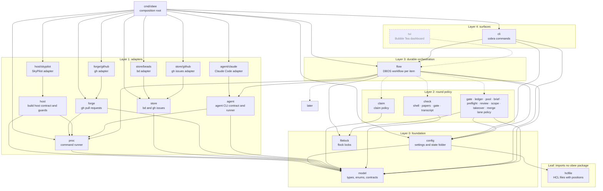
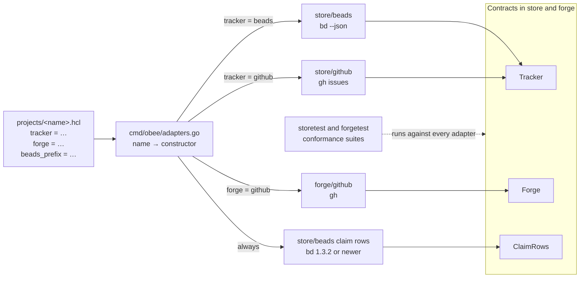
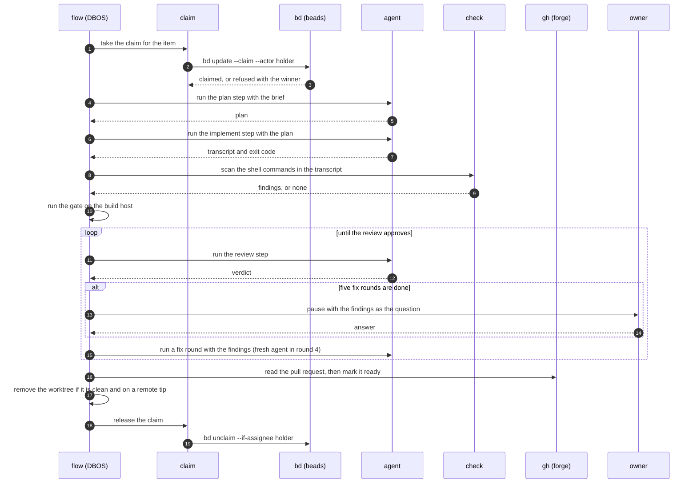

# obee architecture

obee takes a backlog of issues to reviewed, gated pull requests with any coding agent. This document describes the Go packages, their dependencies and the durable loop.

## Packages and layers

A package imports its own layer and lower layers. `depguard` in `.golangci.yml` fails an upward import and fails a package that is not on a layer list.

The diagram shows each package and its imports of other obee packages. A solid box is a package that exists. A dashed box is a package that a later milestone adds.

Every package imports `model`, and `model` imports no obee package. Only `proc` starts a process: `forge` and `agent` call it, and `store` reaches it through the runner that the composition root passes in.

`hclfile` is the one place that reads an HCL file. It decodes the file into a struct and reports each problem with its file, line and column. It imports no obee package, and `depguard` refuses one. `config` uses it. `config` imports the `hcl` package only for the range types of its decode structs.

`filelock` is the one place that calls `flock`. It gives an exclusive lock that waits, an exclusive lock that fails at once when the file is held, and a shared lock. `ledger` and `flow` use it and import no other lock code.

Layer 2 packages declare the small interfaces they need and do not import layer 1. For example, `claim` declares `Rows` and does not import `store`. The composition root builds the adapters and passes them into the layer 2 constructors. `check/transcript` takes the transcript readers and the shell scanner as function values, so it imports neither `agent` nor `check/shell`. `cmd/obee` passes the methods of the agent adapter. The `Call` type lives in `model`, which both sides import.

## Composition root

`cmd/obee/main.go` builds the config, the logger, the adapters, the policy packages and the `flow` engine once, and passes them down as constructor arguments. There is no package-level state, no lazy getter and no reset function. A test builds the same graph with fakes.

## Adapters

The tracker and the forge are adapters that a project selects. The package `store` declares two contracts and the package `forge` declares one. `store.Tracker` covers items and parents. `store.ClaimRows` covers the claim of each item. `forge.Forge` covers pull requests, reviews, threads and checks. The claim store is not a choice: beads fills `ClaimRows` for every project. beads, GitHub Issues and GitHub are the first adapters. No adapter is a default: a project file names both with `tracker` and `forge`. Every project also sets `beads_prefix`, because its leases live in beads whatever its `tracker` is. `obee check config` refuses a project without one.

`model.ParseTracker` and `model.ParseForge` check a name, as `ParseAgent` does. `obee check config` refuses an unknown name. `cmd/obee/adapters.go` holds the one table from name to constructor, and a test fails when the table and the name lists differ. `obee check config` builds the tracker, the forge and the claim store of each project, so a project that cannot build them is a problem. It also runs `bd --version` through the command runner and refuses a bd older than 1.3.2: "obee needs bd 1.3.2 or newer for claims; found 0.56.1". No other package dispatches on an adapter name. Layer 2 packages keep small interfaces over the contracts, so a consumer never sees the whole `Tracker`.

Each contract has an exported conformance suite, in `internal/store/storetest`, `internal/forge/forgetest` and `internal/agent/agenttest`, in the style of `testing/fstest.TestFS`. The suite runs against every adapter with a fake command line. It checks the claim row rules (for `ClaimRows`) and checks that every method returns an error when its command fails.

## Store and claim

`store` holds the `Tracker` and `ClaimRows` contracts and the decode helpers. It has two backends: `store/beads` through `bd --json` and `store/github` for GitHub issues through `gh`. The CLI is the contract. Each payload decodes once into a named struct, and a payload of another shape is a refusal that names the command. Unknown fields are kept, because `bd` and `gh` send many fields the code does not read. The GitHub backend reads and writes issues only. It holds no lease.

`claim` holds the claim policy and no command line: the read of the winner, one reclaim of an ended lease and the refusal of a live holder. It declares the small `Rows` interface it needs and does not import `store`. Beads holds one claim row for each item.

## Claims live in beads

Claims live in beads for every project, whatever tracker the project uses, because beads has native claim leases. GitHub labels have no write that tests the old value and no lease. obee keeps no lease of its own: bd grants, renews and ends the lease.

- **Row.** A forge number has no beads row, so each item gets a task titled `lock:<kind>-<item>`. A row left with a stale assignee or a closed status is reset to open first, guarded by the values that were read.
- **Take.** `bd update <row> --claim --actor <holder>` claims an open row with no assignee in one write and grants the lease to the actor. The holder is the actor and the assignee. A refused take exits 1 with the text `issue already claimed` or `issue not claimable`. The adapter reads that exit as a lost take, and `claim` reads the row to learn the winner. Any other exit 1 is an error.
- **Beat.** `bd heartbeat <row> --actor <holder>` renews the lease of each row of the holder. A row that fails does not stop the renewal of the other rows: the errors join. A holder with no row gets the text that the claim is gone. A row that another holder took after the list gets the same text, because bd refuses the heartbeat with `issue already claimed`. Any other failure is an error. The lease lasts 5 minutes, and bd has no flag to change it.
- **Reclaim.** `bd reclaim --id <row> --older-than 0s` frees a row only when its lease ended. bd ends no lease by itself: a late beat before the reclaim revives the lease. A row set to `in_progress` by hand has no lease, and bd never reclaims it.
- **Release.** `bd unclaim <row> --if-assignee <holder>` sets the status back to open and ends the lease. A mismatch exits 1 with the text `assignee mismatch`, and `claim` refuses with code 3. A closed row holds nothing and counts as free.
- **Version.** The leases and the guards exist from bd 1.3.2. The claim store asks `bd --version` once before its first write and refuses an older bd before it writes anything. `obee check config` runs the same check.

The lease table of bd is node-local: it is not committed to Dolt and not replicated. All the clients of one `dolt sql-server` see the same leases, and a second server has its own. Keep one server for each project.

Backends copy small helpers, such as `derefText` and the argument constants, rather than share them through the parent. A shared helper would add an export that only backends use.

The package `store/beads/beadstest` holds the fake `bd` that the tests of `store/beads` and `cmd/obee` share, as `net/http/httptest` holds a fake server. The fake follows bd 1.3.2. The same package holds the helpers that start and stop the private dolt server of the real-bd contract tests, so `internal/store/beads` and `cmd/obee` share one copy.

The contract test `TestLeaseContract` in `internal/store/beads` runs the same scenarios against the fake and against a real bd 1.3.2 on a private dolt server. The real run is off by default. To run it, set `OBEE_BD_132` to the path of a bd 1.3.2 binary (check its checksum against the release file), put `dolt` on `PATH`, and run `go test ./internal/store/beads -run TestLeaseContract`. The test starts its own dolt server on a free port, refuses ports 3306 and 3307, and stops the server at the end. It ends a lease with `dolt sql` instead of a wait of 5 minutes. `cmd/obee` runs `claim` over the real claim store, because only the composition root may import `store` and `claim` together.

The claim rules: a holder is live while the end of its lease is after the clock. The end comes from bd and the clock from obee, so a clock skew between the host of bd and the host of obee can make `EnsureFree` and `Who` disagree with `Take`. `EnsureFree` only prechecks, and `bd reclaim` decides. A holder with no lease never expires, because bd never reclaims it. A read that fails, does not parse or fills a page is an error, and `claim` turns it into a refusal. `Take` is bd's atomic claim. When another holder wins, `claim` runs one reclaim, then claims again, then refuses with code 3.

## Forge and the command runner

`forge` holds the `Forge` contract. Its backend `forge/github` runs `gh` and has one decoder for each payload shape. The writes are `PostComment`, `SetDraft`, `MergePR`, `CreateBranch`, `SetBase` and `SetBody`. `MergePR` runs `gh pr merge --merge --match-head-commit` and refuses a pin that is not a full commit id before `gh` runs. `TokenScopes` reads `gh auth status --active`. The pull request, review, comment, thread and check types live in `model`, so layer 2 declares its own interfaces over them without importing `forge`.

Seven methods read the conversation and move the pull request. `Comments` and `ReviewComments` return the conversation comments and the inline comments, all pages joined. `Search` returns the numbers of the open issues or pull requests that involve a user and changed since a date, and refuses an answer that fills its limit. `DefaultBranch` returns the default branch and refuses a repository that names none. `BranchRef` returns the tip of a branch; a branch that does not exist gives `found` false and no error, and every other failed read is an error. `PostComment` adds a comment, and `SetDraft` converts a pull request to a draft or marks it ready. `forgetest` runs each method in its conformance suite, and the suite checks that every method fails on a failed command.

`proc` holds the one command runner, the `Runner` interface, and `proc/proctest` holds the scripted fake of it. `model.Decode` is the one JSON decoder for command answers. `store` and `forge` share them. The runner starts each command in its own process group with a timeout, and reports exit code 124 for a deadline, 127 for a missing command and 130 for a cancel.

## Build host

`host` holds the `Host` contract: `Up`, `Status`, `Down`, `Submit`, `Wait`, `Cancel`, `Drain` and `Resume`. A provider is a child package, and `host/skypilot` is the first one. It runs the `sky`, `ssh` and Slurm command lines through `proc.Runner`, links no cloud library and opens no listener. The `sky` command starts its own local API server; only a project that selects this provider gets it. `Up` runs `sky launch --down` with `host.idle_minutes` and passes `host.max_run` as the SkyPilot setting for the lifetime of an instance, which SkyPilot documents for GPU instances only. `Status` reads `sky status -o json`, `sinfo` and `df`. `Submit`, `Wait`, `Cancel`, `Drain` and `Resume` run `sbatch`, `squeue` (then `sacct` after the controller forgets the job), `scancel` and `scontrol` over ssh. Every parser refuses an answer it does not recognise. `Up` is the first call and `Down` the last. The job id, job state, disk reading and host status types live in `model`, so layer 2 declares its own interfaces without importing `host`. Nothing outside a provider names SkyPilot or Slurm. `host/hosttest` is the conformance suite, in the style of `forgetest`.

The guards live in `host`, so every provider gets them. `Banked`, `Bank`, `FindRepos` and `EnsureUnused` take a command runner and run git or find through it, so the same code scans the machine of obee or a remote host. `DiskFloor` and `WaitJob` take a `Host`.

The invariant is: a job holds its slot until its work is banked, for at most `host.max_run`. The provider deletes an idle host with no obee code alive. SkyPilot counts only its own job queue, so `Submit` also starts a `sky exec -d` job that waits for a bank marker, and `Wait` banks the work of the host, writes the marker, and returns a final state. `Wait` returns the state of the job together with the error when the bank fails. `Wait` and `Teardown` scan the same root: the login folder of the head node by its absolute path (`WorkRoot`). `Teardown` is the only way to stop a host with the guards. `Teardown` scans, banks and stops the host; it takes no function, so a caller cannot pass a stub for the check.

1. **Banked.** `Banked` lists every branch tip, tag, stash entry and worktree HEAD that is not an ancestor of a head or tag that `git ls-remote` reports on a remote with a host part. A path or `file://` remote does not count. A remote that cannot be read holds nothing. A git command that cannot read a repository is an error. An annotated tag counts by the commit it names. `Bank` pushes the missing commits to `host.private_remote`, checks again, and refuses when anything is still missing. Each commit goes to its own branch, `obee-banked/<12 characters of the commit>`, on the private remote, with a plain push that never overwrites a branch. All repositories of a host share that namespace. The branches stay until someone deletes them, and CI on the remote can see them. A retry after a partial failure pushes the same names. Uncommitted and untracked files are not banked: they are lost when the host goes.
2. **Repository scan.** `FindRepos` has no depth cap. It lists a directory that holds `.git` and a bare repository. A symlink as the root is followed; a symlink inside the root is not, so a repository reached only through one is not listed. A scan that fails, including one that cannot read a directory, or finds no repository, refuses.
3. **Disk floor.** `DiskFloor` refuses a new job when the free space is under `host.disk_floor_gb` or the reading is not readable.
4. **In-use directories.** `EnsureUnused` refuses when a process or one of its threads has the directory as its working directory, runs an executable from it, or holds a file open in it. One call to `sh` on the host resolves the directory with `readlink -f` and matches the cleaned and the resolved path; nothing resolves on the machine of obee. A scan that fails counts as in use.
5. **Waits.** `WaitJob` accepts only a final job state from the scheduler of the host. Any other state refuses.

A project selects a host with `build_host` and the `host` block. The `host` block is required when `build_host` is a cluster name and refused when it is `"local"`. `provider` names an adapter, a nested block named after the provider (`host { skypilot { } }`) holds the keys of that adapter only, and an unknown key or block is refused. `cmd/obee/adapters.go` picks the provider from its host block by `provider`, like the tracker and the forge, and `obee check config` builds the host of each project. The `skypilot` block keys are `cloud`, `region` (needs `cloud`) and `instance_type`; the cluster name is `build_host`.

## Agent runs

`agent` holds the runner and the `Adapter` contract. An adapter supplies the profile of one CLI (binary, fixed arguments, login variables) and reads its transcript. `agent/claude` is the only adapter; other agents return later as their own packages. `cmd/obee` holds the table that maps an agent name to the constructor of its adapter, and puts the adapter in the `Spec` of each run. A run with no adapter does not start. The conformance suite is `agent/agenttest`: it starts a fake CLI and checks the profile and the transcript readers of an adapter. Every new adapter calls it from its tests. The prompt goes on stdin, so it never shows in a process list. The CLI gets an allowlisted environment: the path, home, locale, proxy and certificate variables, the login folder variables of its runner and the token if one is passed. No other variable of the caller reaches it. A run does not start when the login folder is missing, because the CLI would create an empty profile there.

The CLI runs in its own process group through `proc`. A total timeout, an idle timeout (reset by each write on stdout or stderr) or a cancel of the context kills the group, and the group is killed again when the CLI exits, so no child outlives the step. Stdout is the transcript. A line writer redacts each line (the token value and anything shaped like an `sk-ant-` key) before it reaches the log, and drops a line longer than 16 MiB instead of splitting a secret across two writes. Stderr keeps a redacted tail of 4 KiB for the result.

The transcript reader of `agent/claude` walks each JSON line of a Claude Code file. A Skill call counts once, in a `tool_use` block of an assistant line. A Bash call counts at any depth. The transcript check in `check/transcript` takes the shell scanner as a function value; the shell rules live in `check/shell`. A line ends at LF, CRLF or a lone CR. A file with no JSON object line is refused, so an empty or cut-off transcript never passes a check.

## Shell rules and the job check

`check/shell` reads shell text with the `mvdan.cc/sh/v3` parser and walks the tree, so quotes, heredocs, pipes, subshells and functions need no hand-written tokenizer. `Scan` fills the scan seam of `transcript.Bash`. It finds bulk staging, a delete that needs approval (a path that is not a literal absolute path, or any delete inside an `ssh`, `gcloud compute ssh` or wrapper command), and delete text in `echo`, `printf` or a heredoc. A command that sets `GIT_INDEX_FILE` to a value stages into a private index and passes.

The package imports the parser and its `expand` package, never `interp`. `make deps` checks every package of the module and `depguard` denies `interp`. `expand` resolves a variable that holds a host wrapper. A name it does not know stays as `$name` text, so the literal path rule still sees it. Command substitutions, backticks and process substitutions are read as commands. `busybox` is a wrapper.

Two caps bound the work of the variable lookup. A value longer than 4096 bytes is unreadable, and so is a lookup that must work out more than 1000 values. An unreadable variable stays `$name` text. If it is the command word, or the first word after the wrapper words (`sudo`, `env`, `nice`, `timeout`, `xargs`), the scan reports `opaque-command`, so a cap never lets a staging or a delete pass. A value that depends on a variable being read is kept for the current lookup only, so the number of values worked out for one use does not grow with the number of uses. The time for a script still grows with its size.

`JobScript` applies the bulk staging rule and refuses a test command with no `timeout` in front of it. A test command is `cargo test`, `cargo nextest`, `pytest`, `py.test`, `bats` or `make test*`. The check reads a string that a shell, `ssh`, `eval`, a container runner or `uv run` runs, and a heredoc that a shell reads or that a later command runs as a file.

`JobScript` also refuses two kinds of text:
- A line that does not parse as shell. The lines that do parse are still judged, and so is a line that only ends in an operator, such as `git add -A &&`.
- A command the check cannot read: `env -S`, `find -exec sh -c`, and a command word that holds a variable or a substitution when the words after it would be a staging or a delete if the word were `git` or `rm`, such as `$g add -A` and `$x -rf "$d"`. A delete needs a recursive or force option to count when the variable is the `rm` itself. A command word that hides no rule, such as `$ROOT/bin/run.sh`, passes.

## Lane papers

The package `check` holds only `Refusal`. Each child keeps its own copy of the small text helpers it uses. `check/papers`, `check/gate` and `check/transcript` read the papers a lane leaves. `check/gate` imports `check/shell`; `check/papers` and `check/transcript` never import `check/shell` or `check/gate`, and `check/shell` and `check/gate` never import `check/papers` or `check/transcript`. `depguard` enforces this. `check/papers` reads the context of a lane through `transcript.LaneContext`. Each check returns its lines and a verdict, or an error that is a `Refusal` when it cannot run. A refusal carries the lines found before it stopped. `Report` and `Authors` cannot refuse; `Authors` returns the exit code, because its two refusals (2 and 3) differ.

- The lane report has four sections (Claims, Hunks, Inputs, Siblings), each a table with a fixed column count. A section with nothing to list has one `none: <reason>` row. A claim names the head commit it was verified at, and the report says that no background command is left.
- The handoff file of a lane that stops early states the regressions so far and the lane context. A handoff written between a launch and its read is refused.
- The burn record reads the transcript of the orchestrator. It counts the main thread calls for each hour and the token count of each lane notice. A token count prints as the transcript wrote it, whole or fractional. The lane cap comes from an argument, then `LANE_CONTEXT_CAP`, then 150000; an empty argument is refused, and a cap above the integer range is the largest cap. A project folder that starts with a dot holds no transcript. With no `HOME` and no `CLAUDE_CONFIG_DIR`, the transcript path is refused. A text that is not UTF-8 gets one replacement mark for each cut multi-byte sequence and one for each other bad byte. A transcript line whose `message` or `usage` is not an object is skipped, and so is a line with `NaN` or `Infinity`. A transcript key matches by exact case.
- The papers check lists the source paths that a revision range changes. A range that starts with `-` is refused, so git never reads it as an option. A lane of proof and papers changes none. The globs match as `fnmatch` does: a malformed `[` is a plain `[`, `^` is a plain `^`, `!` negates, and `*` crosses `/`. `check/papers` declares its own `runner` interface for git, so layer 2 does not import `forge`.
- The author check compares the address of a commit with the address of the account. A login with no linked account and a foreign address is refused as well.

The gate list is a Markdown file. Its `## Gate steps` section holds one row for each step, with a `Derived from:` line that ends in a commit. A row with the command `see <file>` is an unstated step: the job passes when it prints `name=<step>`. Any other step passes when one command of the job holds every literal part of the gate command, in order, around the `<slot>` parts. A command here is a simple command with its redirects, a pipeline or list (`&&`, `||`, `;`, `|`), a subshell, a compound command that sits on one line (`time cargo fmt`, `{ cmd; }`, `if`, `while`, `for`, `case`, `coproc`) with its keyword, or one line of a here-document. A compound command on several lines is not one command. The check keeps the text of the outermost command of a chain once, so its cost is linear in the length of the job. A line that runs a step and also declares a skip, such as `cargo fmt; echo "GATE-SKIP fmt: x"`, counts the run and records the skip. Words join on blank and tab only, so a no-break space does not join them. A comment at the end of a line is not a command. The skip reason and the fixed-status message print the text of the command, not of its whole line. The rows and sections are read as text with `splitRow`; the job is read with the parser of `shell.ParseUnits`, and the `let` rule parses its arithmetic text with the same parser. A `GATE-SKIP <step>: <reason>` line declares a skip. It needs a reason, a step of the list, a `command -v` check when the reason names a missing tool, and a final marker with `gate=partial`.

The exit marker rule finds a print command (`echo`, `printf`, a here-document or a here-string, also inside a shell string argument) that prints `rc=` followed by a literal number. A variable counts as a literal when one assignment sets it, to a number, and nothing else can change it: no arithmetic, `read`, `for`, `printf -v`, `eval` or sourced file. The caller passes the function that reads sourced files. A file that cannot be read, or a path that only the shell can resolve, makes every variable unknown.

## Ledger

`ledger` keeps one row for each lane of each pull request. The rows are a TSV file in the state folder. A second file records the issues that the first review of a key closes. Both files have mode 0600.

`Add` holds an exclusive lock for the whole call. The lock file is `<ledger>.lock`, and the `Rows` interface carries it as `Hold`, so a fake needs no file. Every read takes the same lock as a shared lock (`Share`), so a read never sees part of a write. `Add` records a lane once: a key that has a row for the lane is left as it is. A request with no time is refused. The first review of a key also reads the closing keywords of the pull request body and records the issue numbers. `Add` writes the lane row first. It then writes the closes file by `Publish`: a temp file beside it, renamed over it. If the publish fails, a retry finds the lane row and no closes, so it records the closes and returns them. The body comes from the `Body` function of the request. The closing-keyword pattern spells each letter in both cases, because Go case folding maps the long s to `s`.

A fix lane is a fix, a rework or a relay. Only a fix lane writes the mechanism, model and round columns. The empty columns at the end of a row are left off. `Rounds` counts the fix and rework rows on one mechanism since the last design row. `Since` returns whole days from the latest row of a kind. A row whose time is not a UTC stamp is refused.

`ledger` imports `model` and `check`. The print lines of a command line are not here: `Add` returns what it did, and the command prints it.

## Gate

`gate` runs the gate command of a project, on this machine or on its build host, and says whether the tree passed. It takes three function values: the shell, the reader of the tree and the finder of the build host. `proc.RunShell` is the shell. It returns both streams in order, and 128 plus the signal number for a process that a signal ends. It keeps the last `model.ReportLimit` bytes of the output, so a command that prints without end does not grow memory.

A tree with uncommitted changes is refused. A head or tree that changes during the run is refused as well, because the gate must judge the commit that obee sends on. A host job in any state except succeeded or failed gives `ErrNoVerdict`; it never counts as a pass. A gate on a build host sends one command line that makes the host judge the sent commit: a fresh folder under the login folder that an `EXIT` trap removes without a change to the exit status, a clone of the repository from the `CloneURL` of the request, a detached checkout of the head, a check that the checkout is that head, and then the gate command. Every word is shell-quoted. A clone or checkout that fails, as it does for a head that is not pushed, is a failed gate and never a pass. A host request without a `CloneURL` is refused. No caller builds a gate request yet; milestone 12 fills `CloneURL` from the forge of the project. A request with a `Resume` job id reads that job again and submits none. It must carry `ResumeHead`, the head that the job was submitted with, or it is refused, and `Result.Head` is that head. `Submitted` receives the id of a new job as soon as the host accepts it.

## Runner pool

`pool` picks the runner of an agent that has room. A runner has room when both windows are under their caps from `config.Pool`. The pick is the lowest seven-day use, then the lowest five-hour use, then the first runner in config order. A runner whose usage is unknown is never picked. When runners exist and none has room, `Select` returns `NoneQualifiesError`, and the command that called it maps the error to exit 3. The run does not move to another agent.

A reset time prints with its offset and, when it has a fraction, six digits of it (`05:00:00.500000+00:00`).

`pool` reads no usage. It takes a `Reader` function value and reads all runners at the same time, so the whole read takes one timeout. A reader that panics gives an unknown reading and leaves the others.

The window types `Window`, `Usage` and `Reading` live in `model`, because the reader is a layer 1 package and layer 1 cannot import `pool`. A `Reading` holds usage or a reason, and its zero value is unknown.

`agent/claude` has the reader. It starts the CLI with stream-json in the folder `/`, sends one `get_usage` request and stops at its answer. The CLI gets the allowlisted variables and the login of the runner only (`agent.LoginEnv`), never a token. The read has three limits: 30 seconds from the context, 4 MB of output, and one process group that dies at the end. A CLI that cannot start, that exits without an answer or whose reply has no usable window gives an unknown reading with the reason. A reply with a utilization outside 0 to 100 is unknown. A reply line that is not valid JSON, such as one with `NaN`, is skipped.

## Doctor

`obee doctor` checks that the machine can run obee and prints one line for each check: `ok` or `FAIL` with the fix. It exits 1 when any check fails. The checks are a table of a name and a function that returns an error, the fix, or nil. They run in this order: the config folder loads, `bd` and `gh` are on the path, the bd version is new enough, then for each runner its `config_dir` exists and its token is readable when it has a Keychain entry. The bd version check runs only when `bd` is on the path. A version error with no text is still a failure.

The doctor command lives in `cli`. `BuildInfo.Doctor` holds two function values that `cmd/obee` fills: the Keychain reader, which runs `security` and never returns the token, and the bd version check of the beads adapter. Both are required: the command refuses a `Doctor` with a nil value and runs no check. A call of `security` stops after 10 seconds. `cli` does not import a backend.

## Preflight

`preflight` asks whether the pull request a caller is about to act on is still the one it was briefed against. It reads the pull request once and its head branch once, through a two-method `Reader` that the forge fills, and returns a `Result`.

`Stop` is a closed set with a `Code`: 0 unchanged, 2 refused, 3 merged, 4 closed, 5 head moved, 6 base changed, 7 branch gone, 8 draft and 9 held. `Check` tests them in this order: merged, closed, branch gone, hold, draft, head, base. A merged pull request still shows a head that looks fine, so the state comes first. A hold outranks a draft. The expected head must be a full 40-character SHA; any other length is refused and never compared.

A failed read, or a pull request with no state, draft flag, head branch or label list, is a `ReadError`. A null would pass as an open and ready pull request. Only a missing branch counts as branch gone: the ref read answers HTTP 404 and a second read of the repository succeeds, because a missing repository gives the same 404; any other failed read of the branch is a `ReadError`. Each stop carries lines that name the problem and the recovery.

## Review poll

`review` answers one question for a reviewer: what needs me now? It declares the small interfaces it reads (`Reader`, `Own`, `Stacks`), and the forge fills them. It imports only `model`.

`Poll` returns one `Row` for each thing that needs an answer. A pull request that others ask us to review, that we reviewed, or that has other activity, is read once and gets a kind from our last verdict: `NEW`, `CURRENT`, `WAITING`, `FOLLOW-UP` or `RE-REVIEW`. A `CURRENT` or `WAITING` pull request with a reply after our verdict is `REPLIED`. A comment, a dismissed review and a draft review are not a verdict. A review request on a `CURRENT` pull request makes it `RE-REVIEW`. The poll also lists `REPLY` rows (an issue or pull request where others spoke after us), `CI-RED` and `CI-NOT-RUN` rows for our ready pull requests with a failed check, and `OWN` rows for our pull requests with a fresh review, an open thread or a standing change request. A search that fills its limit is an error, because the list may be cut off.

`Sweep` lists our open pull requests with their change requests, open threads and base branch. A base branch that is not the integration branch gets a flag. The sweep and the `OWN` rows read the forge once, through `OwnPulls`. A pull request with a list longer than one page is read again with the per-pull-request reads, so the batched answer and the single reads give the same rows. A list that the single read also refuses for length prints `?` in the sweep and `unknown` in the poll. A failed read stops the poll with an `UnreadError` that names the read and its cause. A page of unknown rows would hide the cause.

## Scope

`scope` refuses a pull request that started to close a new issue after its first review. The first review of a key records the issues that the pull request body closes. `Check` reads the body now and compares the two lists. It reads the body only when the ledger holds a first review for the key, and with no first review it fixes the scope under the key and passes. Two spellings of one number, such as `12` and `012`, name one issue.

A new issue passes only when the ledger holds an `owner-add` row for the key and the issue. The lane column of that row is the issue number and the words column is the reason of the owner. The row text names the command `obee scope allow <key> <issue> <words>`. An `owner-add` row never fixes a lane, so `Count`, `Prior`, `Rounds` and `Since` do not see it. `Check` imports `ledger`, reads the ledger and the forge through the small `Records` and `Reader` interfaces, and returns a `Result` with an exit code and the lines to show.

## Takeover

`takeover` decides whether we take over a pull request that somebody else holds. It has three modes. The dry mode reads and says what it would do. The apply mode posts the notice. The take mode checks the notice, the grace period and the replies, and then calls the take function of the caller. A pull request that is not open, is ours, or has moved from the head the caller names is refused first, in every mode.

The apply mode reads the claim before it posts the notice, so a claim that is held or unreadable posts nothing. The notice names its basis, assigned to us or idle, and the grace period. The notice needs a `CHANGES_REQUESTED` review of ours. A second notice is nagging and is refused.

The take mode refuses in this order: no notice, a notice younger than the grace period, a pull request touched inside the idle threshold, and a reply or a push after the notice. A push after the notice is an objection with no words, and it refuses before any reply block prints. A reply that says `KEEP` stops the take. A reply that says `RELEASE` takes the pull request without the grace wait or the idle wait. A reply with neither word prints every reply and asks the caller to read it, and `--reply-read` lets the take go on with a note.

`takeover` never calls `time.Now`. The caller puts the time in the `Context`, so every age is a pure function of the input. A time that is not a UTC stamp is a refusal, and a pull request with no timestamp at all is unreadable, not idle. A token stands alone as a word when no Unicode letter, digit or underscore touches it, so `KEEPER`, `KEEP_ALL` and `KEEPé` do not say `KEEP`. The text of the notice is Markdown in `takeover/text`, read through one `embed` variable. `takeover` imports `model` and `check`.

## Merge

`merge` merges one reviewed pull request into the round base, pinned to the commit that a reviewer gated. `Run` takes a `Request` and returns a `Result` with a `Stop` and the lines to show. The stops are a closed set with a `Code`: 0 done, 2 refused, 3 no workflow scope and 4 own work.

`merge/roundcut` cuts the next round after the integration pull request merges: it refuses unless that pull request is merged, makes or resumes the new base only at the trunk tip, moves every open pull request on the old base to it, and never deletes the old branch. A dry run takes the same path and prints `WOULD:` lines, and it makes no write call. The forge interface has no call that deletes a branch.

`merge/audit` reads the merges of a range through git, with `-z` path lists, and returns `[]Line`. `Authored` lists the paths of a merge that differ from every parent, as resolved or authored, with a mark on sensitive paths. `Present` lists the lines a merge added that the tip lost, and the files deleted at the tip. A range that git cannot read is an error, never a clean report. A checkout that cannot be entered is a `NoWorktree` error with code 9.

### Own work is never merged

obee never merges its own work. Guard 0 runs before any other read or refusal. It reads the pull request once. If the author of the pull request, or any author of any commit, has a login or address equal to the owner login, the owner address or the login of a runner in `runners.hcl`, the stop is `OwnWork`. Case does not count. A third party's pull request with one commit of ours is refused too, because the rule is about the work and not the opener. The text names the login and says that the owner merges it in the forge.

No flag lifts this rule. `AllowOrphans`, `AllowNoChecks` and `AllowReady` do not reach it, and `auto_merge` covers only the pull request of a contributor. A missing owner login or address is a refusal, because the rule cannot tell whose work it is. The scopes of the token and every later read run after guard 0, so a refused pull request has had no write.

The commit list of the first read can be cut by the forge. Guard 0 also reads the forge's own count of commits with `PullCounts`. A count that is larger than the list read, or that cannot be read, is an `OwnWork` refusal that says the list is incomplete. The workflow scope guard applies the same rule to changed files: a file list that is absent, or shorter than the forge's count, is a refusal.

### Order of the guards

The guards refuse in this order: the round settings, a gated commit id that is not 40 characters, the state, the base, the head, the mergeable flag, children, checks, the workflow scope, change requests, open threads, AI attribution, commits with no linked account and the draft rule. The first read asks for every field in one call. The merge then reads the head once more, and reads the stack of the pull request. A pull request in a native stack is refused, because it merges through the asynchronous merge, which obee does not run. The merge call pins the head on the forge side. A merge call that fails is a refusal with code 2, and the result keeps the text of the forge.

A child is an open pull request whose base is the branch of the pull request. A merge orphans it, unless it is in the same native stack, which GitHub retargets. That child is a note. `AllowOrphans` lets the merge go on and says that this is a stated decision. A list of 1000 pull requests is refused as cut off. A check that skipped is not a pass: with no pass the merge refuses unless `AllowNoChecks` is set.

### Edit of the shared body

`EditBody` reads a body, applies an edit and writes the result. It holds an exclusive `filelock` on `integration-<pr>.lock` in the state folder for the whole read and write, so two writers never lose a row. The lock is released on every exit, a failed write included. A merge with an integration pull request records its row through `EditBody`. A row that cannot be recorded does not undo the merge. The step says so, and the owner adds the row.

### Merge step of the item

When the build has a merger, the item merges after the ready step, pinned to the head that the gate and the review read. A merge that is done, or that is refused as own work, goes on to the ready watch, which ends when the owner merges. Any other refusal ends the item with the lines of the merge. A build with no merger has no merge step.

## Brief

`brief` writes the text that a lane reads before it starts. A brief has two parts. The first part is fixed rules: the skeleton, the rules of the kind, the context cap, the standing blocks and the rules file of the project. The second part is the lines of the item: the title, the model, the read-first list and the names of the lane. Two briefs of one kind share every byte up to the first line of the item, so a prompt cache reads the rules once. A test pins this prefix.

The fixed text is 19 Markdown files in `brief/text`, read through one `embed` variable. The text names `obee` commands only. A kind of brief, a standing block, a tier row and a lane kind are named types with parsers. The kinds are impl, rev, design and papers.

The rules file of the project comes from the config path. `LoadRules` refuses a file with no preflight section or with no CI section that holds a `- Run:` line and a `- Base:` line. `Lean` cuts the file for one kind: it drops a `<!--why` block and keeps a section tagged `<!-- for: ... -->` for the named kinds only. The cut is a small struct with one method for each marker, and a bad marker is a refusal with the file and the line. The `- Take:` line under the standing heading names the blocks that the project takes: build-host, compiled and union. A file with no such line takes all of them.

`Admit` runs the gates before a brief is written, and a brief that a gate holds back writes no row. An impl lane needs its acceptance slots, and a script needs its result at the base. A fix or rework lane names one mechanism, and a pull request with two patch rounds on that mechanism and no design lane since gets a design lane next. A lane of new behavior needs a design lane in the ledger. A lane that follows an earlier fix lane of the same key needs a handoff that passes, and a handoff with two regressions sends the next brief to a design lane. The handoff check is a `HandoffCheck` function value that `cmd/obee` fills, so `brief` does not import `check/papers`. A gate that holds a brief back returns `Stopped`, with the lines for the orchestrator. Any other refusal is a `check.Refusal`.

`Generate` loads the rules, takes the model, reads the slots, admits the lane, sizes the read-first list, emits the text, fills the slots and checks the size. Only then does it add the row of the lane to the ledger. The ledger is the `Book` interface: `Count`, `Rounds`, `Prior` and `Add`. A review of a pull request writes a review row, and the first review also records the issues that the pull request closes.

`Check` and `Size` read a filled brief. The required reading is the brief plus the files under its read-first list, and the limit is 160,000 bytes. `Check` warns about a file above 8,000 bytes, a chain of briefs and an acceptance script with no expected behavior. It refuses a reading above the limit. `Size` lists every file the brief names, follows the briefs that those files name, counts each file once and never refuses for size. The limit, the file warning and the cap are constants, not settings.

## Configuration

In the config folder, `runners.hcl` holds an `agents` block (`max_concurrent`, the global limit on agent processes), a `pool` block and the `runner` blocks with the logins. `projects/<name>.hcl` holds the project keys (`repo`, `tracker`, `forge`, `base_branch`, `gate`, `build_host` and `beads_prefix`), a `host` block for a project with a build host, and an optional `steps "<step>"` block that overrides the defaults of the default workflow. The step names are the typed constants in `model`. `obee check config` loads the folder, prints one line for each problem with the file path, and exits 2 when it finds any.

`config` is the only package that reads the environment. The `OBEE_*` variables override the file values, `OBEE_CONFIG` names the config folder and `OBEE_STATE_DIR` names the state folder. `cmd/obee` sets `umask 077`. `cli.Execute` refuses to start when a `DBOS__*` variable is set. The state folder must be absolute, owned by the user and mode 0700.

## Workflow files

One HCL file is one workflow. A `workflow "<name>"` block holds `method_version` and `require_model`. The step blocks are `agent`, `command`, `gate`, `loop` and `wait`. Steps run in file order, and a `loop` holds its own steps. The schema names the arguments and the built-in outputs of each block. A method value, such as a prompt or a model name, is a value in the file and never a Go constant.

A step reads another step with `<kind>.<name>.<output>`. It reads the work item with `item.<field>`, the environment with `env.<NAME>`, and the round with `loop.round` or `loop.<name>.exhausted`. A step that was skipped has null outputs. `resume_from` names an agent with `agent.<name>`. A step name is unique in the whole file, across all kinds.

`until` of a loop is checked right after the last step it names. It can read any step in the body of the loop, which the walk visits after the loop itself.

`obee check workflow [file]` reads `workflow.hcl` by default and prints one line for each problem as `file:line:col: text`, then the count. It exits 0 for a valid file and 1 for problems. It exits 2 when the file cannot be read or parsed. It checks the structure first. It also checks the steps that loaded, even when the structure has problems, and it does not report a reference to a step that failed to load. It checks that:

- each name in an expression points at a step that exists, runs earlier or encloses the reference, and has that output;
- no step depends on itself, directly or through other steps (the error shows the path as `a -> b -> a`);
- each prompt file is a relative path inside the folder of the workflow file, exists there, and parses as a `text/template`.

The check reads the names in an expression and never evaluates it. An `outputs` argument that is not a list of strings, or a `prompt` that an expression computes, switches off the check of the output name or the file. Types are checked at run time.

`examples/remediation/` is one workflow written in this schema: a plan, an implement step, and a review and fix loop of up to five rounds, with four prompt files. The method lives in that folder and never in Go. `examples/remediation/CONFORMANCE.md` has one row for each rule of the method, with its home (`core`, `file`, `skill` or `drop`) and its status (`gap`, `expressed`, `proven` or `n/a`). A test in the `workflow` package fails when an ID repeats, when a home or status is not one of the allowed words, or when an `expressed` row names a block that the example does not hold. A row moves to `proven` when a behavior test runs it.

## The durable loop

`flow` runs each item as a DBOS workflow. DBOS stores the state of every workflow in SQLite (`dbos.db`) in the state folder. A finished step is never run again, so a crash resumes at the last finished step. The workflows make no outgoing request other than the model call.

### Item and phase workflows

An item workflow has the ID `item-<n>-r<k>`, where `k` counts the attempts at the item. The ID makes a second start of the same attempt join the first. The item workflow is not queued. It runs these steps in order:

1. Pick the login of the item from the `implement` step of its project.
2. Claim the item.
3. Run the plan phase and the implement phase.
4. Run the gate, run the review phase, and read the verdict. If the verdict file is missing, run the review phase one more time. Repeat with a fix round until the verdict approves.
5. Read the forge, then mark the pull request ready. The gate, the review and the ready step must see the same head commit: a push after the review stops the item.
6. Merge the ready pull request when the build has a merger. Then watch it until it merges. A change request or a conflict sets it to draft and ends the item.
7. Release the worktree, then release the claim.

Each agent phase (plan, implement, review, fix) is a child workflow named `phase`. It writes the brief, then starts the agent. Both are steps. The agent is a subprocess (`claude -p`) in its own process group, with a total and an idle timeout. A phase that does not exit with code 0 stops the item with an error that names the step.

### Queue and limits

Phases run on the queue `agents`. The partition key of a phase is the login, and each partition runs one phase at a time. The queue also has a global limit, `agents.max_concurrent`. One login never runs two agents at once, and the host never runs more than the global limit. The queue holds only phases. The wait for the owner is outside the queue and holds no slot.

`run` refuses an item with an empty login before it claims the item or stores a run. The message names the runner setting to change.

### Fix rounds

The round policy is one pure function of the number of fix rounds so far and the verdict:

| Fix rounds so far | Verdict asks for changes |
|---|---|
| 0 to 2 | The next round resumes the agent session. |
| 3 | The next round (round 4) starts a fresh agent. |
| 4 | The next round (round 5) resumes the fresh agent. |
| 5 | The item pauses until the owner answers. |

An approved verdict ends the loop at any round. A gate that ran and failed counts as a verdict that asks for changes, with the gate report as the findings. A gate that could not run stops the item with an error and uses no fix round. The findings of round `k` go into the brief of round `k + 1`.

The optional key `fresh_runner` of the `implement` step names the runner of the fresh agent in round 4. If the key is absent, the fresh agent uses the runner of the item. `obee check config` refuses a name that `runners.hcl` does not list.

The pause sets the findings as the question of the run and waits for a durable receive with no deadline: the receive starts again every seven days. `obee status` shows the question. `obee answer <item> <text>` sends the answer. The answer goes into the brief of round 6, and the run continues.

### Claim beat

A tick runs every 2 seconds in each running `obee run` process. Each tick reads only the runs that the process executes, then it renews each claim that the process holds. Each renewal has its own timeout of 30 seconds, and never more than the time left before the engine stops trusting the claim, so a hung tracker call delays no other claim.

The lease lasts 5 minutes. The engine stops trusting a claim 2 seconds (one tick) before the lease can end: 4 minutes 58 seconds after the start of the last good renewal. For a claim that the run took, the start is the start of the take. A run that continues or resumes did not make the take, so it needs one good renewal before its first step. The engine counts the time on the monotonic clock and on the wall clock, and it uses the longer count. The monotonic clock stops while the machine sleeps, and the lease in the tracker does not. The engine never compares `lease_expires_at` with the clock, so the only error it can make is to stop early.

Two things end the trust. At each good renewal the engine arms a timer for that time, and the timer fires whatever a renewal in flight does. Each tick also checks the time, because a timer cannot see a sleep of the machine: after a sleep, the trust ends at the first tick.

A renewal that fails or times out does not lose the claim before that time. The next tick tries again, and a renewal that works moves the time forward. When the time passes, or at once when the tracker says that another holder has the row or that no claim row exists, the run records the reason and the engine cancels the run, and the claim ends its context.

Each claim a run holds has one context, and every agent of that run starts under it. The context is the only way a lost claim stops an agent: it ends when the engine stops trusting the claim, and when the run ends. If the end comes before an agent starts, the start finds the context done and starts no process. If it comes after, the end of the context kills the process group of the agent. No check sits between the claim and the start, so no loss can fall between them. The context belongs to one run, so the loss of a run never touches the agent of another run of the same item.

A phase asks, by the id of the run that queued it, whether that run holds a trusted claim now: not lost, not past the time on either clock, and with one good renewal when the run did not make the take. The claim of another run on the same item does not count. The phase asks before it writes its brief, and the brief is keyed by the run id, so the brief of a lost run never replaces the brief of a new run. A phase that `obee resume` reopened waits for its run to take the claim again: it waits while the run is open, and for 3 seconds when the run is not open yet. A phase whose run ended stops after those 3 seconds. So no second `obee run` can reclaim the item while the first run still works on it. The run ends with an error that names the reason. It does not release a claim it lost.

A process that leaves its agent's process group is out of reach of this kill. The agent group is the unit that dies.

If the first renewal of a run that continues or resumes fails, the run tries it again every 2 seconds until one works, the tracker says the claim is gone, or the time of trust has passed.

After a loss by time, the old session still holds the row until its lease ends. `obee resume <item>` refuses with code 3 until then, which is up to 5 minutes. Run it again after that time.

### Process control

Each agent process group is a row in the file `agents.pgid` in the state folder (mode 0600). A row holds the group ID and the start time of its leader. A group dies when its phase ends, times out or is canceled, when its run loses the claim, and when `obee run` shuts down. The file does not carry the kill of a lost claim: the context of the claim does. The file serves the end of a phase, the cancel of a run, and the next start after a crash.

DBOS does not kill child processes, so a crash leaves them. At the next start, `obee run` kills each recorded group whose start time still matches the live process. A reused process ID has a different start time, and the check leaves it alone.

On each tick, the process also stops the agents of each run that is now canceled, then releases its worktree and claim. This is how a `cancel` from another process takes effect. The release runs beside the tick, so a slow tracker delays no renewal and no scan. Every release call has a timeout (30 seconds).

`obee cancel` writes a marker file for the run in the `canceled` folder of the state folder before it cancels the run. The release removes the marker. If an engine stops before it finishes the release, the marker stays, and the next `obee run` gives the item back when it starts. A marker for a run that is no longer cancelled, or whose item has a newer run, is dropped. A marker that cannot be read is logged and skipped, and the other markers still give back. The marker is written to a temporary file and renamed, so a crash leaves no half marker. All the markers of one start share one release timeout.

### Ready and release

Before the ready step marks a pull request ready, it reads the forge. The read is `review.Pull`, and it returns one `review.Standing`. `Standing.Reasons` is the only list of reasons: a read that failed, a head that is not the commit the review read, a review that asks for changes, a conflict with the base branch, and an unresolved thread, in that order. The refusal lists the reasons in this order, so its text differs from the text of the earlier flow check. The ready step refuses with the pull request and each reason. A failed read refuses the step too, because an empty fact is not a clean one.

After the ready step marks the pull request ready, the item runs the watch step. The next section describes it.

The release steps run on every exit of the item except a cancel, while the claim is still held. Ctrl-C is not an exit: the run stays open. The worktree step removes the worktree only when all of these are true: the tree is clean, `git ls-remote --heads origin` lists a branch tip, and HEAD equals that tip. In every other case the tree stays, and the log says why. One timeout covers all the git calls. The claim release runs last.

### Ready watch

`review.Watch` reads a ready pull request once and returns `Merged`, `Waiting` or `SendBack` with a reason. A merged pull request wins over every other fact. A change request or a conflict is `SendBack`. An open thread and a moved head are `Waiting`, because the ready step already judged them. A failed read is an `UnreadError`, never `Waiting`.

The watch step of the item reads the pull request number through the forge, then reads with `review.Watch` and waits with `dbos.Sleep` between two reads. The sleep is durable, so a restart resumes the watch and no timer of ours runs. The clock of the engine sets the length of the sleep. The default is one hour, so a day of waiting adds 48 reads and 48 sleeps, 96 durable rows, to the history of the run. A restart replays all of them. Three failed reads in a row end the watch with the last error. A good read resets the count.

On `Merged` the step ends. On `SendBack` the step calls `SetDraft` to put the pull request back to draft and ends the item with a finished run. The result of the run holds the reason, and `obee status` shows it as `sent back to draft`. The next `obee run <item>` starts a new attempt, because the run did not fail.

### Status, resume and cancel

Each run pins the build version that started it. `obee status` lists every run with its state: running, queued, done, failed or cancelled. A run that another version started shows as stranded and names that version. Every command refuses to change a stranded run.

`obee cancel <item>` cancels the open run and the phases it started. The release of the worktree and the claim runs outside the cancelled workflow. If an engine runs, it does the release on its next tick, after the agent groups of the run are dead. If no engine runs, `obee cancel` does the release itself.

`obee resume <item>` first takes a fresh claim on the item, because the release of the old run gave the old claim back. If the claim is held, `resume` refuses and names the holder. A cancelled run that left its claim gives it back at the next `obee run`, so run that first and then `resume` again. The run then uses the fresh claim for its beat and its release. The token of the fresh claim is in `owners/<run id>` in the state folder, and the file ends with the run: a release that works, or the deletion of the run by the retention, removes it. A run whose claim step never finished takes no claim at `resume`: the step claims when the run continues. No engine renews the fresh claim between `obee resume` and the next `obee run`, so run the item within 5 minutes after the resume. When the lease of the fresh claim ends, any other `obee run` can take the item. `resume` reopens the cancelled or the failed run. Then `obee run <item>` continues it from the last finished step. After a crash, or after Ctrl-C of `obee run`, the run stays open, and `obee run <item>` continues it without `resume`.

`obee run <item>` starts a new run only after a finished or a cancelled run. If the last run failed, `obee run` refuses, names the step that failed, and tells the owner to run `obee resume <item>`.

### One engine for each state folder

`obee run` takes an exclusive lock on `engine.lock` in the state folder and holds it until the command ends. A second `obee run` on the same state folder refuses and tells the owner to wait or to run `obee status`. The client commands do not take this lock. Every open of the store also takes the lock `migrate.lock` for the time of the database migration, because the migration of the workflow library has no lock of its own.

An item belongs to the project that `run` names. `run` refuses an item that has an open run under another project.

### One item, end to end

The diagram shows one item through these steps. Each call to `bd`, `gh` or the agent CLI goes through `proc`.

## DBOS and secrets

The DBOS rules live in `.ai-rulez/rules/dbos-and-secrets.md`. In short:

- The state folder is created at 0700 under `umask 077` before DBOS opens `dbos.db`. A test checks the file modes.
- `flow` builds the DBOS config with an empty Conductor URL and key, no schedule, the JSON serializer and a pinned application version. It refuses to start if any `DBOS__*` variable is set.
- A custom `slog` logger writes to a 0600 file and redacts every record when it writes it. DBOS stores the text of a step error as it is, so each step error passes through the same redactor before it returns to DBOS.
- No secret passes through a workflow input, a step output, an event or a message.
- At each start, `obee run` deletes the finished runs that are older than seven days, with their phases, using `DeleteWorkflows`. Failed and cancelled runs stay, because `obee resume` can reopen them.
- The enterprise DBOS module is never imported, and DBOS is imported only in `flow` (both `depguard` rules). `make deps` checks that `go list -deps ./...` has no `go.dbos.dev`, viper or `net/http`. `crypto/tls` is allowed because DBOS links it through its Postgres driver; `TestRun_OpensNoNetworkSocket` proves that `obee` opens no network connection. cobra is allowed (its core imports neither). `make vuln` runs govulncheck, and `go.mod` pins `toolchain go1.27.3` or later.

## Decisions

- **Interfaces at the consumer.** A package states what it needs, so a fake needs few methods and an adapter can change without edits in policy code.
- **CLI as contract for `gh` and `bd`.** The `gh` and `bd` commands are what the owner runs by hand. `bd` has a public Go package, but it needs cgo or a Dolt backend and pulls its whole tree. Revisit when `bd` ships a slim client module.
- **No framework for config.** `hclfile` decodes an HCL file into a struct with `gohcl`, rejects unknown keys and reports each problem with `file:line:col`. The overlay is explicit code in one package.
- **Make, not Task.** A single Makefile holds the targets: `check`, `lint`, `test`, `format`, `vet` and `coverage`.
- **Coverage exclusion.** Only `cmd/obee/main.go` is excluded from the 100% gate. The smoke step runs the built binary.
- **Agent rules from `.ai-rulez/`.** Generated files (`AGENTS.md`, `CLAUDE.md` and the preset folders) are ignored by git.
