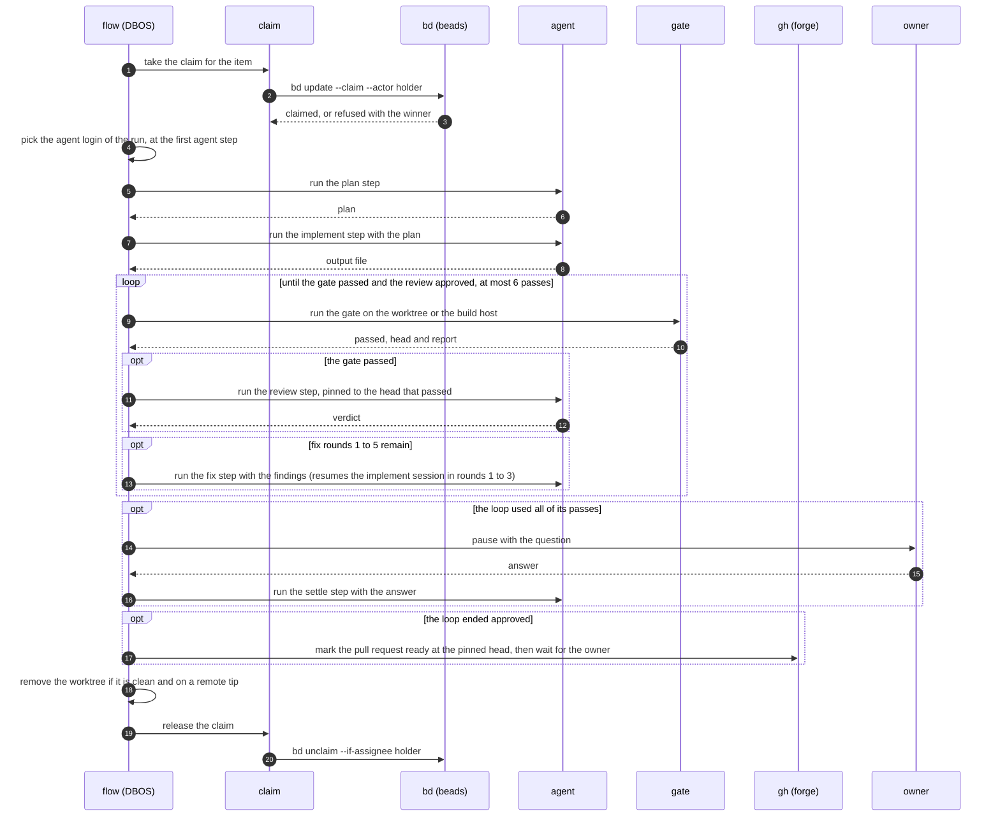

# The durable loop

Part of the [beehave architecture](../architecture.md).

`flow` runs each item as a DBOS workflow, and each agent step as a child workflow. For a first read, start at the diagram in [One item, end to end](#one-item-end-to-end).

## The durable loop

DBOS stores the state of every workflow in SQLite (`dbos.db`) in the state folder. A finished step never runs again, so a crash resumes at the last finished step. The workflows make no outgoing request other than the model call.

### Item and phase workflows

#### The item workflow ID

An item workflow has the ID `item-<n>-r<k>`, where `k` counts the attempts at the item. Because of this ID, a second start of the same attempt joins the first.

#### Who runs the item workflow

The engine that `beehave run` starts runs the item workflow at once, outside any queue.

When an engine already holds the state folder (`beehave serve` or another `beehave run`), `beehave run` joins it:

- It enqueues the item workflow on the queue `items` with the same ID.
- `agents.max_concurrent` applies, so a full queue delays the run.
- The join refuses a build that differs from the version the live engine wrote into the file `engine.version` of the state folder.
- The joined run gets the default place, because the client sets no severity.
- Progress lines print in the log of the engine, not in the terminal of the joiner.

#### The steps of the item workflow

The workflow runs these steps in order:

1. Claim the item.
2. Run `main(item)` of the workflow file on one Starlark thread. Each builtin call runs as a recorded step, so a restart replays `main` and skips the steps that finished. Then run `finish(item)` if the file defines it, unless the run was canceled.
3. Release the worktree, then release the claim.

#### The login of the run

An `agent` step that names no `runner` uses the login of the run.

- A run that a spawn or the queue started has its login in its input.
- A run that `beehave run` started picks the login at its first such step, from the pool (see [Runner pool](runtime-checks.md#runner-pool)). The step waits when the usage caps leave no room.
- A run with no such step picks no login.

The pick is a recorded step, so a resume keeps that login. A step that resumes a session runs on the login that owns the session. An empty pick fails the step.

#### The `gate` step

The `gate` step runs the gate of the project and reports `passed`, `head`, `tree`, `report` and `steps`.

- `steps` lists each step of the gate with its `name` and its `status` (`pass`, `fail` or `unknown`).
- `tree` is the tree id of `head`, read from the worktree before the gate runs.
- A gate that runs a program records an empty `tree`. A resumed host job also records an empty `tree`, unless the resumed head equals the current head.

#### The `follow_ups` keyword of `agent`

An `agent` call takes `follow_ups = "allow"` (the default), `"forbid"` or `"audit"`.

With `"forbid"` or `"audit"`, the call must list `verdict` in `outputs`. The agent writes a `findings` list of `{"class", "text"}` objects in the output file. The classes are `blocking`, `deferred`, `pre-existing` and `minor`.

| Value | Effect on the output `verdict` |
|---|---|
| `"allow"` | None. |
| `"forbid"` | Any open finding sets `changes`. With no open finding, the agent verdict stands. |
| `"audit"` | For work that has merged: any open finding sets `findings`, and no open finding sets `clean`, whatever the agent wrote. |

The review loop of the library takes a `follow_ups` argument and passes it to its review call. The remediation example sets it to `"forbid"`.

`beehave check workflow` refuses these, and shows the position:

- A literal value that is not listed.
- A literal `"forbid"` or `"audit"` whose literal `outputs` lack `verdict`.

The check sees only calls named `agent`. A call through an alias or a wrapper is checked when the run starts it.

#### The `pin` keyword and the `merge` step

An `agent` step with a `pin` starts only when the head of the worktree equals the pin, so a review reads the head that the gate passed.

The `merge` step reads the forge, marks the pull request ready at the pinned head, and watches it until it merges. A change request or a conflict sets the pull request to draft and ends the item.

#### The phase workflow

Each agent step runs as a child workflow named `phase`. The phase starts the agent with the prompt text of the step.

- The agent is a subprocess (`claude -p`) in its own process group.
- The step sets a total timeout and an idle timeout.
- A phase that does not exit with code 0 stops the item with an error that names the step.

### Queue and limits

#### The queues

The queue holds only phases. Phases run on the queue `agents`, or on the queue `reviews` for an agent call with `kind = "review"`.

- The partition key of a phase is the login. Each partition of a queue runs one phase at a time.
- Each queue has a global limit: `agents.max_concurrent` for `agents` and `agents.max_review_concurrent` for `reviews`.
- The queues do not lend slots. The host never runs more than the sum of the two limits.
- One login can run one review phase and one implement phase at once.

The wait for the owner is outside the queue and holds no slot.

#### The order in the queue

A phase waits in the order of its priority. Phases of one priority wait in the order they were queued.

One rule gives the place of a phase, a gate and a run of the queue `items`. The queue starts the lowest place first.

| Place | Who gets it |
|---|---|
| 0 | A run that `beehave resume` rewinds. |
| 1 | An item of severity P0. |
| 2 | A gate whose pull request has a person who waits (an open change request or an unresolved review thread). |
| 3 | An item of severity P1. |
| 4 | An item of severity P2. |
| 5 | An item of severity P3. |
| 6 | An item with no severity. |

So a P0 with nobody waiting comes before a person who waits.

A place never ages. A steady stream of runs in places 1 to 4 keeps a P3 item (place 5) and an item with no severity (place 6) waiting. The only limit is the concurrency cap of the queue.

#### Where the severity comes from

The severity is the field `severity` of the item (`P0` to `P3`, or `P?`). The run reads it in its first recorded step. No forge call sets a place.

- If two labels of a GitHub item name a severity, the first one that GitHub returns sets it.
- The step `spawn` reads the severity of each item it starts, so a tracker that cannot be read fails that step.
- The runs that `spawn` starts get their place from the tracker, in the recorded spawn step, so a replay queues the run with the same place.
- A phase and a run of `items` have no standing at hand, so they take the place of the severity alone.
- A run that `beehave resume` continues keeps the place that its row holds.
- A run that `beehave resume` rewinds is queued with place 0. The rewind of the library takes no priority, and the queue gives a run with no priority the value 0. Place 0 starts before every place from 1 to 6, so a rewound run starts first, ahead of a P0 item.

#### Turn and budget stops

When the agent CLI stops a run at `agents.max_turns` or `agents.max_budget_usd`, the step does not fail. Its output `stop` is `turns` or `budget`, and the workflow decides what follows.

`beehave resume` starts a new agent run with the same cap for each run. The cap of one agent run does not count across resumes. For the cap of an item run, see [Cost budgets](#cost-budgets).

### The `rewrote` output

Every agent call returns `rewrote`. It is true when the commit of the item folder before the agent started is not in the history of its commit after the run, so the agent amended, squashed or reset.

- The render step records that first commit once for the whole call. A replay keeps it, and every try of `output_tries` compares with it.
- A try that amends a commit of an earlier try of the same call is not a rewrite, because that history did not exist before the step.
- The render step fails when the item folder has no git commit, before the agent starts.
- `beehave status <run id>` shows `rewrote=yes` on the line of such a step.
- A record made before the render step kept the commit gives false.

### Cost budgets

#### The cost of an agent call

Every agent call returns `cost_usd`: the total cost in dollars that the agent CLI reports on its result line (`total_cost_usd` for `claude`).

| Case | Result |
|---|---|
| The CLI reports no cost, or a dry run | `cost_usd` is 0. |
| The CLI reports tokens and no dollars | beehave multiplies the tokens by the price of the model in the table `internal/agent/prices.json`. `cost_estimated` is true. |
| The model is not in the price table | No estimate. `cost_unknown` is true, which is not the same as a cost of 0. |

The three outputs `cost_usd`, `cost_estimated` and `cost_unknown` form one cost. Every place that shows, records or sums a cost carries all three: the step lines, the cost record of a failed run and the sum of the run. A sum that holds an estimate shows `(estimate)`. A sum that holds an unknown cost shows `(some cost unknown)`.

When a run has a cost cap and its CLI does not cap dollars itself, the run does not start if its model has no price. A run cap stops the next step after a cost that is unknown, because the cap cannot be checked.

The cost is recorded in the phase and in the read step of the agent call. A replay returns the recorded cost and never asks the CLI again. A run that fails before its result line leaves no cost.

#### The three caps

Three caps use the cost.

**The cap of one agent run: `max_budget_usd`.** This keyword of the `agent` call takes a number of dollars, 0 or more. 0 means no cap.

- The engine passes it to the budget option of the agent CLI (`--max-budget-usd` for `claude`), and the CLI stops the run. beehave runs no timer to stop it.
- When `agents.max_budget_usd` is also set, the lower value goes to the CLI.
- A run that the cap stops ends with the output `stop` set to `budget`.

A CLI with no budget option refuses the run, unless it reports the dollars of each step on its output. Then beehave adds them up and stops the run when the sum passes the cap. The run can pass the cap by the cost of one step. For this sum:

- A line that reports a dollar amount of 0 or less adds nothing.
- The dollars of a line past the line length limit are lost.
- A missing cost never counts as 0. A capped run ends as a budget stop with a note when it exits and no line reported a cost, or when the last line, read after the exit, takes the sum past the cap.
- A run that crashed and reported no cost stays a failed exit, not a budget stop.
- A budget stop keeps the session, the last message and the forbidden-command violations of the run.

**The cap of one item run: `agents.max_run_budget_usd`** (or `BEEHAVE_AGENTS_MAX_RUN_BUDGET_USD`). It caps the sum for one item run.

- A child workflow that the run spawns starts its own sum at 0. The cap applies to each sum alone.
- Before an agent step starts, the engine adds the `cost_usd` that the earlier agent steps of the item run recorded, and the cost of each run that failed.
- If the sum is at or past the cap, the step fails before it starts. The error names the cap and the spent sum.
- The check runs only when a step starts, so one step can pass the cap by its own cost. The cap of the step (`max_budget_usd`) or the global cap limits that. With neither set, a step has no limit.
- The check is a recorded step named `budget`, so a step that started under the cap does not fail on a replay after the cap changes.
- The sum comes from recorded costs, so a replay gives the same answer. A resume does not: `beehave resume` of a failed agent step rewinds past the record of the cost of the failed run. The sum then lacks that cost, so each resume can add up to the cost of one run past the cap.

#### Not covered

- A cap for an item tree, for a week or for a swarm. A spawned run is a run of its own with its own sum.
- The check starts no agent step late and stops no agent step that already runs. The cap of one agent run does that.

#### The swarm ledger

`examples/swarm` closes that gap for one swarm with a script, because the results of `gather` carry no cost.

- Each child run writes the cost of each agent step to a ledger file (`scripts/ledger.sh`).
- The parent reads the total and the file `STOP` before each pass. At the cap, the parent starts no new run and lets the runs that started finish.
- The parent files one item for each backlog line and starts the ready items by priority within `queue.free`.
- It lands the finished pull requests with one `batch_merge` for each priority, `P0` first.
- A conflict gets a fix item at most twice, then the status `hold`.

### Fix rounds

The library `review_fix.star` sets the fix rounds. `examples/remediation/workflow.star` calls `review_fix` with the default of `rounds = 6`.

#### Rounds

A round is one gate, one review and one fix. The loop starts with a review, so five fix rounds need six reviews: the sixth review reads the fifth fix. The loop leaves before the `fix` call of round 6, so the sixth pass never fixes.

| Round | The `fix` agent |
|---|---|
| 1 to 3 | Resumes the session of the `implement` agent, on `sonnet`. |
| 4 and 5 | Starts a fresh agent, on `opus`. |

The loop ends when the gate passed and the review approved.

- A gate that ran and failed gives its report as the findings of the round.
- A gate that could not run stops the item with an error and uses no fix round.
- The findings of round `k` go into the prompt of the `fix` call in round `k`.

The `review` call has a `pin` of `check.head`, the head that the gate passed, so the review reads only that head.

#### Review verdicts

A review verdict is `approve`, `changes` or `reject`.

A `reject` ends the loop at once with no fix round, whatever the gate says. The loop returns `rejected = true`, and the example holds the item with the text of the review as the reason. The review runs only after a passing gate, so a failing gate gives no review and one fix round first. With `follow_ups = "forbid"`, open findings do not turn a `reject` into `changes`.

#### The `guard` argument

The argument `guard` of `review_fix` is a dict of `base`, `hold` and `own`. It turns on a `preflight` call before every review, design and fix agent. The calls are named `before-review-<round>`, `before-design-<round>` and `before-fix-<round>`.

- The call passes the head the gate ran on, which is the head of the worktree. So a loop with a pull request needs each fix pushed before the next gate.
- A stop is a result. The loop returns `stopped = true` and starts no more agents.
- The run reports the step, the exit code and the reason, as the stop at the intake does.

#### Fix caps across runs: `earlier_calls`

The builtin `earlier_calls(call = "<name>")` returns `count`: the number of `agent` calls with that `name` in the other runs of the item. It is a recorded step, so a replay keeps the count of the first start.

The example lowers the fix cap by the count of its `fix` calls, so the cap holds for the pull request over every run of the item.

#### The `review_check` argument

The argument `review_check` of `review_fix` is a function of one argument. The loop calls it with each review whose verdict is not `reject`.

- An empty text goes on.
- Any other text ends the loop at once with `held` set to it and no more fix lane. The example holds the item with that text.

The example passes a function that compares the regression count of the review with the count of the plan.

#### The design round

The design round needs the argument `design_prompt` of `review_fix`. The default is an empty text, which leaves the round off. The example passes `design_prompt = "prompts/design.md"`.

- Without it, the review declares only the output `verdict`, and the loop is the plain loop.
- With it, the review also writes the output `mechanism`: the file path (it may add `:function`) that its open findings are about, or an empty text. The loop keys on the part before the first colon. A review prompt that writes no `mechanism` fails when `design_prompt` is set.

The loop counts the `fix` steps of each mechanism as it runs, so no second counter exists beside the round. When a mechanism had two fix steps and the review still asks for changes on it, the next step is a `design` agent step with the prompt `design_prompt`, not a fix.

The design step writes a `decision` (`keep`, `replace` or `delete`) and a `reason`.

| Decision | Result |
|---|---|
| `keep` | The fix runs with the reason. The design step does not run again for that mechanism. |
| `replace` or `delete` | The loop ends with `design` set. The example holds the item with the decision as the comment. |

A finding on another mechanism, and a finding with an empty mechanism, keep the normal fix rounds. The orchestrator ledger (`remedy ledger rounds`) holds the same rule for lanes.

#### The `review_outputs` argument

The argument `review_outputs` of `review_fix` (default: an empty list) names more outputs for the review to write beside the verdict.

- The returned `review` holds each one as a field. A workflow reads a field of the review, such as a count, and does not parse the text of the report.
- The review prompt must ask for each one. A review that leaves one out fails like a review that leaves out the verdict.
- A dry run writes the text `0` for each output that is not the verdict.

#### Violations of the lane runs

The loop also gates on the violations of the lane runs. The latest violations are `impl.violations` in round 1, and after that the violations of the `fix` call of the round before.

- The review reads them.
- When they are not empty, the `fix` call runs, even if the review approves. It gets them ahead of the review text as findings.
- The loop does not end while they are not empty. So a hit in any lane run forces one more fix round and one more review of it.
- If the violations are still not empty at round 6, the loop is exhausted and the owner rules.

#### The wait for the owner

If the loop used all its rounds, the `exhausted` field of its result is true. The `wait` call in the example then sets a question for the owner and waits for a durable receive. `beehave status` shows the question. `beehave answer <item> <text>` sends the answer. The `settle` agent step applies the answer, and the run continues.

**Deadline.**

- With no `timeout` argument, the wait has no deadline. The receive starts again every seven days.
- With `timeout = "48h"`, the wait ends at the deadline. The `timed_out` field of its result is true, and the `answer` field is empty.
- `beehave check workflow` and the run refuse a `timeout` of zero or below, because it would read as no deadline. For a wait with no deadline, leave the argument out.
- DBOS records the deadline of the wait. A run that stops and resumes after the deadline times out at once. A run that resumes before it waits for the time left.
- An answer that arrives after the deadline and before the engine clears the question is kept for the next `wait` of the same run.

**Who answers.** A plain wait takes the first answer from anyone who can run `beehave answer` on the run. A wait can instead set these keywords:

| Keyword | Meaning |
|---|---|
| `to = ["ana", "bo"]` | The people the wait asks. |
| `quorum = 2` | The number of them that must answer. The default is 1. |
| `choices = ["yes", "no"]` | The closed set of answers. |
| `remind = [0.5, 0.9]` | Only with `to` and `timeout`. Shares of the window, each above 0 and below 1, from the smallest to the largest, with no share twice. |

A person answers with `beehave answer <item> --as ana <text>`. The command refuses these, and the refusal lists what is allowed:

- A name that `to` does not list.
- A missing name when `to` is set.
- A name when the wait sets no `to`.
- A text that is not in `choices`.

The engine does not prove the name. It keeps no key store, so anyone who can run `beehave answer` on the run can give any listed name.

**Counting.**

- Each answer is one recorded message, and the wait counts distinct names. A second answer of one person replaces the first and counts once.
- The wait ends when the count reaches the quorum.
- The `answer` field is the text that completed the quorum. The `answers` field is a dict of every counted answer by name (an empty dict for a plain wait).
- With `timeout`, a quorum that was not reached gives `timed_out` true, an empty `answer`, and the `answers` received so far.
- A vote that arrives after the quorum or the deadline, before the run clears the wait, is accepted and not counted.
- A restart replays each recorded answer and reads the deadline from one recorded step, so the count is the same.
- A record from before `answers` existed reads it as an empty dict.

**Reminders.** When a share of `remind` falls due, the engine records one step (`wait:remind-1`, `wait:remind-2`). It moves the sent count and the next moment in the same ask event that people read with `beehave status`. A wake that comes late sends each owed reminder once, in order, before the wait ends on its deadline. A restart repeats none, because each look at the clock is a recorded step.

**Checks.** `beehave check workflow` refuses:

- An empty or repeated `to` or `choices`.
- A quorum below 1.
- A quorum above the number of names, where `to` is a literal.

`beehave check workflow` and the run refuse:

- `remind` with no `timeout` or no `to`.
- A share outside the range, out of order or twice.

`beehave status` shows the people, how many of the quorum answered and who, and the choices.

#### Answer many waits: `beehave answer --all`

`beehave answer --all <text>` reads the same list as `beehave status` and picks every run that is open and shows a question. The command keeps no state of its own.

These flags narrow the list. A run must fit every flag that is set.

| Flag | Meaning |
|---|---|
| `--project` | The project. |
| `--question` | A text that the question holds. |
| `--items` | A comma-separated list of item ids. |

For each picked run, the command makes the same call as `beehave answer <item> <text>` (with `--as` when given). So each answer is the same recorded message, and each refusal rule holds for each run: a wrong name, a text outside `choices`, a stranded run or a run that ended.

- The command prints one line for each run: `<item>	answered` or `<item>	refused: <reason>`.
- A refusal does not stop the other runs.
- The exit code is 0 when every picked run took the answer. It is 1 when a run refused or when no run waits.
- The command refuses a selector flag without `--all`, and `--all` with no text.

### Claim beat

#### The tick

A tick runs every 2 seconds in each running `beehave run` process. Each tick reads only the runs that the process executes, then renews each claim that the process holds.

Each renewal has its own timeout of 30 seconds, and never more than the time left before the engine stops trusting the claim. So a hung tracker call delays no other claim.

#### The lease and the time of trust

The lease lasts 5 minutes. The engine stops trusting a claim 2 seconds (one tick) before the lease can end: 4 minutes 58 seconds after the start of the last good renewal.

- For a claim that the run took, the start is the start of the take.
- A run that continues or resumes did not make the take, so it needs one good renewal before its first step.

The engine counts the time on the monotonic clock and on the wall clock, and it uses the longer count. The monotonic clock stops while the machine sleeps, and the lease in the tracker does not. The engine never compares `lease_expires_at` with the clock, so the only error it can make is to stop early.

Two things end the trust:

- At each good renewal, the engine arms a timer for that time. The timer fires whatever a renewal in flight does.
- Each tick also checks the time, because a timer cannot see a sleep of the machine. After a sleep, the trust ends at the first tick.

#### Failed renewals and loss

A renewal that fails or times out does not lose the claim before that time. The next tick tries again, and a renewal that works moves the time forward.

If the first renewal of a run that continues or resumes fails, the run tries it again every 2 seconds. It stops when one works, when the tracker says the claim is gone, or when the time of trust has passed.

The claim is lost when the time passes. It is lost at once when the tracker says that another holder has the row or that no claim row exists. Then the run records the reason, the engine cancels the run, and the claim ends its context. The run ends with an error that names the reason. It does not release a claim it lost.

After a loss by time, the old session still holds the row until its lease ends. Until then, `beehave resume <item>` refuses with code 3, which is up to 5 minutes. Run it again after that time.

#### The claim context

Each claim a run holds has one context, and every agent of that run starts under it. The context is the only way a lost claim stops an agent. It ends when the engine stops trusting the claim, and when the run ends.

- If the end comes before an agent starts, the start finds the context done and starts no process.
- If the end comes after, the end of the context kills the process group of the agent.

No check sits between the claim and the start, so no loss can fall between them. The context belongs to one run, so the loss of a run never touches the agent of another run of the same item.

A process that leaves its agent's process group is out of reach of this kill. The agent group is the unit that dies.

#### The check in the phase

A phase asks, by the id of the run that queued it, whether that run holds a trusted claim now. A trusted claim is not lost, not past the time on either clock, and has one good renewal when the run did not make the take. The claim of another run on the same item does not count.

The phase asks before it renders its prompt. The prompt is keyed by the run id, so the prompt of a lost run never replaces the prompt of a new run.

A phase that `beehave resume` reopened waits for its run to take the claim again. It waits while the run is open, and for 3 seconds when the run is not open yet. A phase whose run ended stops after those 3 seconds. So no second `beehave run` can reclaim the item while the first run still works on it.

### Process control

#### The file `agents.pgid`

Each agent process group is a row in the file `agents.pgid` in the state folder (mode 0600). A row holds the group ID and the start time of its leader.

A group dies when its phase ends, times out or is canceled, when its run loses the claim, and when `beehave run` shuts down. The file does not carry the kill of a lost claim: the context of the claim does. The file serves the end of a phase, the cancel of a run, and the next start after a crash.

#### After a crash

DBOS does not kill child processes, so a crash leaves them. At the next start, `beehave run` kills each recorded group whose start time still matches the live process. A reused process ID has a different start time, and the check leaves it alone.

#### Cancel from another process

On each tick, the process also stops the agents of each run that is now canceled, then releases its worktree and claim. This is how a `cancel` from another process takes effect.

The release runs beside the tick, so a slow tracker delays no renewal and no scan. Every release call has a timeout (30 seconds).

#### Cancel markers

`beehave cancel` writes a marker file for the run in the `canceled` folder of the state folder before it cancels the run. The release removes the marker.

- If an engine stops before it finishes the release, the marker stays. The next `beehave run` gives the item back when it starts.
- A marker for a run that is no longer cancelled, or whose item has a newer run, is dropped.
- A marker that cannot be read is logged and skipped. The other markers still give back.
- The marker is written to a temporary file and renamed, so a crash leaves no half marker.
- All the markers of one start share one release timeout.

### Lost steps

#### Start marks

DBOS records a step when it ends, so a step that is lost in the middle leaves no record. The phase writes its own start mark, the step `agent/start<n>`, before it starts the agent. A recovered phase finds the marks of the earlier starts. Each earlier start that has no end was lost.

Every rewind that beehave does goes back to the start mark of the agent step, so the rewind drops the mark with the step. This covers a failed step and a canceled one. So a start with no end exists only after the process was lost, and a cancel followed by `beehave resume` is not a loss.

A rewind of the phase, after a failure or a cancel, goes back to the first start mark that has no agent step after it. It drops every mark and loss record of that sequence, so a resumed phase starts clean.

#### The loss record

The engine renews the lease of the claim on the item at each tick. When a run continues in a new engine, the engine reads the last renewal of that lease from the claim store before its own first renewal. The loss is the time from the start mark to that renewal. The engine keeps no file for this.

The phase records the loss in the step `agent/lost<n>`, a recorded step in the record of the run. It logs "the agent step was lost" with the item, the start time and the run time.

- If the store holds no claim lease for the item, the run time is unknown. The note, the record and the log say so, and no time is made up.
- The cause is always "the process ended with no record". The agent was a child of the engine that died, and nothing it left shows an exit status or a signal.

#### The note in the prompt

The second start of an agent step adds one paragraph to the prompt. The paragraph says:

- that the step ran before,
- how many minutes it ran before the loss, or that the time is unknown,
- that the work tree may hold its edits,
- that the agent must read `git status` and `git diff` first.

The text is the same for every workflow. It is in the record of the step `agent/lost<n>`, so a replay uses the same prompt. A first start gets no note. The agent still starts again from the beginning: the note is the only part of the resume that the engine adds.

### Ready and release

#### The ready step

Before the ready step marks a pull request ready, it reads the forge. The read is `review.Pull`, and it returns one `review.Standing`.

`Standing.Reasons` is the only list of reasons. The reasons come in this order:

1. A read that failed.
2. A head that is not the commit the review read.
3. A review that asks for changes.
4. A conflict with the base branch.
5. An unresolved thread.

The ready step refuses with the pull request and each reason. The refusal lists the reasons in this order, so its text differs from the text of the earlier flow check. A failed read refuses the step too, because an empty fact is not a clean one.

The ready step reads the standing, calls ready, then reads the head again. The ready call cannot name a head. If the head moved or cannot be read, the step sets the pull request back to draft and refuses.

After the ready step marks the pull request ready, the item runs the watch step (see [Ready watch](#ready-watch)).

#### The release steps

The release steps run on every exit of the item except a cancel, while the claim is still held. Ctrl-C is not an exit: the run stays open.

The worktree step removes the worktree only when all of these are true:

- The tree is clean.
- `git ls-remote --heads origin` lists a branch tip.
- HEAD equals that tip.

In every other case the tree stays, and the log says why. One timeout covers all the git calls. The claim release runs last.

### Ready watch

#### One read: `review.Watch`

`review.Watch` reads a ready pull request once and returns `Merged`, `Waiting` or `SendBack` with a reason.

| Fact | Result |
|---|---|
| The pull request merged | `Merged`. This wins over every other fact. |
| A change request or a conflict | `SendBack`. |
| An open thread or a moved head | `Waiting`. `review.Watch` returns the head it read in `Head`. |
| A failed read | An `UnreadError`, never `Waiting`. |

The watch loop of the engine compares `Head` with the head that the ready step marked ready. A head that differs is a send back: the review no longer covers it.

#### The watch step

The watch step of the item reads the pull request number through the forge. Then it reads with `review.Watch` and waits with `dbos.Sleep` between two reads.

- The sleep is durable, so a restart resumes the watch and no timer of ours runs.
- The clock of the engine sets the length of the sleep. The default is one hour.
- A day of waiting adds 48 reads and 48 sleeps, 96 durable rows, to the history of the run. A restart replays all of them.
- Three failed reads in a row end the watch with the last error. A good read resets the count.

#### The outcomes

**`Merged`.** The step ends.

**`SendBack`.** The step reads the pull request again. It calls `SetDraft` only if the fresh read still says send back and does not show a draft. Then it ends the item with a finished run.

- A replay after a crash between the draft call and the record finds the pull request in draft and makes no second call.
- The result of the run holds the reason, and `beehave status` shows it as `sent back to draft`.
- The run did not fail, so the next `beehave run <item>` starts a new attempt.

**`Closed`.** The step ends the item with the merge state `closed`. It makes no draft call, and the item is not sent back. The result holds the text "the pull request was closed", and `beehave status` shows it as `ended`.

### Status, resume and cancel

#### Run states and stranded runs

Each run pins the build version that started it. `beehave status` lists every run with its state: running, queued, done, stopped, failed or cancelled. Each line of the list starts with the run id.

- A run that a `stop_on_rc` code ended is `stopped`, and the line names the step and the code.
- A run that another version started shows as stranded and names that version. Every command refuses to change a stranded run, and the refusal names `beehave resume <item> --on-this-build`.

#### `beehave resume <item> --on-this-build`

DBOS recovers only the runs of its own application version. So this command uses the DBOS rewind with the version of this build.

- The run keeps its id and its finished steps.
- A run that is open is cancelled first, because DBOS rewinds only a run that ended.
- Every phase and child run of the run that is open, failed or cancelled moves with it.

The command refuses in these cases:

| Case | The refusal |
|---|---|
| The claim lease of the run in the store has not ended, because the build that holds the run still renews it. | Names the holder and when the lease ends. |
| The workflow file or a pinned file changed since the run started. | Names the file and lists the scripts outside the repository, which are not pinned. |
| The run was recorded under another version of the steps (the `+star<N>` part of the stored version), whatever its build. Its recorded steps have another format, so it is not moved. | Names both versions and says to start the item again. |

#### Progress notes on a run line

A line of the list also shows these facts when the run has them. Each is a tab-separated note after the state.

| Note | Meaning |
|---|---|
| `spent $S of $C` | The cost so far against `agents.max_run_budget_usd`: the sum of the `cost_usd` of the read steps and of the failed runs. It is the same sum that the run cap checks. `spent $S` when no cap is set. |
| `now <step>` | The step that an open run is in. A run that asks a question shows the question in place of the step and, when the `wait` has a `timeout`, `answer by <time>`. |
| `gate pass at <head>` or `gate fail at <head>` | The newest gate result and the head it judged. |
| `fix U of C` and `review U of C` | The count of the agent calls of the lanes `rework` and `review` against the cap that those calls name with the keyword `rounds`. A call that names none shows the count alone. |

The keyword `rounds` is a whole number of 1 or more, recorded in the phase. The review loop of the library sets it to its `rounds` for the review and to one less for the fix.

Every value is read from the step records, the events and the options of the client. The store has no table for it. The deadline of a `wait` with a `timeout` is the output of the `DBOS.sleep` record that the receive of the wait writes before it waits. Status shows it only while the question is open.

`beehave status <run id> --json` carries the same figures as these fields:

- `spent` (`cost_usd`, `cost_estimated`, `cost_unknown`)
- `cap_usd`
- `now`
- `deadline`
- `gate` (`passed`, `head`)
- `fix_rounds` and `review_rounds` (`used`, `cap`)
- `cost_usd` and `rounds` on each agent step

#### The rest of a run line

The line of a run ends with its item and project (`item <id> of <project>`).

The line of a run that waits shows:

- The question.
- The people it asks, how many of the quorum answered and who, for example `asks ana, bo, 1 of 2 answered (ana); choices yes, no; next reminder <time> (1 of 2 sent)`. The last part shows only while a reminder is left.
- The deadline with the time left (`answer by <time>, 1h30m left`). The time left counts down from the deadline that the `wait` recorded, against the clock of the command. A deadline in the past shows `deadline passed`. A wait that names people shows its deadline like a plain wait.

A finished run shows the fields of its result: `sent back to draft`, `ended`, `merge` or `stopped at <step> rc <n>`.

#### `beehave status --json`

`beehave status --json` prints one JSON object with the same data.

- The `runs` array has one object for each run.
- `schedules`, `days`, `poll` and `poll_not_scheduled` hold the sections that follow the runs. A section with no content is left out.

The fields of a run are `id`, `state`, `version`, `stranded`, `older_steps`, `item`, `project`, `question`, `asked` (`from`, `quorum`, `choices`, `heard`, `reminders`, `reminded`, `next_remind`), `others`, `sent_back`, `closed`, `merge`, `stopped` (`step`, `rc`, `output`, raw and in full, with no redaction), the progress fields above, and `time_left_seconds` (negative after the deadline).

The time left drops the part of a unit that is not complete: 59m59s shows `59m left`.

The fields `stranded`, `older_steps`, `spent`, `cap_usd`, `fix_rounds` and `review_rounds` are always present, so a script tells false or zero from absent. A field that is absent has its own meaning, and the array leaves it out:

- A text field with no text.
- `asked` for a wait that names no one.
- `stopped` for a run that no stop ended.
- `gate` for a run that ran no gate.
- `deadline` and `time_left_seconds` for a run with no timed wait.

The view reads only the recorded events, the step records and the item store of the client. It adds no state and no recorded step, so a replay is the same.

#### The figures of each day

After the schedules, the view shows the figures of each local day from the last `--days` days (default 7, the current day included). The day is the local day of the clock of the command.

A day shows the runs that started, the runs that ended as done, failed or canceled, and the spend of those runs with the estimate and unknown marks of the run total.

- A run that spans midnight counts as started on its start day and as ended on its end day.
- The spend of a run counts once: on the day it ended, or on the day it started while the run is open.
- A run that started before the window counts only on the day it ended, if that day is in the window.
- A run that started before the window and is still open is not read, so its spend so far is not in the window.
- A run that a store wrote before the completion time existed (DBOS migration 36) has no completion time, so it counts only by its start.
- A run that failed and then ended as done after `beehave resume` counts once, as done, on its last end day.
- A stopped result counts as done.
- A day with no run is left out, and a window with no run shows no section.

The JSON object holds the same figures in `days`: one object for each day with `day`, `started`, `done`, `failed`, `canceled` and `spent`.

The figures come from the run records that DBOS keeps (the creation time, the completion time and the status) and from the `spent` of the step records. The read lists only the runs that started or ended since the start of the window.

#### `beehave status <run id>`: the steps of one run

`beehave status <run id>` lists the steps of one run, one line each, in the order the run recorded them. The command reads the step listing of the workflow library from the state folder, decodes the stored outputs, and copies nothing. A builtin call is one line, however many records it left.

A line shows the step name, the start time, the duration and the outcome: done, failed or running. A step that the run did not finish takes the state of the run, so it can also show cancelled or stopped.

The line then shows the fields that decide the flow, when the step has them:

- `exit_code`
- `kind`: the kind of the lane of an agent step (`fix`, `rework`, `relay`, `review` or `design`)
- `stop`
- `verdict`
- `head`
- for a gate, `gate=pass` or `gate=fail` with the status of each gate step

Each field is decoded into the type that the engine records for the step: the gate result, the command output, the phase output of an agent and the read of its outputs. The phase output is the output of the child workflow of the phase, found through the child id of the step record. A step whose recorded output does not decode keeps its state and shows `output_unreadable` (`"output_unreadable":true` in JSON).

A failed step shows its error. The last line is `run`: the state of the run (running, queued, done, failed or cancelled) and, for a failed run, its `error`, which the workflow library keeps for the run. A run that fails outside a step, for example by `fail()` in the workflow file, has no failed step, so this line holds the cause. The `error` text, on a step and on the run, is the raw recorded error and is not redacted. Only the progress lines are redacted.

- A run whose process was killed shows `running` until `beehave run` or `beehave resume` continues it.
- A step that runs shows as running with its elapsed time.
- A command records its row when it ends. While a command runs, the last line is `step in progress`, with the time since the last row.

`--json` prints one object for scripts. Its fields are `run`, `state`, `error` (left out when empty) and `steps`. Each step has `name`, `state`, `duration_seconds` and, when it has them, `started`, `ended`, `error`, `exit_code`, `kind`, `stop`, `verdict`, `head`, `passed` and `gate` (a list of `name` and `status`).

#### `beehave status --item <item>`: the lanes of one item

`beehave status --item <item>` lists the lanes of one item across all its runs, oldest attempt first. It shows one line for each agent step, which is one row for each lane of the pull request of the item. A line is the run id, then the step line of the run view.

`--json` prints `item` and `lanes`, where each lane has `run` and the fields of a step. The view reads the run view of each run and keeps no table of its own.

The kind of a lane is the `lane` argument of the `agent` call (`fix`, `rework`, `relay`, `review` or `design`).

- A call with `kind = "review"` is a `review` lane.
- A call with no `lane` is a `fix` lane.
- The review loop of the library sets `review` for its review, `rework` for each fix after a review and `design` for its design step.
- A record that an older version wrote has no kind.

#### Progress lines of `beehave run`

`beehave run` writes progress lines to the terminal and to `flow.log`:

- One line when a run starts: the run id, the workflow file and the item.
- Two lines for each builtin call of the workflow file: `<run id> step <name> started`, then `done in <time>`, `failed after <time>: <error>` or `stopped the item after <time>`.

A resumed run writes these lines again for the steps it replays from the record. The progress lines go to stderr, so stdout keeps the result lines.

#### The review poll in `beehave status`

When `agents.review_poll_minutes` is set, `beehave run` schedules a review poll. Each tick reads the open pull requests of every project with a forge, in read-only calls. `beehave status` lists each schedule of the store after the runs, with its last tick and whether it fires. The workflow library records the last tick, and beehave adds no record. A schedule that never fired shows `no tick yet`. A paused schedule shows `paused`. A schedule fires only while an engine runs, so with no engine the line says `not firing, no engine runs`; the check is the engine lock that `beehave run` takes. The line shows no next due time: the library counts the first tick of a fixed delay from the launch of the engine, and beehave records no launch time. In JSON the field `firing` is true while an engine runs and the schedule is not paused. `beehave status` then ends with the newest poll that finished: its time and its rows for each project. A project that the poll could not read shows the cause. A project with no forge shows `<project>: no forge, not polled`. A poll that failed, was cancelled or gave up recovering shows `the review poll failed at <time>: <cause or status>`, so an older poll never shows as current. If `beehave run` cannot set the schedule, it logs the cause and goes on, and `beehave status` shows `the review poll is not scheduled: <cause>`. When the interval is 0, `beehave status` shows the same line and names `agents.review_poll_minutes`. The interval is at most 10080 minutes (one week). Under `beehave serve`, set `agents.review_poll_minutes` to 60.

`beehave status` lists each schedule of the store after the runs, with its last tick and whether it fires. The workflow library records the last tick, and beehave adds no record.

| Schedule line | Meaning |
|---|---|
| `no tick yet` | The schedule never fired. |
| `paused` | The schedule is paused. |
| `not firing, no engine runs` | No engine runs. A schedule fires only while an engine runs; the check is the engine lock that `beehave run` takes. |

The line shows no next due time. The library counts the first tick of a fixed delay from the launch of the engine, and beehave records no launch time. In JSON, the field `firing` is true while an engine runs and the schedule is not paused.

`beehave status` then ends with the newest poll that finished: its time and its rows for each project.

- A project that the poll could not read shows the cause.
- A project with no forge shows `<project>: no forge, not polled`.
- A poll that failed, was cancelled or gave up recovering shows `the review poll failed at <time>: <cause or status>`, so an older poll never shows as current.
- If `beehave run` cannot set the schedule, it logs the cause and goes on. `beehave status` shows `the review poll is not scheduled: <cause>`.
- When the interval is 0, `beehave status` shows the same line and names `agents.review_poll_minutes`.

#### `beehave cancel <item>`

`beehave cancel <item>` cancels the open run and the phases it started. The release of the worktree and the claim runs outside the cancelled workflow.

- If an engine runs, it does the release on its next tick, after the agent groups of the run are dead.
- If no engine runs, `beehave cancel` does the release itself.

#### `beehave resume <item>`

`resume` reopens the cancelled or the failed run. Then `beehave run <item>` continues it from the last finished step.

`beehave resume <item>` first takes a fresh claim on the item, because the release of the old run gave the old claim back.

- If the claim is held, `resume` refuses and names the holder.
- A cancelled run that left its claim gives it back at the next `beehave run`. So run that first, then run `resume` again.
- The run uses the fresh claim for its beat and its release.
- The token of the fresh claim is in `owners/<run id>` in the state folder. The file ends with the run: a release that works, or the deletion of the run by the retention, removes it.
- A run whose claim step never finished takes no claim at `resume`. The step claims when the run continues.

No engine renews the fresh claim between `beehave resume` and the next `beehave run`. So run the item within 5 minutes after the resume. When the lease of the fresh claim ends, any other `beehave run` can take the item.

After a crash, or after Ctrl-C of `beehave run`, the run stays open. `beehave run <item>` continues it without `resume`.

#### When `beehave run` starts a new run

`beehave run <item>` starts a new run only after a finished or a cancelled run. If the last run failed, `beehave run` refuses, names the step that failed, and tells the owner to run `beehave resume <item>`.

### One engine for each state folder

#### The engine lock

`beehave run` and `beehave serve` take an exclusive lock on `engine.lock` in the state folder and hold it until the command ends. `beehave serve` runs in the foreground until SIGINT or SIGTERM. It starts no daemon and writes no pid file (see `docs/serve.md`). A second engine on the same state folder (`beehave serve` or `beehave run`) refuses at once and tells the owner to wait or to run `beehave status`.

#### The probe lock

A second file, `probe.lock`, serializes every check of `engine.lock` and every engine start. Each holder keeps it for a moment.

So a held `engine.lock` is always one of these:

- An engine.
- A `beehave cancel` that gives back a run when no engine runs. It holds both locks for the release, so a check waits for it.

The client commands that join a run, show the schedules, or cancel a run take these locks for the check only. The other client commands take none.

#### The file `engine.version`

- The engine writes its version into `engine.version` with an atomic replace while it holds `probe.lock`. It removes the file when it stops.
- A client reads that file under `probe.lock`, so it never reads the version of a crashed engine.
- A client that finds `engine.lock` free removes a version that a crashed engine left.

#### The file `engine.info`

- The engine writes `engine.info` the same way, under the same `probe.lock` rule. It holds the mode (`run` or `serve`), the pid and the start time in UTC.
- `beehave status` reads `engine.info` only while `engine.lock` is held. It prints `engine: serve, pid N, since T`, `engine: run, pid N` or `no engine runs`.
- The lock decides whether an engine runs. The file only describes the engine.
- A client that finds `engine.lock` free removes the version and the info that a crashed engine left.

#### A new state folder

Several processes can open a new state folder at the same time. The migration of the workflow library is safe for that.

#### The project of an item

An item belongs to the project that `run` names. `run` refuses an item that has an open run under another project.

### One item, end to end

The diagram shows one item through these steps. Each call to `bd`, `gh` or the agent CLI goes through `proc`.

