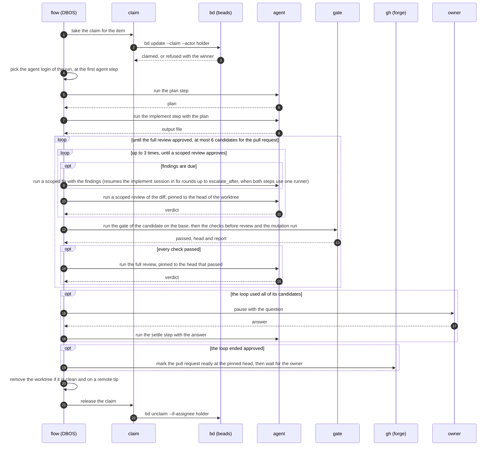

# The durable loop

Part of the [beehave architecture](../architecture.md).

`flow` runs each item as a DBOS workflow, and each agent step as a child workflow. For a first read, start at the diagram in [One item, end to end](#one-item-end-to-end).

## The durable loop

DBOS stores the state of every workflow in SQLite (`dbos.db`) in the state folder. A finished step never runs again, so a crash resumes at the last finished step. The workflows make no outgoing request other than the model call.

### Item and phase workflows

#### The item workflow ID

An item workflow has the ID `item-<n>-r<k>`, where `k` counts the attempts at the item. Because of this ID, a second start of the same attempt joins the first.

A start can ask to replace the open run in place of joining it: `beehave run <item> --on-open replace`, the `RunOnOpen` option of the library, or `on_open="replace"` in a `spawn` call. The default is `join`. A replace takes `probe.lock`, reads the newest run of the item again, and cancels it with its children, as `beehave cancel` does. A canceled run is terminal, so the existing attempt rule then starts attempt `k+1`: a replace adds no second way to number attempts. The read goes through the store view, so a run under a move reads as open. The lock makes the replace wait for the mover, and then it cancels the rewound run. A run that ended since the first read is not canceled. For `beehave run` and the library, the replace holds `probe.lock` until attempt `k+1` is open, so a reader that holds the lock never sees the item with no open run. The cancel of a `spawn` call is one recorded step, and the child starts after it: a start of that item in between plans the same attempt id, and the store keeps one run. A failed run and an open run of another project are refused as for a start with no option, before any cancel. The option is an instruction of the start: the store never holds it, so a resume and a replay read it empty. Each claim has its own owner token, so the release of attempt `k` frees only its own claim. A running engine releases the claim of `k` at its next tick, after the function of `k` returns, and the cancel marker of `k` stays until then. The claim step of `k+1` waits until no other run of its item has a cancel marker, for at most the release time of the clock. If the marker stays longer, because the engine stopped, the claim ends with its refusal, which names the holder. The release of `k` removes the worktree of the item only when no newer run of the item exists, because attempt `k+1` uses the same worktree. A `spawn` call that replaces an item that a run above it executes is refused, because the cancel would stop the run that spawns it. When a `beehave run` that joined an engine replaces the run and then takes over after the engine stops, the takeover joins the new run and cancels nothing.

#### Who runs the item workflow

The engine that `beehave run` starts runs the item workflow at once, outside any queue.

When an engine already holds the state folder (`beehave serve` or another `beehave run`), `beehave run` joins it:

- It enqueues the item workflow on the queue `items` with the same ID.
- `agents.max_concurrent` applies, so a full queue delays the run.
- The join refuses a build that differs from the version the live engine wrote into the file `engine.version` of the state folder.
- The joined run gets the default place, because the client sets no severity.
- Progress lines print in the log of the engine, not in the terminal of the joiner.
- If the engine stops before the run ends, the run stays open in the store. After the grace time of 10 seconds, the joined `beehave run` starts its own engine for the item, and the launch of that engine recovers the run. When two joined commands do this at once, one takes the state folder and the other joins it.

#### The steps of the item workflow

The workflow runs these steps in order:

1. Claim the item.
2. For a round item, make its worktree in a recorded step that stores the commit of the worktree (see "The folder of a program" in the workflow files). A resume replays the step, so the run keeps the commit that it started on, and a later step makes a removed worktree again at that commit. Any other item gets its worktree from its first `agent` call.
3. Run `main(item)` of the workflow file on one Starlark thread. Each builtin call runs as a recorded step, so a restart replays `main` and skips the steps that finished. Then run `finish(item)` if the file defines it, unless the run was canceled.
4. Release the worktree, then release the claim.

#### The login of the run

An `agent` step that names no `runner` uses the login of the run.

- A run that a spawn or the queue started has its login in its input.
- A run that `beehave run` started picks the login at its first such step, from the pool (see [Runner pool](runtime-checks.md#runner-pool)). The step waits when the usage caps leave no room.
- A run with no such step picks no login.

The pick is a recorded step, so a resume keeps that login. A step that resumes a session runs on the login that owns the session. An empty pick fails the step.

#### The `gate` step

The `gate` step runs the gate of the project and reports `passed`, `head`, `tree`, `report` and `steps`.

- `steps` lists each step of the gate with its `name` and its `status` (`pass`, `fail` or `unknown`).
- `tree` is the tree id of `head`, read from the worktree before the gate runs.
- A gate that runs a program records an empty `tree`. A resumed host job also records an empty `tree`, unless the resumed head equals the current head.

#### The `follow_ups` argument of the review loop

The `agent` step has no follow-ups setting. The review loop of the library (`review_fix`) takes `follow_ups = "allow"` (the default) or `"forbid"`.

With `"forbid"`, the loop adds the output `open` to each review call. The agent writes `open` as a text with one line for each open finding, and an empty text for none. A review with a non-empty `open` and a verdict that is not `reject` gets the verdict `changes` in the loop. With `"allow"`, the verdict of the agent stands.

A workflow that calls `agent` itself reads the output `open` in the same way. The remediation example sets `"forbid"`.
- A literal `"forbid"` or `"audit"` whose literal `outputs` lack `verdict`.

The check sees only calls named `agent`. A call through an alias or a wrapper is checked when the run starts it.

#### The `pin` keyword and the `merge` step

An `agent` step with a `pin` starts only when the head of the worktree equals the pin, so a review reads the head that the gate passed.

The `merge` step reads the forge, marks the pull request ready at the pinned head, and watches it until it merges. A change request or a conflict sets the pull request to draft and ends the item.

#### The phase workflow

Each agent step runs as a child workflow named `phase`. The phase starts the agent with the prompt text of the step.

- The agent is a subprocess (`claude -p`) in its own process group.
- The step sets a total timeout and an idle timeout.
- A phase that does not exit with code 0 stops the item with an error that names the step.

### Queue and limits

#### The queues

The queue holds only phases. Phases run on the queue `agents`, or on the queue `reviews` for an agent call with `edits = False`.

- The partition key of a phase is the login. Each partition of a queue runs at most `agents.per_login` phases at once. The default is 1.
- Each queue has a global limit: `agents.max_concurrent` for `agents` and `agents.max_review_concurrent` for `reviews`.
- With `agents.concurrency = "adaptive"`, `agents.max_concurrent` is the ceiling of the queue `agents`, and the limit moves at run time between `agents.per_login` and that ceiling. One controller in the engine writes the limit to the queue row once each minute. It adds one when every login has room under its usage caps and a phase waits. It halves the limit, never below `agents.per_login`, when a phase ends at a provider limit, and it adds nothing until the reset time of that limit. A lower limit stops no running phase and starts no new one. `beehave status` shows the limit.
- The queues do not lend slots. The host never runs more than the sum of the two limits.
- One login can run one review phase and one implement phase at once.

The wait for the owner is outside the queue and holds no slot.

#### The order in the queue

A phase waits in the order of its priority. Phases of one priority wait in the order they were queued.

One rule gives the place of a phase, a gate and a run of the queue `items`. The queue starts the lowest place first.

| Place | Who gets it |
|---|---|
| 0 | A run that `beehave resume` rewinds. |
| 1 | An item of severity P0. |
| 2 | A gate whose pull request has a person who waits (an open change request or an unresolved review thread). |
| 3 | An item of severity P1. |
| 4 | An item of severity P2. |
| 5 | An item of severity P3. |
| 6 | An item with no severity. |

So a P0 with nobody waiting comes before a person who waits.

A place never ages. A steady stream of runs in places 1 to 4 keeps a P3 item (place 5) and an item with no severity (place 6) waiting. The only limit is the concurrency cap of the queue.

#### Where the severity comes from

The severity is the field `severity` of the item (`P0` to `P3`, or `P?`). The run reads it in its first recorded step. No forge call sets a place.

- If two labels of a GitHub item name a severity, the first one that GitHub returns sets it.
- The step `spawn` reads the severity of each item it starts, so a tracker that cannot be read fails that step.
- The runs that `spawn` starts get their place from the tracker, in the recorded spawn step, so a replay queues the run with the same place.
- A phase and a run of `items` have no standing at hand, so they take the place of the severity alone.
- A run that `beehave resume` continues keeps the place that its row holds.
- A run that `beehave resume` rewinds keeps every message that was sent to it. A message that a dropped step took is unread again, an unread message stays unread, and a message that a step below the cut took stays taken. The replay takes the oldest message first, by the millisecond that it was sent. Messages sent in the same millisecond have no defined order. A wait that the replay runs again takes the answer that it took before and does not ask again.
- A run that `beehave resume --on-this-build` moves reads as open from the first moment of the move. The mover marks the run in its DBOS row (the attribute `move`) and holds the file `move.lock` from before the cancel to after the rewind. Every read of a run status goes through one store view. The view reads a canceled run that carries the mark as open while `move.lock` is held. If the lock is free, the view reads the row again: a finished move shows the open run, and a mover that died shows the canceled run. A real cancel carries no mark and reads as ended at once. A message that arrives during the move waits in the inbox and survives the rewind.
- A run that `beehave resume` rewinds is queued with place 0. The rewind of the library takes no priority, and the queue gives a run with no priority the value 0. Place 0 starts before every place from 1 to 6, so a rewound run starts first, ahead of a P0 item.

#### Turn and budget stops

When the agent CLI stops a run at `agents.max_turns` or `agents.max_budget_usd`, the step does not fail. Its output `stop` is `turns` or `budget`, and the workflow decides what follows.

`beehave resume` starts a new agent run with the same cap for each run. The cap of one agent run does not count across resumes. For the cap of an item run, see [Cost budgets](#cost-budgets).

#### Provider limits

When a provider limit (a rate limit or a spend limit) stops an agent run, the step does not fail. The phase ends with the outcome `limited` and records the limit in its `limit` field. The item run then waits for the reset and runs the same agent call again.

- The wait is in the item run, after the phase, so it holds no slot of the agents queue.
- The rerun is part of the same call. It uses no try of `output_tries`, and `earlier_calls` counts the call as one lane.
- The rerun keeps the login of the limited run, because the session of the run lives in the config folder of that login. It resumes the session of the limited run, as a start after a lost step does (see [Resume or start again](#resume-or-start-again)). The saved session wins over the `resume` keyword of the call. A limited run that named no session is followed by a fresh rerun with the note of the limit in the prompt.
- Before the rerun, the run cap and the tree cap are checked again. The limited run can spend money before the limit stops it, and that cost is in the sum.

For try `t` and run `k` (from 0) inside the try, the call records these steps:

| Step | When |
|---|---|
| `agent/caps` | In each phase, before the start marks: the look at the run cap and the tree cap. A stop ends the phase with `cap_stop` and no agent run. |
| `…/budget<t>.<look>` | After a phase that the caps stopped: the stop. A durable sleep follows, then a new phase. The look number continues across the runs of the try. |
| `…/limit<t>.<k>` | After a limited run. It holds `limit` (`kind`, `window`, `resets_at`), `login`, `wait_until`, `session`, `note` and the cost of the run. The `session` is the one that the limited run named, or the session that the run was given to resume when it named none: the session of a lost start, or of the limited run before it. The phase output records that session as `resume_of`. |
| `DBOS.sleep` | After each limit step, until `wait_until`. |

`wait_until` is fixed inside the limit step, so a restart during the wait sleeps only the time that is left and starts the agent once after the reset.

| Case | What the step does |
|---|---|
| The limit has a reset time in the future | Sleeps until the reset time, then runs again. |
| The reset time has passed | Sleeps the least wait (one minute), then runs again. |
| The next run is limited again and its reset time has passed too | Fails. The error names the limit and the login. The reset time is wrong, and a loop on it has no end. |
| The agent gives no reset time, and the usage read of the pool gives one for the login | The phase takes the read time as the reset time of the limit and records it. The step then waits as for any dated limit. A replay never reads the usage again. |
| The agent gives no reset time, and the usage read gives none | Fails. The error names the limit and the login, and says to run `beehave resume <item>` when the limit is gone. |
| The provider is overloaded (limit kind `overload`) | The pool read is not asked. The limit step sets `wait_until` to the wall clock plus a backoff of 1, 2, 4, 8 and 16 minutes, one for each overload in a row. The status shows the overload and the time of the next try. |
| The overload goes on past the fifth wait | Fails with the error of the case with no reset time, in the limit step. A limit with a reset time between two overloads starts the backoff again. |
| The provider refuses for a reason that no wait cures (usage credits, a pause of the organization) | Fails at once, with no limit step. |

The usage read is the one that the login pick uses, over the login of the run. It dates a limit only while the login is over a usage cap of the pool. A failed read fails the phase, and the error says to run `beehave resume <item>`. In the cases that fail, the phase is the failed step, and the run records no limit step. The phase input of a rerun after a past reset holds `reset_passed`, so the phase knows that a second past reset fails. `beehave resume <item>` reopens the failed phase, as it reopens any failed agent run, and the agent runs again. The cost of the failed run counts once, in the cost record of a failed run.

### The `rewrote` output

Every agent call returns `rewrote`. It is true when the commit of the item folder before the agent started is not in the history of its commit after the run, so the agent amended, squashed or reset.

- The render step records that first commit once for the whole call. A replay keeps it, and every try of `output_tries` compares with it.
- A try that amends a commit of an earlier try of the same call is not a rewrite, because that history did not exist before the step.
- The render step fails when the item folder has no git commit, before the agent starts.
- `beehave status <run id>` shows `rewrote=yes` on the line of such a step.
- A record made before the render step kept the commit gives false.

### The `committed` output

Every agent call returns `committed`. It is true when the commit of the item folder after the run is not the commit it had before the agent started. A call that made no commit returns false.

- The push of the sync branch in the example workflow reads it: a resolve that made no commit ends on the head it started on, which is not a commit of the sync branch, so the workflow pushes nothing.
- A record made before the render step kept the commit gives false.

### Cost budgets

#### The cost of an agent call

Every agent call returns `cost_usd`: the total cost in dollars that the agent CLI reports on its result line (`total_cost_usd` for `claude`).

| Case | Result |
|---|---|
| The CLI reports no cost, or a dry run | `cost_usd` is 0. |
| The CLI reports tokens and no dollars | beehave multiplies the tokens by the price of the model in the table `internal/agent/prices.json`. `cost_estimated` is true. |
| The model is not in the price table | No estimate. `cost_unknown` is true, which is not the same as a cost of 0. |

The three outputs `cost_usd`, `cost_estimated` and `cost_unknown` form one cost. Every place that shows, records or sums a cost carries all three: the step lines, the cost record of a failed run and the sum of the run. A sum that holds an estimate shows `(estimate)`. A sum that holds an unknown cost shows `(some cost unknown)`.

When a run has a cost cap and its CLI does not cap dollars itself, the run does not start if its model has no price. A run cap and a tree cap stop the next step after a cost that is unknown, because the cap cannot be checked. A cost is unknown when its model has no price, or when its recorded cost cannot be read. The stop message names which.

The cost is recorded in the phase and in the read step of the agent call, and in the limit step of a run that a provider limit stopped. A replay returns the recorded cost and never asks the CLI again. A run that fails before its result line leaves no cost.

#### The three caps

Three caps use the cost.

**The cap of one agent run: `max_budget_usd`.** This keyword of the `agent` call takes a number of dollars, 0 or more. 0 means no cap.

- The engine passes it to the budget option of the agent CLI (`--max-budget-usd` for `claude`), and the CLI stops the run. beehave runs no timer to stop it.
- When `agents.max_budget_usd` is also set, the lower value goes to the CLI.
- A run that the cap stops ends with the output `stop` set to `budget`.

A CLI with no budget option refuses the run, unless it reports the dollars of each step on its output. Then beehave adds them up and stops the run when the sum passes the cap. The run can pass the cap by the cost of one step. For this sum:

- A line that reports a dollar amount of 0 or less adds nothing.
- The dollars of a line past the line length limit are lost.
- A missing cost never counts as 0. A capped run ends as a budget stop with a note when it exits and no line reported a cost, or when the last line, read after the exit, takes the sum past the cap.
- A run that crashed and reported no cost stays a failed exit, not a budget stop.
- A budget stop keeps the session, the last message and the forbidden-command violations of the run.

**The cap of one item run: `agents.max_run_budget_usd`** (or `BEEHAVE_AGENTS_MAX_RUN_BUDGET_USD`). It caps the sum for one item run.

- A child workflow that the run spawns starts its own sum at 0. The cap applies to each sum alone.
- Before an agent step starts, the engine adds the `cost_usd` that the earlier agent steps of the item run recorded, the cost of each run that a provider limit stopped, and the cost of each run that failed.
- If the sum is at or past the cap, the step waits before it starts. The run stays open and the step is not a failure. The stop names the cap and the spent sum.
- The check runs only when a step starts, so one step can pass the cap by its own cost. The cap of the step (`max_budget_usd`) or the global cap limits that. With neither set, a step has no limit.
- Each look at the caps is the first recorded step of the phase, `agent/caps`, after the claim and before the start marks. A stop ends the phase with no agent run. The item run records the stop in a step named `budget` and sleeps durably before it queues a new phase, which looks again. A step that started under the cap does not stop on a replay after the cap changes.
- While a cap holds a step, the item run queues one phase with no agent run for each look: at most one a minute. The phase holds a slot of the agents queue only for the look.
- The check reads the cap from the config of the engine that runs it. To resume a held round, raise the cap (or set it to 0) and restart the engine.
- A cost that is unknown for an earlier step still fails the step: the cap cannot be checked against it.
- The sum comes from recorded costs, so a replay gives the same answer. The cost of a failed run goes to the DBOS stream `failed_runs` of the item run. A rewind keeps the entries of a stream, so after `beehave resume` the sum still holds the cost of the failed run. The resume rewinds a failed phase to its look, so the rerun of the agent step looks at the caps first and counts the cost.

**The cap of an item tree: `agents.max_tree_budget_usd`** (or `BEEHAVE_AGENTS_MAX_TREE_BUDGET_USD`). It caps the sum for the root run and every run it spawns.

- The sum is read from the step records of the root run and of each run below it, so a restart keeps it.
- A spawned run uses the cap of its root. It does not start a new sum and cannot raise the cap.
- The rule and the wait are the same as for the run cap. Both caps apply when both are set.

**The stop in the status.** `beehave status <run id> --json` shows `cap_stop` with `scope` (`run` or `tree`), `cap_usd`, `spent_usd` and `note` on the run, and on the line of the held agent step, while the run reads `running`. The stop goes away when a phase of the step finds no stop at its look, before its agent ends.

**The wait for a provider limit in the status.** While an agent step waits for a provider limit to reset, `beehave status <run id> --json` shows `limit_wait` with `limit`, `login` and `wait_until` on the run and on the line of the step. The run reads `running`.

#### Not covered

- A cap for a week.
- The check starts no agent step late and stops no agent step that already runs. The cap of one agent run does that.

#### The swarm example

`examples/swarm` caps the spend of one swarm with `agents.max_tree_budget_usd`, because the parent and its child runs are one item tree.

- At the cap, the engine holds each agent step that has not started. An agent step that started finishes.
- The parent reads the file `STOP` before each pass. When the file exists, the parent starts no new run.
- The parent files one item for each backlog line and starts the ready items by priority within `queue.free`.
- It lands the finished pull requests with one `merge` for each priority, `P0` first.
- A conflict gets a fix item at most twice, then the status `hold`.

### Fix rounds

The library `review_fix.star` sets the fix rounds. `examples/remediation/workflow.star` calls `review_fix` with `rounds` from the project setting `fix_rounds` (see [Fix caps across runs](#fix-caps-across-runs-earlier_calls)).

#### Two levels: candidates and scoped fixes

The loop has two levels. The outer level makes candidates, and `rounds` caps them. The inner level runs scoped fixes with no gate, up to `MAX_INNER = 3` times for each candidate.

The inner level runs in this order:

1. The agent `fix-scoped-<n>` fixes the open findings. It runs first only when findings are due: the violations of the implementer, or the findings that sent the last candidate back.
2. The fresh agent `scoped-review-<n>` reads the head with the scope "the diff of the last fix". It writes only a verdict. When no findings were due, no fix ran: that first review of candidate 1 is `scoped-review-implement`, with the scope "the diff of the implementer".
3. An approve with no violations ends the inner level. A `changes` gives the findings of the next scoped fix. After the third scoped review, the head is the candidate, whatever the verdict. The findings of that review go with any findings of the full checks to the next fix, and its violations keep the full review from a clean approve.

Each candidate then gets the full checks once, in this order. The first entry with findings sends the candidate back to the inner level, and the entries after it do not run.

1. The gate `candidate-gate` on the base. A void result reruns as `candidate-gate-void-<n>`. A void result with a host cause reruns as `candidate-gate-host-<k>`; see "The host loss limit".
2. The checks before review `candidate-before-review`, which compare the head with `origin/<base>`. Their `command` steps are `candidate-before-review-ancestor`, `-paths` and `-keywords`. A closing keyword in a commit message is a refusal that no new commit repairs, because a fix adds commits and never rewrites history. The loop then stops the item at once with a stop text that names the commit, the issue and the repair (rebuild the branch without the keyword), lists every other finding of the same check so that one rebuild repairs all, and spends no fix round.
3. The function `lane_check` of the caller, called with the lane that made the head. The example checks the report of the lane (`candidate-lane-report`).
4. Each function in the list `checks` of the caller. The example passes its mutation run.
5. The fresh agent `candidate-review` reads the whole pull request at the head that the gate passed (`pin` is that head).

The loop ends when the full review approves and no lane run left a violation. If `rounds` candidates did not end it, the loop is exhausted.

- A gate that ran and failed gives its report as the findings for the next scoped fix.
- A gate that could not run stops the item with an error.
- The fix prompt gets `round`, the fix round. The fixes after candidate k are round k, and the fixes inside candidate 1 are round 1.

| Fix round | The `fix-scoped-<n>` agent |
|---|---|
| 1 to `escalate_after` | Runs on the step `fix`. It resumes the session of the `implement` agent when `fix` and `implement` use the same runner. If the runners differ, it starts a fresh agent. |
| After `escalate_after` | Starts a fresh agent on the step `fix_late`. With no `fix_late` entry, it starts a fresh agent on `fix`. |

`escalate_after` is 3 by default (`FIX_ESCALATE_AFTER`). A session belongs to one login, and a resume on another agent fails. So a fix resumes the implementer only when both steps name the same runner, or both name none and use the pool.

#### The steps and the limits

The library holds no model name. The argument `steps` of `review_fix` is a dict from a step name to `{"model": text, "runner": text}`. The entries `implement`, `review` and `fix` are required. `design` is required when the call has a `design_prompt`. `fix_late` is optional. A missing or blank model is a refusal that names the step. A runner that is empty or left out means the pool pick. A step with a runner never reads the pool, so the usage caps of the pool do not apply to it, for a Claude runner too.

The four limits are arguments of `review_fix`. The constants of the same names in capitals are the defaults.

| Argument | Default | Meaning |
|---|---|---|
| `design_after` | `DESIGN_AFTER`, 2 | The fixes on one mechanism before the design step. |
| `void_reruns` | `VOID_RERUNS`, 2 | The reruns of a void gate before the loop asks the owner. |
| `void_asks` | `VOID_ASKS`, 3 | The questions to the owner about a void gate. |
| `escalate_after` | `FIX_ESCALATE_AFTER`, 3 | The last fix round on the step `fix`. |

`examples/remediation/workflow.star` reads both from the project file. The table `STEP_DEFAULTS` of the example is the one place that names a model: plan `opus`, implement `sonnet`, review `opus`, fix `sonnet`, fix_late `opus`, design `opus`, take_review `opus`, sync_review `opus`, sync_resolve `opus`, queue_audit `sonnet` and settle `sonnet`. `vars.round.steps` overrides the model, the runner or both of any step. `vars.round.design_after`, `void_reruns`, `void_asks` and `escalate_after` set the limits, each a whole number from its least value to 100. The example refuses an unknown step, an unknown field, a model that is not non-blank text, a runner that is not text and a limit out of range, each with the path of the key. It also refuses a review on the model of the implementer when at least two models are in use. A project on one model for every step is accepted. `beehave check workflow <file> --project <name> --dry-run` shows each refusal.

The status caps follow from `rounds`: the review cap is `rounds * (MAX_INNER + 1)` and the fix cap is `rounds * MAX_INNER`.

#### The `base` and `checks` arguments

The keyword `base` of `review_fix` is required: the base branch of the item. The gate of each candidate runs on it.

The argument `allow` of `review_fix` is the list of globs that a fix may change. The default `None` is no scope. A list that `before_review` refuses, the empty list included, stops the item before the first step of the loop, with the text of `before_review`.

The argument `checks` is a list of functions of one argument, the passed gate. Each one returns an empty text for a clean head, or the findings as text.

#### The result of the loop

The result holds `head`, the commit that the last step of the loop judged. A scoped review can reject or a guard can stop before the first gate. Then `gate` is `None`, and `head` is the head of the last lane run. So a caller that holds the item reports `head`, not `gate.head`.

The result also holds `lanes`, the list of the fix agent results in the order they ran. It is empty when no fix ran. The caller reads the outputs that it declared with `fix_outputs`, such as the reds that a lane did not cause. The caller holds the result of the implement agent already.

#### The host loss limit

A void gate has a host cause when its `host_loss` is not empty: the engine proved that the host job of the gate was lost. The gate gave no verdict about the code, and the host is not the fault of the item.

- The loop reruns the gate as `candidate-gate-host-<k>`, with `k` from 1 for each call of the gate. The rerun takes no plain attempt: `void_reruns` and `void_asks` count only the voids with no host cause, and the fix round does not change.
- The loop reads `host_losses` of the gate result, the count of the engine. It keeps no count of its own.
- `HOST_LOSS_LIMIT` is 5, one constant in `review_fix.star`. A void gate whose `host_losses` is at or above the limit is not rerun. No fix agent reads its report.
- The result of the loop then has `host_lost = true`, with no `held` reason. The caller decides what the loss costs.
- The result always has `host_losses`, the highest count that any gate of the loop read. A passing rerun reads 0, so the loop keeps the maximum.

#### Review verdicts

A review verdict is `approve`, `changes` or `reject`.

A `reject` from a scoped review or the full review ends the loop at once with no more fixes. The loop returns `rejected = true`, and the example holds the item with the text of the review as the reason. The full review runs only after a passing gate, so a failing gate gives no full review and one scoped fix first. With `follow_ups = "forbid"`, open findings do not turn a `reject` into `changes`.

#### The `guard` argument

The argument `guard` of `review_fix` is a dict of `base`, `hold` and `own`. It turns on a `preflight` call before every review, design and fix agent. The calls are named `before-scoped-review-<candidate>`, `before-fix-<candidate>`, `before-design-<candidate>` and `before-review-<candidate>`.

- The call passes the head that the next agent reads, which is the head of the worktree. So a loop with a pull request needs each fix pushed before the next review.
- A stop is a result. The loop returns `stopped = true` and starts no more agents.
- The run reports the step, the exit code and the reason, as the stop at the intake does.

#### Fix caps across runs: `earlier_calls`

The builtin `earlier_calls(call = "<name>")` returns `count`: the number of `agent` calls with that `name` in the other runs of the item. It is a recorded step, so a replay keeps the count of the first start.

A candidate counts as spent when its first agent starts: its first scoped fix `fix-scoped-1`, or `scoped-review-implement` when no findings were due. Each candidate makes one of these two calls once. The library function `candidates_spent()` adds up both calls in the other runs of the item, and the example loads it. The first candidate reviews the implementer, so `fix_rounds` fix rounds need one candidate more. The example passes:

```
rounds = max(fix_rounds + 1 - candidates_spent(), 0)
```

- An earlier run that ended early leaves the candidates that it did not start. A run that spent one candidate of `fix_rounds = 2` leaves two.
- A run that stops after the first fix of a candidate and before its scoped review still spends that candidate.
- After the cap, a run gets no candidate. The loop starts no review and no fix lane, and the example asks the owner to rule on the open findings.

#### The `review_check` argument

The argument `review_check` of `review_fix` is a function of one argument. The loop calls it with each full review whose verdict is not `reject`. Scoped reviews write only a verdict, so the loop does not call it for them.

- An empty text goes on.
- Any other text ends the loop at once with `held` set to it and no more fix lane. The example holds the item with that text.

The example passes a function that compares the regression count of the review with the count of the plan.

#### The design round

The design round needs the argument `design_prompt` of `review_fix`. The default is an empty text, which leaves the round off. The example passes `design_prompt = "prompts/design.md"`.

- Without it, the review declares only the output `verdict`, and the loop is the plain loop.
- With it, the review also writes the output `mechanism`: the file path (it may add `:function`) that its open findings are about, or an empty text. The loop keys on the part before the first colon. A review prompt that writes no `mechanism` fails when `design_prompt` is set.

The loop counts the scoped fix steps of each mechanism as it runs, so no second counter exists beside the candidate. When a mechanism had two fix steps and a review still asks for changes on it, the next step is a `design` agent step with the prompt `design_prompt`, not a fix. Scoped reviews write the output `mechanism` too, so the count includes the fixes inside one candidate.

The design step writes a `decision` (`keep`, `replace` or `delete`) and a `reason`.

| Decision | Result |
|---|---|
| `keep` | The fix runs with the reason. The design step does not run again for that mechanism. |
| `replace` or `delete` | The loop ends with `design` set. The example holds the item with the decision as the comment. |

A finding on another mechanism, and a finding with an empty mechanism, keep the normal fix rounds. The orchestrator ledger (`remedy ledger rounds`) holds the same rule for lanes.

#### The `review_outputs` argument

The argument `review_outputs` of `review_fix` (default: an empty list) names more outputs for the review to write beside the verdict.

- The returned `review` holds each one as a field. A workflow reads a field of the review, such as a count, and does not parse the text of the report.
- The review prompt must ask for each one. A review that leaves one out fails like a review that leaves out the verdict.
- A dry run writes the text `0` for each output that is not the verdict.

#### The `fix_outputs` and `lane_check` arguments

The argument `fix_outputs` of `review_fix` (default: an empty list) names more outputs for each fix agent to write. The caller declares the outputs of the implement agent on its own `agent` call. The fix prompt must ask for each one, and a fix that leaves one out fails like a review that leaves out the verdict.

The argument `lane_check` (default: none) is a function of one argument, the lane that made the candidate head: the result of the implement agent, or of the last fix agent. It runs for each candidate after the checks before review and before the list `checks`. It returns an empty text for a clean lane, or the findings as text, which send the candidate back to a fix. The example reads the output `report` of the lane and checks it with `remedy report`.

A caller that passes neither argument gets no extra output and no extra step.

#### Violations of the lane runs

The loop also gates on the violations of the lane runs. The latest violations are `impl.violations` before the first fix, and after that the violations of the last scoped fix.

- When `impl.violations` is not empty, the first scoped fix runs before any review. It gets them as findings.
- Each review reads the latest violations.
- When they are not empty, the next scoped fix runs, even if the review approves. It gets them ahead of the review text as findings.
- The loop does not end while they are not empty. So a hit in any lane run forces one more scoped fix and one more review of it.
- If the violations are still not empty after the last candidate, the loop is exhausted and the owner rules.

#### The wait for the owner

If the loop used all its rounds, the `exhausted` field of its result is true. The `wait` call in the example then sets a question for the owner and waits for a durable receive. `beehave status` shows the question. `beehave answer <item> <text>` sends the answer. The `settle` agent step applies the answer, and the run continues.

**Deadline.**

- With no `timeout` argument, the wait keeps waiting until someone answers. It has no deadline. The engine renews the receive every seven days, and that renewal ends nothing.
- The `timeout` argument sets the deadline of a wait. To bound the owner wait of a `wait` step, set `timeout` in that step. It does not bound the owner wait for a lost job, which `docs/design/hosts.md` describes.
- With `timeout = "48h"`, the wait ends at the deadline. The `timed_out` field of its result is true, and the `answer` field is empty.
- `beehave check workflow` and the run refuse a `timeout` of zero or below, because it would read as no deadline. For a wait with no deadline, leave the argument out.
- DBOS records the deadline of the wait. A run that stops and resumes after the deadline times out at once. A run that resumes before it waits for the time left.
- If a wait timed out and the run failed, `beehave resume` reopens the wait at its deadline step when only receives and their sleeps lie between the deadline step and the receive that timed out. That means the wait counted nothing. It records a new deadline and waits its whole `timeout` again. This holds for a plain wait, for a wait with people and no voice, and for a wait with choices and no answer.
- A wait that counted a voice, and a wait with reminders, record a step between the deadline and the receive. `beehave resume` reopens such a wait at the receive that timed out. The wait keeps its old deadline and times out again at once.
- An answer that arrives after the deadline and before the engine clears the question is kept for the next `wait` of the same run.

**Who answers.** A plain wait takes the first answer from anyone who can run `beehave answer` on the run. A wait can instead set these keywords:

| Keyword | Meaning |
|---|---|
| `to = ["ana", "bo"]` | The people the wait asks. |
| `quorum = 2` | The number of them that must answer. The default is 1. |
| `choices = ["yes", "no"]` | The closed set of answers. |
| `remind = [0.5, 0.9]` | Only with `to` and `timeout`. Shares of the window, each above 0 and below 1, from the smallest to the largest, with no share twice. |

A person answers with `beehave answer <item> --as ana <text>`. The command refuses these, and the refusal lists what is allowed:

- A name that `to` does not list.
- A missing name when `to` is set.
- A name when the wait sets no `to`.
- A text that is not in `choices`.

The engine does not prove the name. It keeps no key store, so anyone who can run `beehave answer` on the run can give any listed name.

**Where answers arrive.** An answer is a message of the reserved topic `beehave.answer` on the inbox of the run, the same inbox that `recv` reads. A `wait` takes the oldest answer of its own. An answer that comes while a `recv` waits for another topic stays in the buffer of the run until a `wait` reads it. A wait with no `to` ignores an answer that names a wait.

**Retry an answer.** Add `--key <key>` to `beehave answer`. The key is the idempotency key of the message. If the run already got an answer with that key, the command sends nothing again. The key of an answer and the key of `beehave send` are separate: the same text on both sends both messages. With no key, each answer gets a new one.

**Counting.**

- Each answer is one recorded message, and the wait counts distinct names. A second answer of one person replaces the first and counts once.
- The wait ends when the count reaches the quorum.
- The `answer` field is the text that completed the quorum. The `answers` field is a dict of every counted answer by name (an empty dict for a plain wait).
- With `timeout`, a quorum that was not reached gives `timed_out` true, an empty `answer`, and the `answers` received so far.
- A vote that arrives after the quorum or the deadline, before the run clears the wait, is accepted and not counted.
- A restart replays each recorded answer and reads the deadline from one recorded step, so the count is the same.
- A record from before `answers` existed reads it as an empty dict.

**Reminders.** When a share of `remind` falls due, the engine records one step (`wait:remind-1`, `wait:remind-2`). It moves the sent count and the next moment in the same ask event that people read with `beehave status`. A wake that comes late sends each owed reminder once, in order, before the wait ends on its deadline. A restart repeats none, because each look at the clock is a recorded step.

**Checks.** `beehave check workflow` refuses:

- An empty or repeated `to` or `choices`.
- A quorum below 1.
- A quorum above the number of names, where `to` is a literal.

`beehave check workflow` and the run refuse:

- `remind` with no `timeout` or no `to`.
- A share outside the range, out of order or twice.

`beehave status` shows the people, how many of the quorum answered and who, and the choices.

#### Answer many waits: `beehave answer --all`

`beehave answer --all <text>` reads the same list as `beehave status` and picks every run that is open and shows a question. The command keeps no state of its own.

These flags narrow the list. A run must fit every flag that is set.

| Flag | Meaning |
|---|---|
| `--project` | The project. |
| `--question` | A text that the question holds. |
| `--items` | A comma-separated list of item ids. |

For each picked run, the command makes the same call as `beehave answer <item> <text>` (with `--as` when given). So each answer is the same recorded message, and each refusal rule holds for each run: a wrong name, a text outside `choices`, a stranded run or a run that ended.

- The command prints one line for each run: `<item>	answered` or `<item>	refused: <reason>`.
- A refusal does not stop the other runs.
- The exit code is 0 when every picked run took the answer. It is 1 when a run refused or when no run waits.
- The command refuses a selector flag without `--all`, and `--all` with no text.

### Claim beat

#### The tick

A tick runs every 2 seconds in each running `beehave run` process. Each tick reads only the runs that the process executes, then renews each claim that the process holds.

Each renewal has its own timeout of 30 seconds, and never more than the time left before the engine stops trusting the claim. So a hung tracker call delays no other claim.

#### The lease and the time of trust

The lease lasts 5 minutes. The engine stops trusting a claim 2 seconds (one tick) before the lease can end: 4 minutes 58 seconds after the start of the last good renewal.

- For a claim that the run took, the start is the start of the take.
- A run that continues or resumes did not make the take, so it needs one good renewal before its first step.

The engine counts the time on the monotonic clock and on the wall clock, and it uses the longer count. The monotonic clock stops while the machine sleeps, and the lease in the tracker does not. The engine never compares `lease_expires_at` with the clock, so the only error it can make is to stop early.

Two things end the trust:

- At each good renewal, the engine arms a timer for that time. The timer fires whatever a renewal in flight does.
- Each tick also checks the time, because a timer cannot see a sleep of the machine. After a sleep, the trust ends at the first tick.

#### Failed renewals and loss

A renewal that fails or times out does not lose the claim before that time. The next tick tries again, and a renewal that works moves the time forward.

If the first renewal of a run that continues or resumes fails, the run tries it again every 2 seconds. It stops when one works, when the tracker says the claim is gone, or when the time of trust has passed.

The claim is lost when the time passes. It is lost at once when the tracker says that another holder has the row or that no claim row exists. Then the run records the reason, the engine cancels the run, and the claim ends its context. The run ends with an error that names the reason. It does not release a claim it lost.

After a loss by time, the old session still holds the row until its lease ends. Until then, `beehave resume <item>` refuses with code 3, which is up to 5 minutes. Run it again after that time.

#### The claim context

Each claim a run holds has one context, and every agent of that run starts under it. The context is the only way a lost claim stops an agent. It ends when the engine stops trusting the claim, and when the run ends.

- If the end comes before an agent starts, the start finds the context done and starts no process.
- If the end comes after, the end of the context kills the process group of the agent.

No check sits between the claim and the start, so no loss can fall between them. The context belongs to one run, so the loss of a run never touches the agent of another run of the same item.

A process that leaves its agent's process group is out of reach of this kill. The agent group is the unit that dies.

#### The check in the phase

A phase asks, by the id of the run that queued it, whether that run holds a trusted claim now. A trusted claim is not lost, not past the time on either clock, and has one good renewal when the run did not make the take. The claim of another run on the same item does not count.

The phase asks before it renders its prompt. The prompt is keyed by the run id, so the prompt of a lost run never replaces the prompt of a new run.

A phase that `beehave resume` reopened waits for its run to take the claim again. It waits while the run is open, and for 3 seconds when the run is not open yet. A phase whose run ended stops after those 3 seconds. So no second `beehave run` can reclaim the item while the first run still works on it.

#### The check before a write

A write that the engine makes for an item happens only while the run that ordered it holds a trusted claim. The writes are a pull request comment, the opening of a pull request, a push, the ready mark of a hand-off, the tracker writes (create, status and comment), a merge, and the start of the program of a `command` or a `write` step. A program can write to the forge, so its start counts as a write. Each write reads the claim once, at the call, and runs under a context that the loss of the claim ends. The read checks the wall clock as well as the monotonic clock, so it also refuses a write after a sleep of the machine, before any tick has marked the claim lost. Two callers make this read. An item run makes it for each of its writes, through one write handle for the run. A child that a run queued (the merge of a member, or the host job of a command with a slot class) makes it when its call starts. The child names the run and its item in its input, and it waits for that run, as a phase does, when `beehave resume` reopens the child before the run. A child that names no run is refused. The writes that reduce what a lost run exposes run with no claim: the return of a pull request to draft, the disarm of a queued merge, the notice to the owner, and the release of the claim. The undo of a `write` step runs only while the context of the run is live. After a loss that a renewal found, it does not run. After a lease that lapsed before any renewal noticed, it runs with no claim. A gate writes nothing, and its program needs no claim. A program that is already running when the claim is lost, and that ignores the end of its context, can still write until the lease ends.

### Process control

#### The file `agents.pgid`

Each agent process group is a row in the file `agents.pgid` in the state folder (mode 0600). A row holds the group ID and the start time of its leader.

A group dies when its phase ends, times out or is canceled, when its run loses the claim, and when `beehave run` shuts down. The file does not carry the kill of a lost claim: the context of the claim does. The file serves the end of a phase, the cancel of a run, and the next start after a crash.

#### After a crash

DBOS does not kill child processes, so a crash leaves them. At the next start, `beehave run` kills each recorded group whose start time still matches the live process. A reused process ID has a different start time, and the check leaves it alone.

#### Cancel from another process

On each tick, the process also stops the agents of each run that is now canceled, then releases its worktree and claim. This is how a `cancel` from another process takes effect.

The release runs beside the tick, so a slow tracker delays no renewal and no scan. Every release call has a timeout (30 seconds).

#### Cancel markers

`beehave cancel` writes a marker file for the run in the `canceled` folder of the state folder before it cancels the run. The release removes the marker.

- If an engine stops before it finishes the release, the marker stays. The next `beehave run` gives the item back when it starts.
- A marker for a run that is no longer cancelled, or whose item has a newer run, is dropped. On a tick, the marker of a run that is still open stays, because the cancel may still come. The tick drops it when the run ends.
- A marker that cannot be read is logged and skipped. The other markers still give back.
- The marker is written to a temporary file and renamed, so a crash leaves no half marker.
- All the markers of one start share one release timeout.

### Lost steps

#### Start marks

DBOS records a step when it ends, so a step that is lost in the middle leaves no record. The phase writes its own start mark, the step `agent/start<n>`, before it starts the agent. A recovered phase finds the marks of the earlier starts. Each earlier start that has no end was lost.

Every rewind that beehave does goes back to the look at the caps that opens the phase, before the start marks, so the rewind drops the marks with the step. This covers a failed step and a canceled one. So a start with no end exists only after the process was lost, and a cancel followed by `beehave resume` is not a loss.

A rewind of the phase, after a failure or a cancel, goes back to the first look or start mark that has no agent step after it. It drops the look and every mark and loss record of that sequence, so a resumed phase looks at the caps again and starts clean.

#### The loss record

The engine renews the lease of the claim on the item at each tick. When a run continues in a new engine, the engine reads the last renewal of that lease from the claim store before its own first renewal. The loss is the time from the start mark to that renewal. The engine keeps no file for this.

The phase records the loss in the step `agent/lost<n>`, a recorded step in the record of the run. It logs "the agent step was lost" with the item, the start time and the run time.

- If the store holds no claim lease for the item, the run time is unknown. The note, the record and the log say so, and no time is made up.
- The cause is always "the process ended with no record". The agent was a child of the engine that died, and nothing it left shows an exit status or a signal.

#### The saved session

The agent step saves the session id of the agent while the agent runs. The tap of the output gives each new id to the engine at the line that holds it, which is the `init` line, before any tool call. The engine writes the id as the DBOS event `session` of the phase, with `SetEvent` from the context of the agent step. That write takes no step id, so the step count stays the same. A saver goroutine does the write, and the tap only gives it the newest id, so a slow write never stops the reading of the output. While the store is down, DBOS retries the write until the step ends: the agent runs on, and the idle timer still sees its output. The step waits for the saver before it records its output, so the event comes first. A saved id adds the line "saved the session of the agent" with the item and the session to `flow.log`. A refused write logs a warning and the run goes on. No side file holds the id.

The `agent/lost<n>` step reads the event of the phase with the context of the engine, because DBOS refuses a read of an event inside a step. The record holds the id as `session`, so a second replay resumes the same session. A rewind of the phase drops the event with the agent step that wrote it, so a rerun after `beehave resume` starts a fresh session.

The record also holds `diff_stat`: the output of `git diff --stat --stat-count=50 <start commit>` in the item folder. The start commit is the head that the render step of the call read. The summary covers the commits of the lost agent and its edits to tracked files, for any history of the folder (amend, rebase, reset). A plain folder has no start commit and no summary.

The render step also writes the start commit to the per-worktree ref `refs/worktree/beehave/call-start` of the item folder. Git keeps a per-worktree ref in the admin folder of that worktree, so `git worktree remove` and `git worktree prune` delete it with the worktree. The engine reads the diff only when the folder holds the ref at the start commit. A missing ref, or a ref at another commit, means that the folder is not the one that the call started in: it was made again or removed, or someone removed the mark. The record then holds no summary. The ref also keeps the start commit reachable, so `git gc` does not remove it. Only the note uses the summary. If the engine cannot find the folder or read the diff, the step logs a warning with the reason, the note says that the engine could not read the summary, and the session still resumes. A failed read of the event fails the step.

#### Resume or start again

When the loss record holds a session, the agents layer decides once, before the start, whether the session can resume. It cannot resume when the CLI of the runner has no resume option, or when the transcript file of the session is missing (a moved worktree, a cleaned login folder, another login). A session that can resume starts with `--resume <id>` and a short prompt: the engine stopped after N minutes, continue the step, the brief and the output file are earlier in the session. The phase output records `resumed`. The saved session wins over the `resume` keyword of the call.

The rerun after a provider limit uses the same decision. The phase input of the rerun holds `limited`: the session of the limit record, the note of the limit and the prompt of the resumed session (the limit of the login stopped you, it has reset, continue the step). The note of the limit says that the limit of the login stopped the step, then holds the same diff summary and the same request to read `git status` and `git diff` as the note of a lost step. Each rerun of a try starts from the input of the try, so two limits in a row give one note. If the rerun itself is lost after it named a session, that newer session wins. If it is lost before it named one, the note of the loss goes into the prompt and the rerun resumes the limited session. `beehave resume` of a rerun that failed keeps the phase input, so it resumes the limited session again. A run that recorded an agent step under an earlier agent module does not move to this build: `resume --on-this-build` refuses it, as it refuses any run that recorded a step of a module whose version changed. Start such an item again.

A session that cannot resume, and a loss before the agent named a session, start the agent again with the prompt and the note. OpenCode never resumes a lost run: it keeps no file for one session, so the check finds none. A start that the CLI refuses at run time fails the step as any failed run does.

#### The note in the prompt

The note is one paragraph after the prompt. It says:

- that the step ran before,
- how many minutes it ran before the loss, or that the time is unknown,
- that the work tree may hold its edits, or, for a folder with no start mark at the start commit, that the work tree is not the one that the step started in and the edits of the step can be lost,
- the diff summary in a fenced block, that the engine found no change to tracked files since the step started, or that the engine could not read the summary. The note makes the first two claims only for a folder that holds the start mark at the start commit. With no start commit (a plain folder), it says that the engine cannot say what the step changed. For a folder with no such mark, it claims nothing about the changes,
- that the agent must read `git status` and `git diff` first.

The text is the same for every workflow. It is in the record of the step `agent/lost<n>`, so a replay uses the same prompt. A first start gets no note.

### Release

#### The release steps

The release steps run on every exit of the item except a cancel, while the claim is still held. Ctrl-C is not an exit: the run stays open.

The worktree step removes the worktree only when all of these are true:

- The tree is clean.
- `git ls-remote --heads` lists a branch tip. It reads the address of the project in the push repository, never the remote that the clone config names.
- HEAD equals that tip.

In every other case the tree stays, and the log says why. One timeout covers all the git calls. The claim release runs last.

### Status, resume and cancel

#### Run states and stranded runs

Each run pins the build version that started it. `beehave status` lists every run with its state: running, queued, done, stopped, failed or cancelled. Each line of the list starts with the run id.

- A run that a `stop_on_rc` code ended is `stopped`, and the line names the step and the code.
- A run that another version started shows as stranded and names that version. Every command except `beehave run` and `beehave serve` refuses to change a stranded run, and the refusal names `beehave resume <item> --on-this-build`. `beehave run` and `beehave serve` move an open run of another build when the modules agree, as the next section says.

#### Join of an open run of another build

`beehave run <item>` and `beehave serve` join the open run of an item. When that run is stored under another build, they compare the module versions, as `beehave resume <item> --on-this-build` does, and not the whole build string. A new release with the same module versions needs no command: the run moves and the call joins it.

- The move is the one of `--on-this-build`: the same checks, the same cancel and the same restamp of the run and its phases.
- If a module that the run used has another version here, the call refuses and names the module, as the table below does. If the claim lease of the run has not ended, the call refuses and names the holder.
- A run of another project is refused as before.

#### `beehave resume <item> --on-this-build`

DBOS recovers only the runs of its own application version. So this command uses the DBOS rewind with the version of this build.

- The run keeps its id and its finished steps.
- A run that is open is cancelled first, because DBOS rewinds only a run that ended.
- Every phase and child run of the run that is open, failed or cancelled moves with it.

The command refuses in these cases:

| Case | The refusal |
|---|---|
| The claim lease of the run in the store has not ended, because the build that holds the run still renews it. | Names the holder and when the lease ends. |
| The workflow file or a pinned file changed since the run started. | Names the file and lists the scripts outside the repository, which are not pinned. |
| The run recorded a step of a step module whose version differs from the version in this build. The application version ends in one version for each module, such as `+core7.agent12.tracker2.forge6.land9.gate6.host1.round3`. The kind at the start of each step name (`gate:g#1`) names the module of that step. A recorded receive of the answer of the owner counts as a step of the core module, so a run that only waited is refused when the core version differs. A module that the run recorded no step of may differ. | Names the module and both versions, and says to start the item again. |
| The run recorded a step that this build does not record. The steps of the engine (the claim, the worktree, a step that DBOS records) are recorded by every build. A kind that only an older build recorded keeps its module in the table: `merge:<label>#<n>` of the single merge (land), `scope-check:<label>#<n>` (round) and the `watch` read of the owner merge wait (core). The replay cannot reach such a step, so the move fails closed, even when the stored list equals the list of this build. | Names the step and the module of the older build, or says that no module records it, and says to start the item again. |
| The run is a run of a round item, and the version of the round module differs from the version in this build. The version of the round module covers the step that makes the worktree at the start of every round item, so every round run uses the module, even a run that an older build recorded with no such step. | Names the step that makes the worktree, and says to finish the run on the build that started it or to start the item again. |
| The run was recorded under an older single version of the steps (the `+star<N>` part of the stored version), other than `star30`. Its recorded steps have another format, so it is not moved. | Names both versions and says to start the item again. |

A stored version that ends in `+star30` stands for every module at version 1. A change to the recorded steps of one builtin bumps the version of its module and no other module, so a run that never used that module still moves. The first build with module versions has a new application version, so an open run of an older build moves only with this command.

#### Change a builtin that old runs replay

A run replays its recorded steps, so a change to the steps of a builtin breaks every run that already passed it. The rules for a contributor:

1. If the change adds, removes or reorders the recorded steps of a builtin, put it behind `dbos.Patch(ctx, "<name>")` and keep the old code in the false branch. Do not raise the module version. `Patch` works with `EnablePatching` set to false, as the DBOS rules require.
2. Call `Patch` from the body of the builtin, before its first step. Never call it in a step closure: a call with the workflow context inside a step closure passes the guard of DBOS and makes two steps share one step id.
3. The old code and the new code must be safe in one run, because a run that has not reached the builtin takes the new code.
4. Raise the module version only for a retirement (a builtin or step kind that no build records), or a change to the input or the output of a step that a replay reads again.
5. Add one replay test for each patch, in the shape of `internal/flow/patch_test.go`: the old build starts a run and the new build finishes it. A builtin that starts a child workflow has its own test in that shape.
6. Keep the old branch while any run that predates the patch can replay: an open run, and a failed or cancelled run that `beehave resume` can rewind, because the rewind keeps the steps before the failed one. Retention deletes only finished runs, so a failed or cancelled run stays, and with `agents.retention_days = 0` every run stays. Delete the old branch and call `dbos.DeprecatePatch` only when no such run is left. `DeprecatePatch` records no marker, so a run that survives fails with an unexpected step.

A patch adds a step named `DBOS.patch-<name>` to each run that calls the builtin. It is a step of the engine, so the move of a run to another build never refuses it. The per-run view of `beehave status` folds it into the call. The dry run lists it as a row, as it lists the other `DBOS.` rows. Every golden step list shows the marker, and a test refuses a change to a step sequence that has no marker. A second test keeps a digest of the golden lists for each set of module versions in `internal/flow/goldenbump_test.go`: a changed list under the same module versions breaks it. A bump adds a new digest. A developer can still rewrite the digest of the current versions, but the diff shows that.

#### Progress notes on a run line

A line of the list also shows these facts when the run has them. Each is a tab-separated note after the state.

| Note | Meaning |
|---|---|
| `spent $S of $C` | The cost so far against `agents.max_run_budget_usd`: the sum of the `cost_usd` of the read steps, of the limited runs, and of the failed runs in the stream `failed_runs`, which a resume keeps. It is the same sum that the run cap checks. `spent $S` when no cap is set. |
| `stopped at the <scope> cap $C, spent $S` | A cap holds an agent step of the open run back. The scope is `run` or `tree`. The step waits until the cap is raised and beehave restarts. |
| `waits for the <kind> limit <window> of login <login> until <time>` | A provider limit holds an agent step of the open run. The step runs again after that time. |
| `now <step>` | The step that an open run is in. A run that asks a question shows the question in place of the step and, when the `wait` has a `timeout`, `answer by <time>`. |
| `waits for a message on topic <topic> until <time>` | The open run is in a `recv` call. The time is the end of the wait, with the time left, as for `answer by`. |
| `waits for the agent output of run <run> until <time>` | The open run is in a `stream` call that reads that child run. The time is the end of the wait, with the time left. |
| `gate pass at <head>` or `gate fail at <head>` | The newest gate result and the head it judged. |
| The latest label, such as `review 3/24` | The `label` of the latest agent call that has one. The review loop of the library labels its reviews with the count against `rounds * (MAX_INNER + 1)` and its fixes with the count against `rounds * MAX_INNER`. |

Every value is read from the step records, the events and the options of the client. The store has no table for it. The deadline of a `wait` with a `timeout` is the output of the `DBOS.sleep` record that the receive of the wait writes before it waits. Status shows it only while the question is open.

`beehave status <run id> --json` carries the same figures as these fields:

- `spent` (`cost_usd`, `cost_estimated`, `cost_unknown`)
- `cap_usd`
- `cap_stop` and `limit_wait`, while a cap or a provider limit holds a step
- `now`
- `deadline`
- `receiving`: the topic that an open run waits on in a `recv` call. It is left out for a run that waits in no `recv`.
- `streaming`: the id of the child run that an open run waits on in a `stream` call. It is left out for a run that waits in no `stream`.
- `gate` (`passed`, `head`)
- `label`: the latest label of the run
- `cost_usd` on each agent step
- `host_losses`, the number of `<call>/host-loss` steps in the item runs of the tree of the run, from its root. Only the view of one run reads the tree for it, and it is left out at 0. See "The host loss fields" in [workflow-files.md](workflow-files.md).

#### The rest of a run line

The line of a run ends with its item and project (`item <id> of <project>`).

The line of a run that waits shows:

- The question.
- The people it asks, how many of the quorum answered and who, for example `asks ana, bo, 1 of 2 answered (ana); choices yes, no; next reminder <time> (1 of 2 sent)`. The last part shows only while a reminder is left.
- The deadline with the time left (`answer by <time>, 1h30m left`). The time left counts down from the deadline that the `wait` recorded, against the clock of the command. A deadline in the past shows `deadline passed`. A wait that names people shows its deadline like a plain wait.

A finished run shows the fields of its result: `sent back to draft`, `ended`, `merge` or `stopped at <step> rc <n>`.

#### `beehave status --json`

`beehave status --json` prints one JSON object with the same data.

- The `runs` array has one object for each run.
- `schedules`, `days`, `agents_concurrency` (the limit of the agents queue, only with `agents.concurrency = "adaptive"`), `poll` and `poll_not_scheduled` hold the sections that follow the runs. A section with no content is left out.

The fields of a run are `id`, `state`, `version`, `stranded`, `older_steps`, `item`, `project`, `question`, `asked` (`from`, `quorum`, `choices`, `heard`, `reminders`, `reminded`, `next_remind`), `others`, `sent_back`, `closed`, `merge`, `lost_job` (`job`, `host`, `since`, `limit`, while an open run asks the owner about a lost gate job; see [hosts.md](hosts.md)), `stopped` (`step`, `rc`, `output`, raw and in full, with no redaction), the progress fields above, and `time_left_seconds` (negative after the deadline).

The time left drops the part of a unit that is not complete: 59m59s shows `59m left`.

The fields `stranded`, `older_steps`, `spent` and `cap_usd` are always present, so a script tells false or zero from absent. A field that is absent has its own meaning, and the array leaves it out:

- A text field with no text.
- `asked` for a wait that names no one.
- `stopped` for a run that no stop ended.
- `gate` for a run that ran no gate.
- `deadline` and `time_left_seconds` for a run with no timed wait.

The view reads only the recorded events, the step records and the item store of the client. It adds no state and no recorded step, so a replay is the same.

#### The figures of each day

After the schedules, the view shows the figures of each local day from the last `--days` days (default 7, the current day included). The day is the local day of the clock of the command.

A day shows the runs that started, the runs that ended as done, failed or canceled, and the spend of those runs with the estimate and unknown marks of the run total.

- A run that spans midnight counts as started on its start day and as ended on its end day.
- The spend of a run counts once: on the day it ended, or on the day it started while the run is open.
- A run that started before the window counts only on the day it ended, if that day is in the window.
- A run that started before the window and is still open is not read, so its spend so far is not in the window.
- A run that a store wrote before the completion time existed (DBOS migration 36) has no completion time, so it counts only by its start.
- A run that failed and then ended as done after `beehave resume` counts once, as done, on its last end day.
- A stopped result counts as done.
- A day with no run is left out, and a window with no run shows no section.

The JSON object holds the same figures in `days`: one object for each day with `day`, `started`, `done`, `failed`, `canceled` and `spent`.

The figures come from the run records that DBOS keeps (the creation time, the completion time and the status) and from the `spent` of the step records and of the stream `failed_runs` of each run. The read lists only the runs that started or ended since the start of the window.

#### `beehave status <run id>`: the steps of one run

`beehave status <run id>` lists the steps of one run, one line each, in the order the run recorded them. The command reads the step listing of the workflow library from the state folder, decodes the stored outputs, and copies nothing. A builtin call is one line, however many records it left.

A line shows the step name, the start time, the duration and the outcome: done, failed or running. A step that the run did not finish takes the state of the run, so it can also show cancelled or stopped.

The line then shows the fields that decide the flow, when the step has them:

- `exit_code`
- `label`: the free label of an agent step
- `login`: the runner that an agent step runs on. It is the runner that the call names with `runner`, or the login that the pool picked when the call names none. The line shows it while the step runs and after the step fails.
- `model`: the model that an agent step sets. The line shows it while the step runs and after the step fails. A step that sets no model shows none.
- `stop`
- `verdict`
- `head`
- for a gate, `gate=pass` or `gate=fail` with the status of each gate step

Each field is decoded into the type that the engine records for the step: the gate result, the command output, the phase output of an agent and the read of its outputs. The phase output is the output of the child workflow of the phase, found through the child id of the step record. A step whose recorded output does not decode keeps its state and shows `output_unreadable` (`"output_unreadable":true` in JSON).

A failed step shows its error. The last line is `run`: the state of the run (running, queued, done, failed or cancelled) and, for a failed run, its `error`, which the workflow library keeps for the run. A run that fails outside a step, for example by `fail()` in the workflow file, has no failed step, so this line holds the cause. The `error` text, on a step and on the run, is the raw recorded error and is not redacted. Only the progress lines are redacted.

- A run whose process was killed shows `running` until `beehave run` or `beehave resume` continues it.
- A step that runs shows as running with its elapsed time.
- A command records its row when it ends. While a command runs, the last line is `step in progress`, with the time since the last row.
- While the run waits for a spawned child, the last line is `step in progress` with no start time and no duration, and the field `waits_on` names the runs of the children that have not ended.
- A step with no recorded start or end shows an empty column. A duration is never shown for an end that is before its start.

`--json` prints one object for scripts. Its fields are `run`, `state`, `error` (left out when empty) and `steps`. Each step has `name`, `state` and, when it has them, `duration_seconds`, `waits_on`, `started`, `ended`, `error`, `exit_code`, `label`, `login`, `model`, `stop`, `verdict`, `head`, `passed` and `gate` (a list of `name` and `status`).

#### `beehave status --item <item>`: the lanes of one item

`beehave status --item <item>` lists the lanes of one item across all its runs, oldest attempt first. It shows one line for each agent step, which is one row for each lane of the pull request of the item. A line is the run id, then the step line of the run view.

`--json` prints `item` and `lanes`, where each lane has `run` and the fields of a step. The view reads the run view of each run and keeps no table of its own.

The label of a lane is the `label` argument of the `agent` call. A label is free text. It shows in the status and never changes what the step does.

- A call with no `label` has an empty label.
- The review loop of the library labels its calls with the round, for example `review 3/24` and `fix 2/18`, and `design` for its design step.
- The run status shows the latest label.
- A record that an older version wrote has no label.

#### `beehave status <run id or item> --follow`: the output of the agents

`beehave status <run id or item> --follow` prints the text and the tool calls of each agent phase of one run, in order, as they arrive. An item id names its newest run. The command ends when the run ends. On a run that ended, it prints the output of its phases again and ends. `--json` and `--item` do not combine with it, and it needs one run.

**The stream.** The phase writes each message text and each tool call of its agent to the DBOS stream `agent` of the phase workflow, from inside the agent step. The runner reads each output line once. The adapter reports the texts and the calls of the line (`Seen.Said`), the tap of the run gives them to the engine, and a goroutine of the step writes them in order, so a slow store never stops the reading of the agent output. A tool call reads `<tool>: <target>`, for example `Bash: ls`.

**The entry.** An entry holds `seq`, `try`, `kind` (`text` or `call`) and `text`. The text passes the redactor before the write, so a token shaped like an Anthropic key is stored as `[redacted]`. The redactor of the engine also holds the value of each environment variable that the `env` builtin treats as a secret. A name marks a secret when it ends in `_KEY`, `_PAT`, `_DSN` or `_AUTH`, is `PAT`, `AUTH` or `DSN`, holds `_PAT_` (as in `GH_PAT_OLD`), or holds `TOKEN`, `SECRET`, `PASSWORD` or `CREDENTIAL`. A value marks a secret when it holds `scheme://user:password@` with a password that is not empty, anywhere in the text. The engine redacts the whole value. The config has no field that marks a secret, so the name and the value decide. The redactor removes each value in plain, JSON-escaped and URL-escaped form, each line of a value of several lines, and the longest value first. A value shorter than 8 bytes stays in the output, and the engine logs a warning at start that names its variable. A secret in a variable that neither the name nor the value marks is not redacted. The tokens of the forge and agent logins are not passed to the redactor yet.

The engine builds the redactor once at start. These writers use it: the agent stream, the phase text and shell calls that the tap keeps, published and progress values, messages that `send` and `beehave send` store, the question of a wait, the answer that `beehave answer` stores, the stdout and stderr of a `command`, step errors, the progress lines of the terminal and the log file. The client builds the same redactor from the same variables. The runner applies it to the output of the agent after the account token, before the tap reads it. `seq` counts the entries of the phase from 1.

**The cap.** A phase stores at most 4 MiB of text. The entry that passes the cap is replaced by one entry that says the stream was cut, and the phase stores nothing after it.

**A lost run.** A step that a lost run left is run again in the same phase. Its entries go under the next `try`, and the numbers go on. The follow prints a heading line for each phase and each new try. A replay returns the recorded output of the phase, never runs the agent step again, and so writes no entry.

**The read.** The client reads each phase of the run with the DBOS stream read, which ends when the phase is no longer open. A new phase of an open run is found by a look each second. The follow ends only when the run has ended, because a later phase can start after an earlier one ends. A run that waits for an answer keeps it open, so the follow prints one line, `-- waiting for an answer to: <question>`, once for each question. The stream stays in the state folder after the run, so `--follow` on an ended run prints it again. A write that fails is logged once. The agent goes on, and the stream holds the entries before the failure.

A workflow file has no reader of the stream. The `transcript` field of the agent result holds the text of a finished run.

#### Progress lines of `beehave run`

`beehave run` writes progress lines to the terminal and to `flow.log`:

- One line when a run starts: the run id, the workflow file and the item.
- Two lines for each builtin call of the workflow file: `<run id> step <name> started`, then `done in <time>`, `failed after <time>: <error>` or `stopped the item after <time>`.

A resumed run writes these lines again for the steps it replays from the record. The progress lines go to stderr, so stdout keeps the result lines.

#### The review poll in `beehave status`

When `agents.review_poll_minutes` is set, `beehave run` schedules a review poll. Each tick reads the open pull requests of every project with a forge, in read-only calls. The interval is at most 10080 minutes (one week). The search for replies looks back `agents.review_lookback_days` days, 3 by default and 365 at most. Under `beehave serve`, set `agents.review_poll_minutes` to 60.

`beehave status` lists each schedule of the store after the runs, with its last tick and whether it fires. The workflow library records the last tick, and beehave adds no record.

| Schedule line | Meaning |
|---|---|
| `no tick yet` | The schedule never fired. |
| `paused` | The schedule is paused. |
| `not firing, no engine runs` | No engine runs. A schedule fires only while an engine runs; the check is the engine lock that `beehave run` takes. |

The line shows no next due time. The library counts the first tick of a fixed delay from the launch of the engine, and beehave records no launch time. In JSON, the field `firing` is true while an engine runs and the schedule is not paused.

`beehave status` then ends with the newest poll that finished: its time and its rows for each project.

- A project that the poll could not read shows the cause.
- A project with no forge shows `<project>: no forge, not polled`.
- A poll that failed, was cancelled or gave up recovering shows `the review poll failed at <time>: <cause or status>`, so an older poll never shows as current.
- If `beehave run` cannot set the schedule, it logs the cause and goes on. `beehave status` shows `the review poll is not scheduled: <cause>`.
- When the interval is 0, `beehave status` shows the same line and names `agents.review_poll_minutes`.

#### `beehave cancel <item>`

`beehave cancel <item>` cancels the open run and the phases it started. The release of the worktree and the claim runs outside the cancelled workflow.

- If an engine runs, it does the release on its next tick, after the agent groups of the run are dead. This holds also for a run that the engine does not execute, such as a run that `beehave resume --on-this-build` moved to another build: the engine reads the cancel markers on each tick.
- If no engine runs, `beehave cancel` does the release itself.
- The cancel marker records the claim token that the run holds at the cancel. The release gives back that token. It removes the token file and the marker of the run only while they still name that token, under a lock on the owners folder that every write of a token file or a marker also takes. So a `beehave resume` that takes the item inside the release keeps its token, and the marker of a later cancel stays.
- A failed run is cancelled too, in one store write: the DBOS cancel takes an option that also ends a failed run, so the run goes from failed to cancelled with no state between. No step runs and no workflow file is read, so a run that another build recorded, or whose workflow file changed, can be closed. The recorded error and steps stay. A failed child stays failed. If the store refuses the write, the run stays failed and a second `beehave cancel` ends it. A done run has nothing to cancel, and a cancelled run with no open child has nothing to cancel.

#### `beehave resume <item>`

`resume` reopens the cancelled or the failed run. Then `beehave run <item>` continues it from the last finished step. To reopen every failed run after an outage, see [Resume many runs](#resume-many-runs-beehave-resume---failed).

When the store refuses the record of a step, the step records its failure at once, under the same name at the next step id. The resume goes back to the first failed record, so the refused step runs again and no record after it stays. `beehave status <run id>` shows such a step as failed. A canceled run records no failure, and a step whose error DBOS has already recorded, also after its retries, records nothing more. If the store refuses the failure record too, the engine logs a warning. The records that DBOS writes itself (the start of a child run, `DBOS.sleep`) are outside this rule.

`beehave resume <item>` first takes a fresh claim on the item, because the release of the old run gave the old claim back.

- If the claim is held, `resume` refuses and names the holder.
- A cancelled run that left its claim gives it back at the next `beehave run`. So run that first, then run `resume` again.
- The run uses the fresh claim for its beat and its release.
- The token of the fresh claim is in `owners/<run id>` in the state folder. The file ends with the run: a release that works, or the deletion of the run by the retention, removes it.
- A run whose claim step never finished takes no claim at `resume`. The step claims when the run continues.

No engine renews the fresh claim between `beehave resume` and the next `beehave run`. So run the item within 5 minutes after the resume. When the lease of the fresh claim ends, any other `beehave run` can take the item.

#### Resume many runs: `beehave resume --failed`

After an outage, `beehave resume --failed` reopens each run that failed, with no item. It reads the store through the one store view and keeps no state of its own. A run that a move has canceled is not failed, so the list never meets it.

A run is picked when it is the newest attempt of its item and its status is `ERROR` or `MAX_RECOVERY_ATTEMPTS_EXCEEDED`. A cancelled run is not picked: resume it by its item. The end time of a run is the time that `beehave status` shows: the completion time, or the last update when the run has no completion time. The command filters on that time, because a run that ended before the store recorded completion times has none.

These flags narrow the list. A run must fit every flag that is set.

| Flag | Meaning |
|---|---|
| `--since` | The earliest end time, inclusive. An RFC 3339 time, or a duration such as `6h` for that long ago. A time in the future is refused. |
| `--until` | The latest end time, inclusive. The same forms. A time before `--since` is refused. |
| `--project` | The project of the run. An empty value is refused. |
| `--limit` | At most this many runs, the ones that ended first. 0 sets no limit. A negative value is refused. |
| `--dry-run` | Print the runs and change nothing: no claim, no rewind. |
| `--on-this-build` | Move each run that another build started to this build, as `beehave resume <item> --on-this-build` does. |

Every flag except `--failed` needs `--failed`, and `--failed` takes no item.

For each picked run, in the order of the list (end time, then run id), the command makes the same call as `beehave resume <item>`. So each run takes its own fresh claim and keeps each refusal rule: a claim that another holder has, a run that another build started, a run that is no longer failed. The command does not use the DBOS bulk resume: that call cannot rewind a failed run and takes no claim.

- The command prints one line for each run: `<item>	<run id>	<end time>	<outcome>`. The outcome is `would resume` (dry run), `resumed`, `skipped: <reason>` or `refused: <reason>`.
- A run that another process resumed after the list prints `skipped`. It does not count as a refusal.
- A refusal does not stop the other runs.
- The last line counts the outcomes: `3 resumed, 1 skipped, 1 refused`.
- The exit code is 0 when no run refused. It is 1 when a run refused or when no failed run fits the filter. A dry run exits 1 when the list is empty.

After a crash, or after Ctrl-C of `beehave run`, the run stays open. `beehave run <item>` continues it without `resume`. A second Ctrl-C during the stop exits at once with code 130.

If the run has already ended when the stop begins, the next Ctrl-C exits at once with the exit code of the run: 0 for a finished run, 1 for a failed or stopped run. The line on stderr says the run had ended before the stop.

The shutdown of the engine and the start of a run do not overlap. The shutdown waits for a start in flight to hand its run to DBOS, and only then stops DBOS. A start that comes after the shutdown began stores no run and fails with `the engine has shut down`. DBOS v1.8.0 does not give this order itself: its wait for the open runs races with a direct `RunWorkflow`.

#### When `beehave run` starts a new run

`beehave run <item>` starts a new run only after a finished or a cancelled run. If the last run failed, `beehave run` refuses, names the step that failed, and tells the owner to run `beehave resume <item>`. If the resume refuses the run, because another build made it, the refusal names `beehave cancel <item>`: the cancel ends the failed run, and the next `beehave run` starts a new attempt.

A resume replays the recorded steps of the run. If the run failed in the workflow file on a recorded result, for example a missing skill call, the run fails again at the same point. To start a failed item again from the first step, run `beehave cancel <item>`, then `beehave run <item>`. `beehave cancel` ends a failed run (see below), so no resume comes first. To start again from a later step, or with other vars, fork the run (see below).

#### `beehave fork <run id> --from <step> [--vars <file>]`

A fork starts a new run of the item from a step of a run that ended: finished, failed or canceled. The old run does not change. The new run is the next attempt of the item (`item-<item>-r<k+1>`), so `beehave status`, `beehave cancel` and the next `beehave run` work on it. It waits in the `roots` queue. Run `beehave run <item>` to continue it.

- The step is a call as `beehave status` shows it, such as `command:review#2`. The new run keeps the recorded outputs of every call before it and runs the call and every later call again. An unknown step is refused, and the error lists the steps of the run.
- DBOS `ForkWorkflow` copies the records before the step in one transaction. beehave writes no replay of its own. The new run reads the same input as the source run, so it runs the workflow file that the source run pinned.
- `--vars` names a file that holds one JSON object. Each top-level key replaces the same key of the `vars` of the source run, and every other key stays. A key that names a fact of the project (`gate`, `repo` and the rest) is refused: a fork changes `vars` only.
- The overlay is stored as the attribute `fork:<new run id>` on the row of the source run, and the fork copies it to the new run in the same transaction that creates it. `facts()` merges the overlay of its own run over the recorded vars on every read, a replay included. The steps before the chosen step are recorded and do not run again, so the overlay reaches only the steps that run. A fork of a fork starts with the overlay of its parent, and the new `--vars` go over it.
- A workflow that takes another path on a changed var before the chosen step fails the replay with the unexpected-step error of DBOS. The old run stays unchanged.
- The fork takes a fresh claim on the item and saves its token under the new run id, as a resume does. A source run that has no recorded claim before the chosen step takes none: the new run claims by itself. A fork that fails gives the claim back.
- A fork refuses a run of another build, a pass run, a child run, and an item that has an open run: run `beehave cancel <item>` first. It reads the runs under `probe.lock` and through the one store view, so a move in flight ends first.
- The call that `--from` names can be a finished call or the call that the run failed in, as `beehave status` shows them. A run that failed before it recorded a step of the call has no such call to name.
- The worktree starts at the head that the copied steps recorded: the head after the last agent call before the step, else the commit that the worktree of a round item was made at, else the head that the first agent call found. A round item gets a detached worktree at that commit. Any other item gets the branch `<item>-r<k+1>` cut at that commit, so the branch of the old run keeps its commits. A fork refuses, and names the commit, when the clone does not hold it. It also refuses a worktree with changes, and a round worktree that holds commits that no remote branch holds and the head does not hold. Nothing is stored or claimed then.
- A fork never pushes to a branch of an earlier run. A `push` step in the new run refuses a branch that the source run, or a run before it, pushed to. Name the branch in a var and pass the new name with `--vars`. The engine reads the branches from the `push` records. A push with `expect` guards only against a branch that moved between its read and its push.
- A fork stores the keys `fork:<new run id>` and `fork-pushed:<new run id>` on the row of the source run. A fork that fails removes them. Setting an attribute moves `updated_at` of the old row. Its status, output and `completed_at` stay as they were.
- The overlay reaches the run that the fork made and no run that this run spawns. A spawn child reads its own recorded facts.
- Two forks of one run at the same time make one run. The second fork finds the open run and is refused, and it takes no claim.

### One engine for each state folder

#### The engine lock

`beehave run` and `beehave serve` take an exclusive lock on `engine.lock` in the state folder and hold it until the command ends. `beehave serve` runs in the foreground until SIGINT or SIGTERM. It starts no daemon and writes no pid file (see `docs/serve.md`). A second engine on the same state folder (`beehave serve` or `beehave run`) refuses at once and tells the owner to wait or to run `beehave status`.

#### The probe lock

A second file, `probe.lock`, serializes every check of `engine.lock` and every engine start. Each holder keeps it for a moment.

So a held `engine.lock` is always one of these:

- An engine.
- A `beehave cancel` that gives back a run when no engine runs. It holds both locks for the release, so a check waits for it.

The client commands that join a run, show the schedules, or cancel a run take these locks for the check only. The other client commands take none.

`beehave cancel` holds `probe.lock` from the cancel of the run to the end of its release. `beehave resume`, with or without `--on-this-build`, holds it while it reads and reopens the tree of the run. DBOS commits each level of a cancel in its own transaction. Without the lock, a resume that reads the tree between two levels skips a child that is still open, and the cancel then cancels that child under the reopened run. With the lock, a resume reads the tree only before or after a cancel. A child that a resume finds open under a canceled parent belongs to a cancel that stopped, and the resume leaves it running. `beehave cancel` of the canceled run cancels it. `beehave resume --on-this-build` of an open run holds the lock from its cancel to its rewind, as a move at join does, so no reader sees the run canceled in between.

#### The file `engine.version`

- The engine writes its version into `engine.version` with an atomic replace while it holds `probe.lock`. It removes the file when it stops.
- A client reads that file under `probe.lock`, so it never reads the version of a crashed engine.
- A client that finds `engine.lock` free removes a version that a crashed engine left.

#### The file `engine.info`

- The engine writes `engine.info` the same way, under the same `probe.lock` rule. It holds the mode (`run` or `serve`), the pid and the start time in UTC.
- `beehave status` reads `engine.info` only while `engine.lock` is held. It prints `engine: serve, pid N, since T`, `engine: run, pid N` or `no engine runs`.
- The lock decides whether an engine runs. The file only describes the engine.
- A client that finds `engine.lock` free removes the version and the info that a crashed engine left.

#### A new state folder

Several processes can open a new state folder at the same time. The migration of the workflow library is safe for that.

#### The project of an item

An item belongs to the project that `run` names. `run` refuses an item that has an open run under another project.

### One item, end to end

The diagram shows one item through these steps. Each call to `bd`, `gh` or the agent CLI goes through `proc`.


