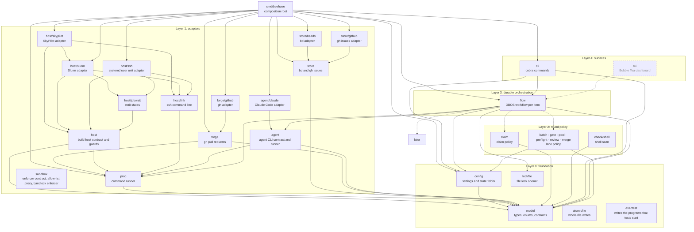
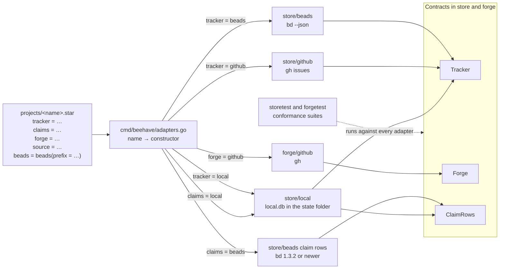

# Packages and layers

Part of the [beehave architecture](../architecture.md).

This part describes the Go packages, the layers they sit on, the composition root that builds them, and the adapters that a project selects.

## Packages and layers

A package imports its own layer and lower layers. `depguard` in `.golangci.yml` fails an upward import. It also fails a package that is not on a layer list.

The diagram shows each package and its imports of other beehave packages. A solid box is a package that exists. A dashed box is a package that a later milestone adds.

### The model package

Every package imports `model`. `model` imports no beehave package.

### Processes and git

Only `proc` starts a process. `forge` and `agent` call it. `store` reaches it through the runner that the composition root passes in.

`proc/gitexec` is the one place that names the git program. Every git call in a tree that beehave manages runs with `core.hooksPath` set to the null device, so a hook in the tree never runs as the owner.

### File locks and whole-file writes

File locks come from `github.com/gofrs/flock`. `flow` and `merge` open every lock through `lockfile.Open`, a layer 0 package. It opens the file for reading and writing, so a folder or a read-only file of that name is refused and not locked.

`flow` and `merge` write the cancel marker and the saved check logs through `atomicfile.Write`, a layer 0 package. It writes a temporary file in the same folder, syncs it and renames it over the target. It sets the mode every time.

### Layer 2 interfaces

Layer 2 packages declare the small interfaces they need and do not import layer 1. For example, `claim` declares `Rows` and does not import `store`. The composition root builds the adapters and passes them into the layer 2 constructors.

## Composition root

`cmd/beehave/main.go` builds these once and passes them down as constructor arguments:

- the config,
- the logger,
- the adapters,
- the policy packages,
- the `flow` engine.

There is no package-level state, no lazy getter and no reset function. A test builds the same graph with fakes.

## Adapters

The tracker and the forge are adapters that a project selects.

### Contracts

The package `store` declares two contracts and the package `forge` declares one.

| Contract | Covers |
|---|---|
| `store.Tracker` | Items and parents |
| `store.ClaimRows` | The claim of each item |
| `forge.Forge` | Pull requests, reviews, threads and checks |

### Project keys

A project file selects each adapter with a key. Each key is optional.

| Key | Values | When missing |
|---|---|---|
| `tracker` | `local`, `beads` or `github` | `local` |
| `claims` | `local` or `beads` | `local` |
| `forge` | `github` | The project has no forge |

`beehave check config` refuses each of these cases at the position of the key:

- `repo` is missing when `tracker` or `forge` is `github`.
- The `beads` block is missing when `tracker` or `claims` is `beads`.
- `source` is set and is not a git URL or an absolute path (a leading `~` expands).
- A path `source` is set without `build_host = "local"`. A remote host cannot read a path on this machine.

### The local tracker and claim store

The local tracker and the local claim store keep their rows in `local.db` in the state folder (`internal/store/local`). The state folder is where `BEEHAVE_STATE_DIR` points. The file has mode 0600.

The local claim store covers one state folder, on one machine. Two machines need beads.

| Command | Does |
|---|---|
| `beehave item add <project> <id> --title <title> --body-file <file>` | Files an open item |
| `beehave item list <project>` | Shows the open items |

Both commands refuse a project whose tracker is not `local`. `beehave run <id>` refuses an id that the local project never added, and names the fix: `beehave item add`.

### Where the clone comes from

- A project with no `source` gets the clone from the forge.
- A project with `source` clones from `source` and never asks the forge. The gate of a build host reads the same URL.
- A project with no forge and no `source` has no repository.

### Projects with no repository

For a project with no forge and no `source`:

- `base_branch` and `gate` are optional.
- `test_report` is required only when `gate` is set.
- `pin_file` is refused.

Each item gets a plain folder under the state folder that beehave makes. Release keeps the folder and beehave never deletes it, so the state folder grows with each item.

No step reads git there:

- An agent call records no start commit, and `rewrote` is false.
- `pin` and `allow_paths` are refused.
- A cancel or a release with no engine running reads no git.
- The builtins `merge`, `batch_merge` and `preflight`, and a `gate` call with no `run`, refuse the project with a plain message.
- A `gate` call that names `run` runs its own program, reads no git, and records an empty `head` and an empty `tree`.

`beehave run` and `beehave check workflow --project <name>` refuse each such call for a project with no repository. `beehave run` refuses it before any step runs.

A project with a source or a forge still needs `base_branch`, `gate` and `test_report`. Any other call that needs a forge gets the error "no forge" (`forge.ErrNoForge`).

### Adapter names

`model.ParseTracker` and `model.ParseForge` check a name, as `ParseAgent` does. `beehave check config` refuses an unknown name.

`cmd/beehave/adapters.go` holds the one adapter table. Each entry has the name of an adapter, its constructor, its config block, the tools it needs on the path and its doctor check. A new adapter is one package and one entry. The config validates a chosen name against the table, and the core passes an adapter block to the adapter unread. No other package dispatches on an adapter name.

`beehave check config` builds only what the project names:

- A local tracker and a local claim store open no file in that check.
- A project that names beads, for the tracker or the claims, also runs `bd --version` through the command runner. It refuses a bd older than 1.3.2: "beehave needs bd 1.3.2 or newer for claims; found 0.56.1".
- A project that names no beads never starts `bd`.

Layer 2 packages keep small interfaces over the contracts, so a consumer never sees the whole `Tracker`.

### Conformance suites

Each contract has an exported conformance suite, in the style of `testing/fstest.TestFS`:

- `internal/store/storetest`
- `internal/forge/forgetest`
- `internal/agent/agenttest`

The suite runs against every adapter with a fake command line. It checks the claim row rules (for `ClaimRows`). It checks that every method returns an error when its command fails.

